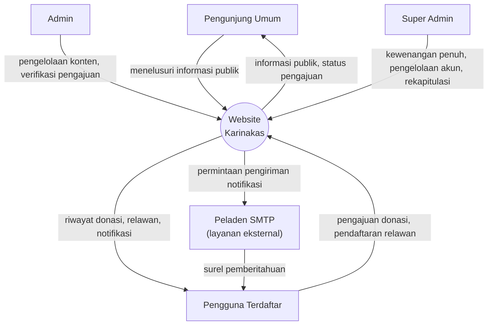
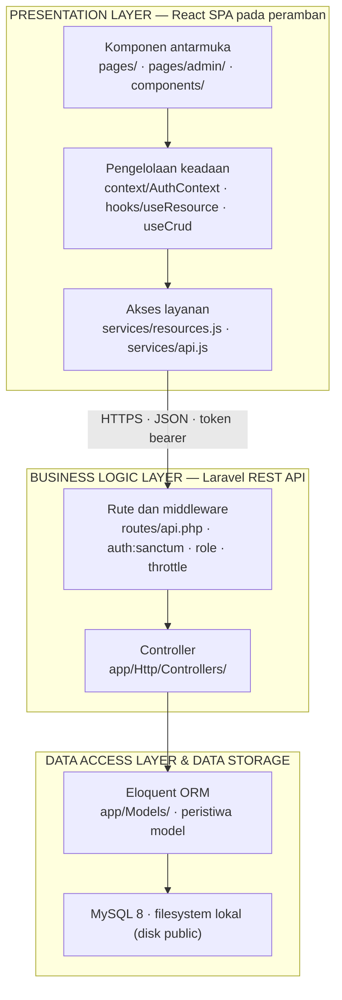
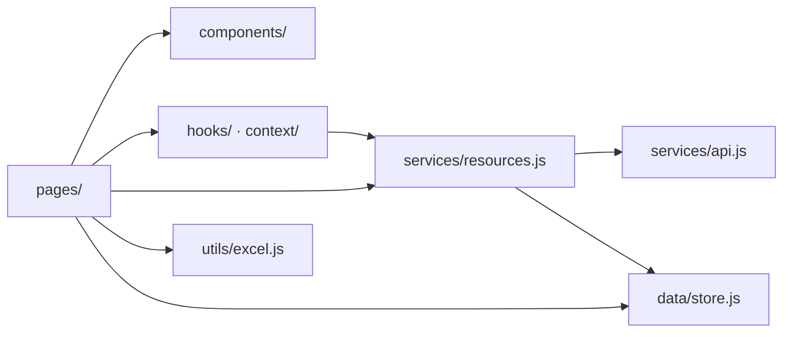
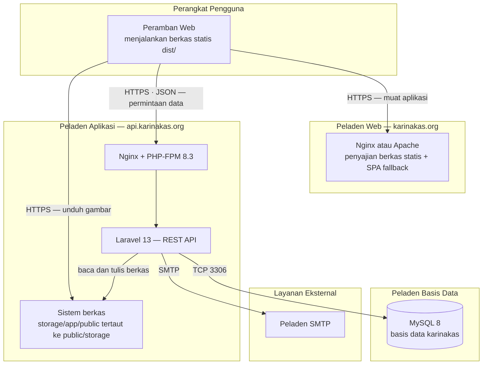

# DOKUMEN PERANCANGAN PERANGKAT LUNAK (DPPL)

## Website Karinakas

Disusun oleh:

Aaron Risang Panji Bharata

*&lt;NIM&gt;*

Program Studi *&lt;isi program studi&gt;*

Fakultas *&lt;isi fakultas&gt;*

Universitas *&lt;isi universitas&gt;*

| | | | | |
|---|---|---|---|---|
| *(logo)* | Program Studi *&lt;isi&gt;* Universitas *&lt;isi&gt;* | Nomor Dokumen | | Halaman |
| | | | | *&lt;#&gt;/&lt;jml #&gt;* |
| | | Revisi | *&lt;nomor revisi&gt;* | *Tgl: &lt;isi tanggal&gt;* |

---

# DAFTAR REVISI

| Revisi | Deskripsi |
|---|---|
| A | |
| B | |
| C | |
| D | |
| E | |
| F | |

| INDEX TGL | - | A | B | C | D | E | F |
|---|---|---|---|---|---|---|---|
| Ditulis oleh | | | | | | | |
| Diperiksa oleh | | | | | | | |
| Disetujui oleh | | | | | | | |

---

**Daftar Isi**

DAFTAR REVISI

1\. Pendahuluan

1.1 Tujuan Penulisan Dokumen

1.2 Ruang Lingkup

1.3 Definisi, Akronim, dan Singkatan

1.4 Referensi

2\. Perancangan Sistem

2.1 Perancangan Arsitektur

2.1.1 Overview Sistem

2.1.2 Arsitektur Perangkat Lunak

2.1.3 Deployment Diagram

2.2 Perancangan Rinci

2.2.1 Kelas Diagram

2.2.2 Deskripsi Kelas dan Atribut

2.3 Perancangan Data

2.3.1 Dekomposisi Data

2.3.2 Physical Data Model

2.4 Perancangan Antarmuka

2.4.1 Antarmuka Website

---

> **Catatan kerja — jangan disalin ke naskah akhir.**
> Status penyusunan: Bab 1 (1.1–1.4), 2.1, 2.2, dan 2.3 **selesai**; 2.4 **belum dikerjakan**.
> Yang masih perlu dilengkapi penyusun: NIM dan identitas program studi pada halaman muka serta
> butir 1 Subbab 1.4; verifikasi nomor peraturan pada butir 5 Subbab 1.4.
> Dokumen ini merupakan kelanjutan dari [SKPL.md](SKPL.md) — SKPL menjawab *apa*, DPPL menjawab *bagaimana*.
> Dokumen teknis pendamping: [CONTEXT.md](CONTEXT.md), [HANDOFF.md](HANDOFF.md), [TESTING.md](TESTING.md), [DEPLOY.md](DEPLOY.md).

---

# 1. Pendahuluan

Dokumen Perancangan Perangkat Lunak (DPPL) merupakan dokumen yang berisi informasi yang dibutuhkan oleh pengembang perangkat lunak untuk merancang produk perangkat lunak **Website Karinakas**. Dokumen ini berisi rincian bagaimana perangkat lunak akan dikembangkan, yang meliputi arsitektur perangkat lunak, dekomposisi data, deskripsi antarmuka, dan informasi pendukung lainnya.

Perancangan yang diuraikan pada dokumen ini merupakan realisasi dari kebutuhan yang telah dispesifikasikan pada Dokumen Spesifikasi Kebutuhan Perangkat Lunak (SKPL) Website Karinakas. Setiap keputusan perancangan yang diambil dapat ditelusuri kembali kepada kebutuhan fungsional (FR SIKAS 101 sampai 608), kebutuhan non-fungsional, serta kebutuhan data yang tercantum pada dokumen tersebut, sehingga tidak terdapat rancangan yang tidak berasal dari kebutuhan dan tidak terdapat kebutuhan yang tidak terwadahi oleh rancangan.

## 1.1 Tujuan Penulisan Dokumen

> **Ketentuan penulisan:** menuliskan tujuan penulisan dokumen DPPL ini dan untuk siapa dokumen ini ditulis.

Dokumen Perancangan Perangkat Lunak (DPPL) ini disusun untuk menguraikan rancangan **Website Karinakas** secara terperinci sehingga dapat langsung dijadikan acuan dalam pelaksanaan implementasi. Uraian tersebut meliputi rancangan arsitektur perangkat lunak beserta pembagian tanggung jawab antarkomponennya, dekomposisi data yang menjadi dasar pembentukan struktur basis data, serta deskripsi antarmuka yang menghubungkan komponen satu dengan komponen lainnya maupun sistem dengan penggunanya. Dengan tersedianya uraian tersebut, keputusan perancangan tidak lagi tersimpan sebagai pengetahuan pribadi pengembang, melainkan terdokumentasi sehingga dapat diperiksa, dinilai, dan ditinjau ulang oleh pihak lain.

Dokumen ini ditujukan kepada empat kelompok pembaca berikut.

1. **Pengembang perangkat lunak**, sebagai acuan dalam menerjemahkan kebutuhan yang telah dispesifikasikan pada SKPL menjadi struktur kode program, struktur basis data, dan antarmuka yang konkret.
2. **Pengembang pemelihara sistem**, yaitu pihak yang kelak melakukan perbaikan kesalahan maupun penambahan fungsi, sebagai sarana memahami susunan sistem beserta keterkaitan antarbagiannya tanpa harus menelusuri keseluruhan kode program terlebih dahulu.
3. **Dosen pembimbing dan dosen penguji**, sebagai dasar penilaian atas ketepatan keputusan perancangan yang diambil serta kesesuaiannya dengan kebutuhan yang telah dirumuskan pada SKPL.
4. **Pelaksana pengujian**, sebagai dasar penyusunan pengujian keterpaduan antarmodul dan penentuan bagian sistem yang perlu diuji ketika terjadi perubahan rancangan, melengkapi pengujian fungsional yang bersandar pada SKPL.

Kedudukan dokumen ini terhadap SKPL bersifat berkelanjutan. SKPL menetapkan *apa* yang harus dikerjakan perangkat lunak beserta batasan yang berlaku padanya, sedangkan DPPL menetapkan *bagaimana* hal tersebut diwujudkan. Keterkaitan keduanya dijaga melalui penelusuran berjenjang, yaitu dari kebutuhan fungsional (FR SIKAS 101 sampai 608) menuju komponen arsitektur, lalu ke kelas dan modul pelaksananya, hingga ke tabel basis data serta antarmuka yang bersangkutan. Penelusuran tersebut memungkinkan setiap kebutuhan diperiksa perwujudannya dalam rancangan, dan sebaliknya setiap unsur rancangan ditelusuri asal kebutuhannya.

Dokumen ini bukan merupakan panduan penggunaan bagi pengguna akhir sistem. Tata cara pengoperasian bagi pengunjung umum, pengguna terdaftar, admin, maupun super admin berada di luar cakupan dokumen ini.

## 1.2 Ruang Lingkup

> **Ketentuan penulisan:** (1) mengidentifikasi produk perangkat lunak yang akan dihasilkan berdasarkan nama, misalnya DBMS yang digunakan dan *report generator*; (2) menjelaskan apa yang akan dan tidak akan dilakukan oleh perangkat lunak; (3) menjelaskan manfaat, sasaran, atau tujuan yang diperoleh dari penerapan aplikasi.

### 1.2.1 Identifikasi Produk

Perangkat lunak yang dirancang pada dokumen ini adalah **Website Karinakas**, yaitu sistem informasi berbasis web bagi lembaga sosial Yayasan Karinakas. Website Karinakas dirancang dengan arsitektur yang memisahkan antarmuka pengguna dari layanan data, sehingga keduanya dapat dikembangkan, diuji, dan diterapkan secara mandiri. Perangkat lunak ini tersusun atas enam komponen berikut.

| No | Komponen | Teknologi yang digunakan | Peran dalam sistem |
|---|---|---|---|
| 1 | Antarmuka pengguna (klien) | React 19.2, Vite 8.0, Bootstrap 5.3, React Router 7.16 | Aplikasi web satu halaman (*Single Page Application*) yang menyajikan seluruh halaman publik dan panel pengelolaan, serta memanggil layanan data melalui HTTP |
| 2 | Layanan data | Laravel 13.7 di atas PHP 8.3 | REST API yang menangani seluruh logika bisnis, validasi masukan, dan pengendalian hak akses |
| 3 | Modul autentikasi | Laravel Sanctum | Penerbitan, pemeriksaan, dan pencabutan token *bearer* yang menyertai setiap permintaan ke sumber daya terproteksi |
| 4 | DBMS | MySQL 8.0 | Penyimpanan seluruh data transaksional pada sembilan entitas sebagaimana dirinci pada Subbab 3.5 SKPL |
| 5 | Pembangkit laporan (*report generator*) | Modul internal pada sisi klien | Pembentukan tiga berkas rekapitulasi dalam format lembar kerja, yaitu rekapitulasi donasi, rekapitulasi relawan, dan laporan dasbor |
| 6 | Penyimpanan berkas dan pengirim surel | Sistem berkas peladen dan Laravel Mail melalui SMTP | Penyimpanan foto dokumentasi kegiatan serta bukti pembayaran donasi, dan pengiriman notifikasi surel otomatis |

Pembangkit laporan tidak memakai pustaka pihak ketiga. Berkas rekapitulasi dibentuk sebagai *workbook* HTML berekstensi `.xls`, sehingga dapat mengatur lebar kolom, pembekuan baris judul, serta pemaksaan tipe teks pada kolom nomor identitas dan nomor telepon — pengaturan yang tidak dimungkinkan apabila keluaran berupa CSV.

### 1.2.2 Batas Cakupan Perancangan

Perancangan yang diuraikan pada dokumen ini **mencakup** hal-hal berikut.

1. Rancangan arsitektur perangkat lunak beserta pembagian tanggung jawab antarkomponen dan pola komunikasi di antaranya.
2. Rancangan pengendalian akses berbasis peran bagi pengunjung umum, pengguna terdaftar, admin, dan super admin, termasuk pembatasan data nominal donasi bagi admin.
3. Dekomposisi data yang menjadi dasar pembentukan sembilan tabel basis data beserta relasi dan aturan integritasnya.
4. Rancangan antarmuka pengguna pada halaman publik dan panel pengelolaan, serta rancangan antarmuka pemrograman berupa 65 titik akhir REST API.
5. Rancangan modul pembangkit laporan dan mekanisme penyimpanan berkas unggahan.

Sebaliknya, hal-hal berikut **berada di luar cakupan perancangan** dokumen ini, sejalan dengan lingkup yang telah ditetapkan pada Subbab 1.2 SKPL.

1. Perancangan keterhubungan dengan *payment gateway*. Kode QRIS yang digunakan bersifat statis dan keabsahan pembayaran ditentukan melalui verifikasi bukti transfer oleh pengelola, sehingga tidak terdapat rancangan rekonsiliasi transaksi otomatis maupun penyimpanan kredensial pembayaran.
2. Perancangan pengiriman notifikasi WhatsApp, karena memerlukan layanan pihak ketiga berbayar yang belum ditetapkan.
3. Perancangan aplikasi bergerak (*mobile native*). Antarmuka dirancang sebagai aplikasi web responsif yang diakses melalui peramban.
4. Perancangan modul pembukuan dan akuntansi keuangan lembaga.
5. Perancangan infrastruktur peladen produksi secara terperinci, seperti penyetelan jaringan, sertifikat keamanan, dan pencadangan berkala.

### 1.2.3 Manfaat dan Sasaran Penerapan

Penerapan Website Karinakas ditujukan untuk meningkatkan transparansi informasi lembaga, khususnya mengenai penyelenggaraan kegiatan sosial dan penggunaan dana donasi yang seluruhnya terekam serta dapat ditelusuri melalui satu sistem. Pencatatan jejak audit secara otomatis atas setiap tindakan pengelola yang mengubah data turut memperkuat pertanggungjawaban tersebut.

Bagi masyarakat, sistem ini memangkas hambatan berpartisipasi karena pendaftaran relawan dan pengajuan donasi dapat dilakukan secara mandiri kapan saja tanpa harus datang ke kantor lembaga. Bagi pengelola, sistem ini menggantikan pencatatan manual sehingga mempercepat verifikasi, mengurangi risiko kesalahan pencatatan, serta menyediakan rekapitulasi dan statistik yang dapat langsung dipakai sebagai bahan pelaporan kegiatan.

Pemisahan antara antarmuka dan layanan data sebagaimana dirancang pada dokumen ini mendukung sasaran tersebut dalam jangka panjang, karena memungkinkan antarmuka diperbarui mengikuti kebutuhan pengguna tanpa mengubah logika bisnis dan struktur data yang telah mapan. Sasaran akhir yang hendak dicapai adalah meningkatnya partisipasi masyarakat dalam bentuk pendaftaran relawan dan donasi melalui antarmuka yang berpusat pada pengguna, dengan memperhatikan karakteristik pengguna lembaga yang sebagian besar berusia lanjut.

## 1.3 Definisi, Akronim, dan Singkatan

> **Ketentuan penulisan:** memberikan penjelasan atas semua definisi, akronim, dan singkatan yang digunakan untuk menginterpretasikan DPPL. Informasi dapat dibagi dengan mereferensikan lampiran dalam DPPL atau dokumen lain. Setiap istilah dan singkatan ditulis dalam urutan abjad.

Subbab ini memuat istilah yang diperlukan untuk membaca dokumen ini, disusun dalam urutan abjad dan dipisahkan menjadi dua kelompok, yaitu definisi dan akronim beserta singkatan. Istilah yang berkaitan dengan perumusan kebutuhan, seperti kode penomoran kebutuhan fungsional, aktor, dan *use case*, telah dijelaskan pada Subbab 1.3 SKPL Website Karinakas dan tidak diulang di sini. Adapun istilah yang dijelaskan pada subbab ini adalah istilah ranah lembaga serta istilah perancangan yang dipakai pada uraian arsitektur, dekomposisi data, dan deskripsi antarmuka.

### 1.3.1 Definisi

| Istilah | Penjelasan |
|---|---|
| **Admin** | Peran pengguna yang mengelola konten lembaga dan memverifikasi pengajuan relawan maupun donasi, tanpa kewenangan melihat nominal donasi, mengelola akun pengguna, dan membaca jejak audit |
| **Album galeri** | Sekumpulan foto dokumentasi yang dihimpun di bawah satu judul kegiatan yang sama, dipakai sebagai satuan penyajian pada halaman galeri publik |
| **Bidang minat** | Pilihan bidang kegiatan yang ditetapkan pengelola pada tiap kegiatan dan dipilih calon relawan pada saat mendaftar |
| **Bukti transfer** | Berkas gambar yang diunggah donatur sebagai bukti pembayaran, menjadi dasar penetapan status pembayaran oleh pengelola |
| **Donatur** | Pengguna terdaftar yang mengajukan donasi pada kegiatan yang membuka penerimaan donasi |
| **Jejak audit** | Catatan yang dibentuk sistem secara otomatis atas setiap tindakan pengelola yang mengubah data, memuat pelaku, jenis tindakan, sasaran data, dan waktu kejadian |
| **Kampanye** | Entitas data yang menampung berita dan kampanye lembaga. Pada antarmuka pengguna, entitas ini disajikan dengan sebutan “Berita” |
| **Kegiatan** | Program sosial yang diselenggarakan lembaga, berkedudukan sebagai induk bagi pendaftaran relawan, pengajuan donasi, dan album galeri |
| **Komponen antarmuka** | Satuan bagian tampilan pada sisi klien yang dapat dipakai ulang pada beberapa halaman, misalnya bilah navigasi dan tapak halaman |
| **Kontroler** | Kelas pada layanan data yang menerima permintaan, memeriksa keabsahan masukan, memanggil model, lalu menyusun tanggapan yang dikirim balik kepada klien |
| **Mapper** | Fungsi pada sisi klien yang mengubah bentuk data dari layanan menjadi bentuk yang dipakai antarmuka, dan sebaliknya |
| **Middleware** | Lapisan pemeriksaan yang dijalankan sebelum permintaan mencapai kontroler, dipakai untuk memeriksa keabsahan token dan kesesuaian peran pengguna |
| **Migrasi** | Berkas berversi yang mendefinisikan perubahan struktur basis data, sehingga struktur tersebut dapat dibentuk ulang secara berurutan pada lingkungan lain |
| **Model** | Kelas yang mewakili satu entitas basis data beserta relasi, aturan penyaringan, dan perilaku turunannya |
| **Pembangkit laporan** | Modul yang menyusun berkas rekapitulasi dalam format lembar kerja berdasarkan data yang sedang ditampilkan pada layar |
| **Pengguna terdaftar** | Pengguna berakun yang dapat mengajukan donasi, mendaftar sebagai relawan, serta memantau riwayat keduanya |
| **Pengunjung umum** | Pengguna tanpa akun yang hanya dapat menelusuri informasi publik |
| **Peran** | Penanda kewenangan yang melekat pada akun pengguna, bernilai pengguna, admin, atau super admin |
| **QRIS statis** | Kode QRIS yang tidak memuat nominal pembayaran, sehingga nominal diisi sendiri oleh pembayar |
| **Relawan** | Pengguna terdaftar yang mengajukan diri untuk membantu pelaksanaan suatu kegiatan |
| **Seeder** | Berkas yang mengisikan data awal ke basis data untuk keperluan pengembangan dan peragaan sistem |
| **Super Admin** | Peran pengguna dengan kewenangan penuh, meliputi seluruh kewenangan admin ditambah melihat nominal donasi, mengelola akun pengguna, membaca jejak audit, dan mengunduh berkas rekapitulasi |
| **Titik akhir** | Alamat layanan tertentu pada REST API yang menerima permintaan dengan metode HTTP baku |
| **Token *bearer*** | Tanda pengenal sesi yang disertakan pada setiap permintaan menuju sumber daya terproteksi |
| **Unggah massal** | Mekanisme pengunggahan banyak foto sekaligus yang dipecah menjadi beberapa permintaan berukuran tetap agar tidak melampaui batas unggahan peladen |

### 1.3.2 Akronim dan Singkatan

| Akronim | Kepanjangan |
|---|---|
| **API** | *Application Programming Interface* |
| **CORS** | *Cross-Origin Resource Sharing* |
| **CRUD** | *Create, Read, Update, Delete* |
| **CSS** | *Cascading Style Sheets* |
| **DBMS** | *Database Management System* |
| **DPPL** | Dokumen Perancangan Perangkat Lunak |
| **ERD** | *Entity Relationship Diagram* |
| **FK** | *Foreign Key* |
| **FR** | *Functional Requirement* |
| **HCD** | *Human-Centered Design* |
| **HTML** | *HyperText Markup Language* |
| **HTTP** | *HyperText Transfer Protocol* |
| **HTTPS** | *HyperText Transfer Protocol Secure* |
| **JSON** | *JavaScript Object Notation* |
| **JSX** | *JavaScript XML* |
| **MVC** | *Model-View-Controller* |
| **NFR** | *Non-Functional Requirement* |
| **NMID** | *National Merchant Identifier* |
| **ORM** | *Object-Relational Mapping* |
| **OTP** | *One-Time Password* |
| **PHP** | *PHP: Hypertext Preprocessor* |
| **PK** | *Primary Key* |
| **QRIS** | *Quick Response Code Indonesian Standard* |
| **REST** | *Representational State Transfer* |
| **SKPL** | Spesifikasi Kebutuhan Perangkat Lunak |
| **SMTP** | *Simple Mail Transfer Protocol* |
| **SPA** | *Single Page Application* |
| **SQL** | *Structured Query Language* |
| **UML** | *Unified Modeling Language* |
| **UQ** | *Unique* |
| **URL** | *Uniform Resource Locator* |
| **UUID** | *Universally Unique Identifier* |
| **WCAG** | *Web Content Accessibility Guidelines* |

## 1.4 Referensi

> **Ketentuan penulisan:** menuliskan semua dokumen yang diacu oleh dokumen ini, termasuk dokumen yang diacu, buku, panduan, peraturan, surat keputusan, atau dokumentasi lain yang dipakai dalam pengembangan perangkat lunak. Dokumen diidentifikasi berdasarkan judul, nomor dokumen (jika ada), tahun, dan organisasi penerbit.

Seluruh rujukan pada subbab ini diterbitkan dalam kurun lima tahun terakhir, yaitu tahun 2021 sampai dengan 2026.

**Dokumen acuan utama**

1. Spesifikasi Kebutuhan Perangkat Lunak (SKPL) Website Karinakas, dokumen internal penelitian tugas akhir, 2026.

**Standar dan pedoman**

2. ISO/IEC/IEEE 42010:2022, *Software, Systems and Enterprise — Architecture Description*, International Organization for Standardization, International Electrotechnical Commission, dan Institute of Electrical and Electronics Engineers, 2022.
3. *Web Content Accessibility Guidelines (WCAG) 2.2*, W3C Recommendation, World Wide Web Consortium, 2023.

**Peraturan perundang-undangan**

4. Undang-Undang Republik Indonesia Nomor 27 Tahun 2022 tentang Pelindungan Data Pribadi, Pemerintah Republik Indonesia, 2022.
5. Peraturan Bank Indonesia Nomor 23/6/PBI/2021 tentang Penyedia Jasa Pembayaran, Bank Indonesia, 2021.

**Pustaka metode perancangan dan rekayasa antarmuka**

6. N. Husseniy, T. Abdellatif, dan R. Nakhil, “Improving the Websites User Experience (UX) Through the Human-Centered Design Approach,” *Journal of Design Sciences and Applied Arts*, vol. 2, no. 2, hlm. 24–31, 2021.
7. F. P. Putra dan A. Tedyyana, “Pendekatan Human Centered Design pada Perancangan User Experience Aplikasi Pemesanan Menu Cafe,” *Sistemasi*, vol. 10, no. 2, hlm. 336, 2021.
8. I. G. P. A. Pradyani, N. K. A. Wirdiani, dan P. W. Buana, “Penerapan Metode Human Centered Design Dalam Perancangan User Interface,” vol. 2, no. 3, 2021.
9. S. Vial, S. Boudhraâ, dan M. Dumont, “Human-Centered Design Approaches in Digital Mental Health Interventions: Exploratory Mapping Review,” *JMIR Mental Health*, vol. 9, no. 6, 2022.
10. S. Azaro Lichas, I. Jaelani, dan M. Minarto, “Implementasi Metode Human Centered Design (HCD) Dalam Perancangan User Interface User Experience Aplikasi E-Menu Berbasis Mobile,” *JATI*, vol. 7, no. 3, hlm. 2032–2038, 2023.
11. N. Normah dan F. Sihaloho, “Perancangan User Interface (UI) dan User Experience (UX) Aplikasi Pendistribusian Alat-Alat Kesehatan,” *Indonesian Journal of Software Engineering*, vol. 9, no. 1, hlm. 33–38, 2023.
12. N. W. Purnama dan I. N. A. A., *Teori dan Implementasi Sistem Informasi di Berbagai Bidang*, 2022.

**Dokumentasi teknis perangkat lunak pembangun**

13. *Laravel Documentation* versi 13.x, Laravel LLC, 2026. Tersedia pada <https://laravel.com/docs>
14. *React Documentation*, Meta Open Source, 2026. Tersedia pada <https://react.dev>
15. *MySQL 8.0 Reference Manual*, Oracle Corporation, 2026. Tersedia pada <https://dev.mysql.com/doc>

**Dokumen teknis internal proyek**

16. CONTEXT.md — Arsitektur dan Referensi Titik Akhir Website Karinakas, dokumen teknis internal proyek, 2026.
17. TESTING.md — Rencana dan Kasus Uji Website Karinakas, dokumen teknis internal proyek, 2026.
18. DEPLOY.md — Panduan Penerapan Website Karinakas, dokumen teknis internal proyek, 2026.

---

# 2. Perancangan Sistem

## 2.1 Perancangan Arsitektur

> **Ketentuan penulisan:** berisi gambaran arsitektur sistem dan bagaimana sistem diperinci ke dalam komponen-komponen penyusunnya, meliputi (1) *overview* sistem beserta konteksnya, (2) arsitektur perangkat lunak, misalnya arsitektur *n-layer* atau *package dependency diagram*, dan (3) *deployment diagram*.

Perancangan arsitektur Website Karinakas dilakukan untuk menunjukkan bagaimana sistem diperinci ke dalam komponen-komponen penyusun yang saling berhubungan. Arsitektur ini mencakup gambaran umum sistem, arsitektur perangkat lunak, dan penerapannya pada lingkungan peladen. Website Karinakas dirancang sebagai sistem informasi berbasis web dengan satu platform, yaitu aplikasi web responsif yang diakses melalui peramban oleh seluruh kategori pengguna, ditopang satu layanan data terpusat berupa REST API.

### 2.1.1 Overview Sistem

Website Karinakas merupakan perangkat lunak yang dikembangkan khusus untuk mendukung kegiatan Yayasan Karinakas. Website Karinakas merupakan produk baru dan bukan merupakan bagian dari produk perangkat lunak lain yang sudah ada. Sistem ini terdiri atas dua komponen utama yang saling terhubung melalui satu layanan data terpusat.

1. **Aplikasi Klien (*Single Page Application*):** dibangun menggunakan React 19.2 dan Vite 8.0 dengan gaya visual Bootstrap 5.3, diakses melalui peramban oleh Pengunjung Umum, Pengguna Terdaftar, Admin, dan Super Admin. Aplikasi klien menyediakan antarmuka halaman publik, halaman transaksional bagi pengguna terdaftar, serta panel pengelolaan bagi admin dan super admin.
2. **Layanan Data (REST API):** dibangun menggunakan Laravel 13.7 di atas PHP 8.3 dan dikonsumsi aplikasi klien melalui protokol HTTP dengan format pertukaran data JSON. Layanan ini menangani seluruh aturan bisnis, pemeriksaan keabsahan masukan, dan pengendalian hak akses.

Seluruh data disimpan pada satu basis data MySQL 8 terpusat, sedangkan berkas gambar dokumentasi kegiatan dan bukti pembayaran donasi disimpan pada sistem berkas peladen. Autentikasi memakai token *bearer* yang diterbitkan Laravel Sanctum, tanpa memakai sesi peladen.

Aplikasi klien berjalan sepenuhnya di peramban pengguna dan tidak memiliki akses langsung ke basis data; seluruh permintaan data dilayani melalui REST API yang menjadi satu-satunya pintu masuk menuju basis data dan penyimpanan berkas. Dengan susunan tersebut, aturan bisnis dan pengendalian hak akses terpusat pada satu tempat, sehingga tidak dapat dilangkahi dengan memanipulasi tampilan pada sisi klien. Penyembunyian menu pada antarmuka hanya berfungsi sebagai kenyamanan, sedangkan penolakan akses yang sesungguhnya dilakukan *middleware* pada sisi peladen.

Website Karinakas berinteraksi dengan empat kelompok pengguna dan satu layanan eksternal. Keempat kelompok pengguna dibedakan berdasarkan peran yang melekat pada akun, sedangkan satu-satunya layanan eksternal yang benar-benar dihubungi sistem adalah peladen SMTP untuk pengiriman notifikasi surel. Pembayaran donasi tidak melibatkan layanan eksternal karena kode QRIS yang dipakai bersifat statis dan keabsahan pembayaran ditetapkan melalui verifikasi bukti transfer oleh pengelola.

**Gambar 2.1 — Diagram Konteks Website Karinakas**

Batas sistem pada Gambar 2.1 mencakup aplikasi klien, layanan data, basis data, dan penyimpanan berkas. Peladen SMTP berada di luar batas sistem karena disediakan pihak lain dan hanya dihubungi ketika terjadi peristiwa tertentu, yaitu penerimaan pendaftaran relawan dan permintaan pemulihan kata sandi.

### 2.1.2 Arsitektur Perangkat Lunak

Website Karinakas menggunakan arsitektur sistem berbasis web dengan pola *Model-View-Controller* (MVC) pada kerangka kerja Laravel 13. Pendekatan MVC memisahkan tanggung jawab penyajian data, logika bisnis, dan akses data sehingga sistem mudah dipelihara dan dikembangkan. Berbeda dengan penerapan MVC yang lazim, lapisan *View* tidak dirender pada sisi peladen memakai *template engine*, melainkan digantikan aplikasi klien tersendiri berupa *Single Page Application* yang mengonsumsi REST API. Laravel dengan demikian berperan sebagai *Model* dan *Controller*, sedangkan React berperan sebagai *View*.

Ketergantungan antarlapisan bersifat satu arah, yaitu dari lapisan yang lebih atas menuju lapisan di bawahnya. Lapisan bawah tidak mengetahui keberadaan lapisan di atasnya, sehingga perubahan pada tampilan tidak merambat ke aturan bisnis maupun struktur data. Secara konseptual, sistem terdiri atas tiga lapisan berikut.

1. **Presentation Layer:** Lapisan ini bertanggung jawab menampilkan data dan menerima masukan pengguna. Antarmuka dibangun menggunakan komponen React 19.2 dengan gaya visual Bootstrap 5.3 dan perutean sisi klien menggunakan React Router 7.16, yang mengonsumsi data dari REST API dalam format JSON. Termasuk dalam lapisan ini adalah pengelolaan keadaan antarmuka melalui `context/AuthContext.jsx` untuk keadaan sesi pengguna serta `hooks/useResource.js` dan `pages/admin/shared/useCrud.js` untuk keadaan data yang sedang ditampilkan, ditambah `services/api.js` dan `services/resources.js` yang menyusun permintaan HTTP, menyertakan token, dan memetakan bentuk data layanan ke bentuk yang dipakai antarmuka.

2. **Business Logic Layer:**  Lapisan ini diimplementasikan menggunakan *Controller* Laravel. *Controller* menangani perutean aksi melalui `routes/api.php`, pemeriksaan keabsahan masukan, orkestrasi logika bisnis (keterikatan donasi pada kegiatan yang membuka donasi, pemeriksaan kesesuaian pilihan relawan terhadap opsi kegiatan, penyembunyian nominal donasi bagi admin, penerbitan notifikasi surel), serta pengendalian akses berbasis peran (RBAC) melalui *middleware* `role`. Termasuk dalam lapisan ini adalah pemeriksaan keabsahan token oleh Laravel Sanctum dan pembatasan laju permintaan `throttle` pada rute autentikasi.

3. **Data Access Layer & Data Storage:** Lapisan ini menggunakan Eloquent ORM untuk seluruh operasi CRUD terhadap basis data relasional MySQL 8. Setiap tabel dipetakan ke kelas *Model* beserta relasinya, dan sebagian model memasang pendengar peristiwa yang menjaga kekonsistenan data turunan, misalnya pemutakhiran cacah relawan pada kegiatan. Berkas media berupa foto dokumentasi kegiatan dan bukti pembayaran donasi disimpan pada *filesystem* lokal Laravel (disk `public`) dan diakses publik melalui pranala simbolik.

**Gambar 2.2 — Arsitektur Berlapis Website Karinakas**

Tanggung jawab setiap lapisan beserta wujudnya dalam kode diuraikan pada Tabel 2.1.

**Tabel 2.1 — Tanggung Jawab Lapisan**

| Lapisan | Tanggung jawab | Wujud dalam kode |
|---|---|---|
| *Presentation Layer* | Menampilkan data, menerima masukan pengguna, mengatur navigasi antarhalaman, menyimpan keadaan sesi dan data yang sedang ditampilkan, serta menyusun permintaan menuju layanan data | `pages/`, `pages/admin/`, `components/`, `context/AuthContext.jsx`, `hooks/useResource.js`, `services/api.js`, `services/resources.js` |
| *Business Logic Layer* | Memetakan alamat permintaan ke kontroler, memeriksa keabsahan token dan kesesuaian peran, membatasi laju permintaan, memeriksa keabsahan masukan, menjalankan aturan bisnis, dan menyusun tanggapan | `routes/api.php`, `RoleMiddleware`, `app/Http/Controllers/`, `AppServiceProvider` |
| *Data Access Layer & Data Storage* | Memetakan tabel ke kelas model beserta relasinya, menjaga kekonsistenan data turunan melalui peristiwa model, serta menyimpan dan mengambil data dan berkas unggahan | `app/Models/`, MySQL 8, `storage/app/public/` |

Keterkaitan antarpaket pada *presentation layer* digambarkan pada Gambar 2.3. Seluruh anak panah bergerak satu arah dan tidak membentuk lingkaran ketergantungan, sehingga setiap paket dapat diuji secara terpisah.

**Gambar 2.3 — *Package Dependency Diagram* Aplikasi Klien**

Untuk mempermudah pengembangan dan pemeliharaan, *business logic layer* Website Karinakas didekomposisi menjadi delapan paket utama berikut.

- **Paket Autentikasi:** pendaftaran akun, masuk, keluar, pembacaan data akun, pembaruan profil, penggantian kata sandi, serta pemulihan kata sandi melalui kode OTP.
- **Paket Kegiatan:** pengelolaan data kegiatan sosial, penetapan status, penetapan opsi jenis relawan dan bidang minat, serta penyajian kegiatan yang membuka pendaftaran relawan.
- **Paket Kampanye:** pengelolaan berita dan kampanye lembaga beserta penyaringan menurut kategori.
- **Paket Galeri:** pengelolaan album dokumentasi kegiatan, pengunggahan berkas tunggal, dan pengunggahan massal berukuran tetap.
- **Paket Donasi:** pengajuan donasi yang terikat kegiatan, pengunggahan bukti pembayaran, verifikasi status pembayaran, serta penyembunyian nominal bagi admin.
- **Paket Relawan:** pendaftaran relawan, pemeriksaan kesesuaian pilihan terhadap opsi kegiatan, verifikasi status, dan pemutakhiran jumlah relawan diterima.
- **Paket Pengelolaan:** dasbor statistik sadar-peran, pengelolaan akun pengguna, serta pembacaan jejak audit yang seluruhnya khusus super admin.
- **Paket Notifikasi:** pengiriman surel penerimaan relawan dan kode pemulihan kata sandi, serta pencatatan riwayat notifikasi.

Terdapat tiga keputusan perancangan yang menyertai arsitektur ini.

1. **Pemetaan bentuk data dipusatkan pada satu berkas.** Penamaan atribut pada layanan data memakai bahasa Indonesia bergaya *snake_case*, sedangkan antarmuka memakai penamaan yang lebih ringkas. Seluruh penerjemahan bentuk ditempatkan pada `services/resources.js` sehingga perubahan nama atribut pada basis data cukup disesuaikan di satu tempat.
2. **Alamat layanan ditetapkan pada saat pembangunan berkas.** Alamat REST API dibaca dari variabel lingkungan `VITE_API_URL` yang nilainya disisipkan ke dalam berkas hasil pembangunan. Konsekuensinya, perubahan alamat layanan mengharuskan pembangunan ulang berkas statis.
3. **Pengendalian hak akses ditegakkan pada lapisan peladen.** Penyembunyian menu pada antarmuka hanya berfungsi sebagai kenyamanan; penolakan akses yang sesungguhnya dilakukan oleh *middleware* dan pemeriksaan peran pada kontroler.

### 2.1.3 Deployment Diagram

Website Karinakas diterapkan sebagai dua aplikasi terpisah yang menempati dua nama domain berbeda. Aplikasi klien berwujud berkas statis hasil pembangunan yang disajikan langsung oleh peladen web tanpa memerlukan Node.js pada peladen produksi, sedangkan layanan data berjalan sebagai aplikasi PHP di belakang PHP-FPM.

**Gambar 2.4 — *Deployment Diagram* Website Karinakas**

Spesifikasi setiap simpul penerapan dirinci pada Tabel 2.2.

**Tabel 2.2 — Spesifikasi Simpul Penerapan**

| Simpul | Perangkat lunak | Keterangan |
|---|---|---|
| Perangkat pengguna | Peramban web modern | Menjalankan aplikasi klien; tidak memerlukan pemasangan perangkat lunak tambahan |
| Peladen web | Nginx atau Apache | Menyajikan berkas statis hasil pembangunan. Wajib menerapkan pengalihan seluruh rute ke `index.html` agar pemuatan ulang pada alamat dalam tidak menghasilkan galat 404 |
| Peladen aplikasi | PHP 8.3, PHP-FPM, Laravel 13 | Menjalankan REST API. Akar dokumen diarahkan ke direktori `public/` |
| Peladen basis data | MySQL 8 | Menyimpan data transaksional pada sembilan tabel |
| Penyimpanan berkas | Sistem berkas peladen aplikasi | Menyimpan foto dokumentasi dan bukti pembayaran, diakses publik melalui pranala simbolik |
| Layanan surel | Peladen SMTP pihak ketiga | Mengirimkan notifikasi penerimaan relawan dan kode pemulihan kata sandi |

Pada lingkungan pengembangan, keempat simpul tersebut ditempatkan pada satu mesin dengan pembagian porta sebagaimana Tabel 2.3.

**Tabel 2.3 — Pembagian Porta pada Lingkungan Pengembangan**

| Komponen | Alamat | Keterangan |
|---|---|---|
| Aplikasi klien | `http://localhost:5173` | Peladen pengembangan Vite |
| Layanan data | `http://127.0.0.1:8000` | Peladen bawaan Laravel |
| Basis data | `127.0.0.1:3307` | MySQL melalui Laragon |

Perbedaan porta basis data antara lingkungan pengembangan dan produksi diatur melalui berkas konfigurasi lingkungan, sehingga tidak memerlukan perubahan kode program.

## 2.2 Perancangan Rinci

> Naskah lengkap subbab ini disimpan terpisah pada **[docs/dppl/2.2-Perancangan-Rinci.md](docs/dppl/2.2-Perancangan-Rinci.md)** agar mudah disalin, mengikuti cara yang dipakai pada Bab III SKPL.

Subbab ini memuat diagram kelas beserta deskripsi tiap kelas, yang terdiri atas deskripsi atribut dan deskripsi fungsi. Kelas disusun mengikuti pola **Boundary–Control–Entity (BCE)** yang bersesuaian langsung dengan arsitektur berlapis pada Subbab 2.1.2. Kelas Website Karinakas berjumlah **tiga puluh sembilan**, yaitu 22 kelas `«boundary»` berupa antarmuka pada aplikasi klien, 9 kelas `«control»` berupa kontroler dan *middleware*, serta 8 kelas `«entity»` berupa model basis data. Seluruhnya digambarkan pada **Gambar 2.5** dalam tiga pita mendatar sesuai stereotipnya.

Uraian atribut dan fungsi pada **Subbab 2.2.2 dibatasi pada sembilan kelas `«control»`**, karena kelas `«entity»` sudah dirinci pada Subbab 2.3 dan kelas `«boundary»` pada Subbab 2.4, sehingga tidak perlu diulang. Sistem ini tidak memiliki kelas *service* tersendiri pada sisi layanan data; seluruh aturan bisnis ditempatkan langsung pada kelas kontroler.

## 2.3 Perancangan Data

> Naskah lengkap subbab ini disimpan terpisah pada **[docs/dppl/2.3-Perancangan-Data.md](docs/dppl/2.3-Perancangan-Data.md)**.

Subbab ini menjabarkan struktur fisik basis data beserta relasi antartabelnya. **Subbab 2.3.1 Dekomposisi Data** memerinci sembilan tabel basis data MySQL, masing-masing lengkap dengan nama medan, tipe data, sifat boleh kosong, konstrain, jangkauan nilai, nilai bawaan, dan keterangannya. **Subbab 2.3.2 *Physical Data Model*** menyajikan diagram struktur fisik basis data pada **Gambar 2.6** beserta penjelasan relasi antartabel dan aturan integritas yang berlaku.
