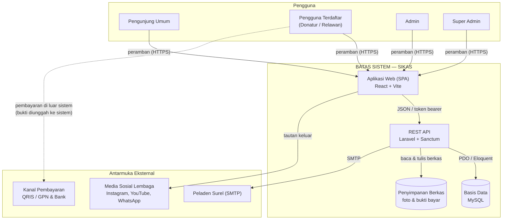

# 📘 SKPL — Spesifikasi Kebutuhan Perangkat Lunak
## Sistem Informasi Yayasan Karinakas (SIKAS)

**Proyek:** Skripsi/Tugas Akhir · **Disusun:** Agustus 2026
**Perangkat lunak:** Sistem Informasi Yayasan Karinakas (SIKAS)
**Metode perancangan:** *Human-Centered Design* (HCD)

> Dokumen ini merangkum naskah SKPL yang telah disusun. Seluruh pernyataan teknis di dalamnya
> **sudah diverifikasi terhadap kode sistem yang dibangun** — rinciannya pada [Lampiran A](#lampiran-a--verifikasi-pernyataan-terhadap-kode).
> Dokumen teknis pendamping: [CONTEXT.md](CONTEXT.md), [HANDOFF.md](HANDOFF.md), [TESTING.md](TESTING.md), [DEPLOY.md](DEPLOY.md).

---

## Status Penyusunan

| Bagian | Status |
|---|---|
| **1.1 Tujuan Penulisan Dokumen** | ✅ Selesai |
| **1.2 Lingkup** | ✅ Selesai |
| **1.3 Definisi, Akronim, dan Singkatan** | ✅ Selesai — 39 istilah |
| **1.4 Referensi** | ✅ Selesai — lengkapi rincian bibliografis sesuai gaya prodi |
| **1.5 Deskripsi Umum Dokumen** | ✅ Selesai |
| **2.1 Perspektif Produk** | ✅ Selesai |
| **2.2 Fungsi Produk** | ✅ Selesai |
| **2.3 Karakteristik Pengguna** | ✅ Selesai |
| **2.4 Kekangan** | ✅ Selesai |
| **2.5 Asumsi dan Kebergantungan** | ✅ Selesai |
| **3.1 Kebutuhan Antarmuka Eksternal** | ✅ Selesai — [docs/skpl/3.1-Kebutuhan-Antarmuka-Eksternal.md](docs/skpl/3.1-Kebutuhan-Antarmuka-Eksternal.md) |
| **3.2 Kebutuhan Fungsional** | ✅ Selesai — [docs/skpl/3.2-Kebutuhan-Fungsional.md](docs/skpl/3.2-Kebutuhan-Fungsional.md) · 71 butir, FR SIKAS 101–608 |
| **3.3 Diagram Use Case** | ✅ Selesai — [docs/skpl/3.3-Diagram-Use-Case.md](docs/skpl/3.3-Diagram-Use-Case.md) · 23 use case |
| **3.4 Kebutuhan Non-Fungsional** | ✅ Selesai — [docs/skpl/3.4-Kebutuhan-Non-Fungsional.md](docs/skpl/3.4-Kebutuhan-Non-Fungsional.md) · 32 butir terukur |
| **3.5 Kebutuhan Data (ERD)** | ✅ Selesai — [docs/skpl/3.5-Kebutuhan-Data.md](docs/skpl/3.5-Kebutuhan-Data.md) · 9 entitas + kamus data |
| **A. Lampiran** | ✅ Selesai |

> **Bab III** disimpan terpisah di folder [docs/skpl/](docs/skpl/) agar tiap subbab mudah disalin. Indeksnya pada [docs/skpl/README.md](docs/skpl/README.md).

**Konvensi penomoran yang dipakai:**
`F-01`–`F-21` fungsi produk · `K-01`–`K-20` kekangan · `A-01`–`A-08` asumsi · `D-01`–`D-06` kebergantungan.
Kode-kode ini dapat dirujuk dari Bab III dan bab pengujian.

---

# BAB I — PENDAHULUAN

## 1.1 Tujuan Penulisan Dokumen

Dokumen Spesifikasi Kebutuhan Perangkat Lunak (SKPL) ini disusun untuk mendefinisikan secara lengkap dan terperinci kebutuhan **Sistem Informasi Yayasan Karinakas (SIKAS)**, meliputi kebutuhan antarmuka eksternal, kebutuhan fungsional, kebutuhan non-fungsional, dan kebutuhan data. Dokumen ini menjadi acuan tunggal yang disepakati antara pengembang dan pihak lembaga mengenai apa yang harus dikerjakan perangkat lunak, sekaligus batasan yang berlaku padanya.

Dokumen ini ditujukan kepada empat kelompok pembaca berikut.

1. **Pengembang perangkat lunak**, sebagai acuan dalam merancang, membangun, dan memelihara sistem.
2. **Dosen pembimbing dan dosen penguji**, sebagai dasar penilaian kesesuaian antara kebutuhan yang dirumuskan dengan perangkat lunak yang dihasilkan.
3. **Pengelola Yayasan Karinakas**, sebagai sarana untuk memastikan kebutuhan lembaga telah terwakili sebelum pembangunan sistem dilaksanakan.
4. **Pelaksana pengujian**, sebagai dasar penyusunan kasus uji dan penentuan kriteria keberterimaan.

Selain itu, dokumen ini menyediakan penelusuran kebutuhan secara berjenjang, yaitu dari fungsi produk (F-01 sampai F-21) menuju kebutuhan fungsional (FR SIKAS 101 sampai 608), lalu ke use case (UC-01 sampai UC-23), hingga kasus uji pada dokumen pengujian. Penelusuran tersebut memungkinkan setiap kebutuhan diperiksa keterpenuhannya dan setiap fungsi yang dibangun ditelusuri asal kebutuhannya.

## 1.2 Lingkup

> **Ketentuan penulisan:** (1) mengidentifikasi produk berdasarkan nama, termasuk komponen seperti DBMS dan *report generator*; (2) menjelaskan apa yang akan dan tidak akan dilakukan perangkat lunak; (3) menjelaskan manfaat, sasaran, atau tujuan penerapan; (4) konsisten dengan spesifikasi sistem.

Perangkat lunak yang dihasilkan pada penelitian ini diberi nama **Sistem Informasi Yayasan Karinakas (SIKAS)**, yaitu sistem informasi berbasis web bagi lembaga sosial Yayasan Karinakas. SIKAS dibangun dengan arsitektur terpisah antara antarmuka dan layanan data. Antarmuka pengguna berupa aplikasi web satu halaman (*Single Page Application*) yang dikembangkan menggunakan React dan Vite, sedangkan layanan data disediakan melalui REST API yang dikembangkan menggunakan kerangka kerja Laravel dengan mekanisme autentikasi berbasis token (Laravel Sanctum). Seluruh data transaksional disimpan pada DBMS **MySQL**, sementara berkas gambar dokumentasi kegiatan dan bukti pembayaran donasi disimpan pada penyimpanan berkas server. Sistem ini juga dilengkapi modul pembangkit laporan (*report generator*) yang menghasilkan berkas rekapitulasi donasi, rekapitulasi relawan, dan laporan keseluruhan dalam format lembar kerja Excel. Perancangan antarmuka SIKAS menerapkan pendekatan *Human-Centered Design* dengan memperhatikan karakteristik pengguna lembaga yang sebagian besar berusia lanjut.

SIKAS melayani empat kategori pengguna, yaitu pengunjung umum, pengguna terdaftar, admin, dan super admin. Bagi **pengunjung umum**, sistem menyajikan profil lembaga, informasi kegiatan sosial, berita dan kampanye, galeri dokumentasi yang dikelompokkan per album kegiatan, serta informasi kontak lembaga. Bagi **pengguna terdaftar**, sistem menyediakan pendaftaran dan pengelolaan akun, pendaftaran relawan pada kegiatan tertentu sesuai opsi jenis relawan dan bidang minat yang ditetapkan pengelola, pengajuan donasi yang terikat pada kegiatan yang membuka donasi dengan metode QRIS atau transfer bank disertai unggah bukti pembayaran, serta pemantauan riwayat donasi, keikutsertaan relawan, dan notifikasi melalui halaman profil. Bagi **admin dan super admin**, sistem menyediakan pengelolaan data kegiatan, berita, dan galeri; verifikasi status pendaftaran relawan, sedangkan verifikasi status pembayaran donasi khusus bagi super admin; dasbor statistik lembaga; pengunduhan berkas rekapitulasi; pengelolaan akun dan peran pengguna; serta pencatatan otomatis jejak audit dan riwayat notifikasi. Sistem turut mengirimkan notifikasi surel otomatis kepada calon relawan yang pendaftarannya diterima.

Sebaliknya, terdapat sejumlah hal yang **tidak dilakukan** oleh SIKAS, yaitu:

1. Sistem tidak memproses pembayaran secara otomatis. SIKAS tidak terhubung dengan *payment gateway*, tidak melakukan rekonsiliasi transaksi secara otomatis, dan tidak menyimpan data kartu atau kredensial pembayaran. Kode QRIS yang digunakan bersifat statis sehingga nominal diisi sendiri oleh donatur, dan keabsahan pembayaran ditentukan melalui verifikasi bukti transfer oleh pengelola.
2. Sistem tidak menangani pembukuan dan akuntansi keuangan lembaga, seperti penjurnalan, penyusunan neraca, maupun pelaporan pajak.
3. Sistem tidak mengirimkan notifikasi WhatsApp secara otomatis. Seluruh pemberitahuan otomatis — penerimaan relawan, ucapan terima kasih donasi, dan tautan penyetelan ulang kata sandi — dikirimkan melalui surel. Pengiriman WhatsApp berada di luar lingkup pengembangan karena memerlukan layanan pihak ketiga berbayar.
4. Sistem tidak dikembangkan sebagai aplikasi bergerak (*mobile native*), melainkan sebagai aplikasi web responsif yang dapat diakses melalui peramban pada perangkat komputer maupun telepon pintar.
5. Sistem tidak melakukan seleksi atau penilaian otomatis terhadap pendaftar relawan. Keputusan penerimaan sepenuhnya berada pada pengelola lembaga, sedangkan sistem hanya memfasilitasi pencatatan dan verifikasinya.
6. Sistem tidak mengelola logistik dan inventaris bantuan, penjadwalan tugas harian relawan, serta administrasi kepegawaian internal lembaga.
7. Sistem tidak menyediakan fasilitas komunikasi dua arah secara waktu nyata seperti *live chat*.

Penerapan SIKAS diharapkan memberikan manfaat berupa peningkatan transparansi informasi lembaga, khususnya terkait penyelenggaraan kegiatan sosial dan penggunaan dana donasi yang kini terekam serta dapat ditelusuri melalui satu sistem. Bagi masyarakat, sistem ini mempermudah akses informasi dan memangkas hambatan dalam berpartisipasi karena pendaftaran relawan dan pengajuan donasi dapat dilakukan secara mandiri kapan saja tanpa harus datang ke kantor lembaga. Bagi pengelola, sistem ini menggantikan pencatatan manual sehingga mempercepat proses verifikasi, mengurangi risiko kesalahan pencatatan, serta menyediakan rekapitulasi dan statistik yang dapat langsung digunakan sebagai bahan pelaporan kegiatan. Sasaran yang hendak dicapai adalah meningkatnya partisipasi masyarakat dalam bentuk pendaftaran relawan dan donasi melalui antarmuka yang intuitif dan berpusat pada pengguna.

Seluruh lingkup yang diuraikan pada subbab ini konsisten dengan spesifikasi kebutuhan fungsional dan non-fungsional yang dirinci pada bab berikutnya, serta dengan hasil analisis kebutuhan pengguna yang diperoleh dari lembaga Yayasan Karinakas.

## 1.3 Definisi, Akronim, dan Singkatan

| Istilah | Penjelasan |
|---|---|
| **SKPL** | Spesifikasi Kebutuhan Perangkat Lunak; dokumen yang mendefinisikan kebutuhan perangkat lunak secara lengkap |
| **SIKAS** | Sistem Informasi Yayasan Karinakas; nama perangkat lunak yang dispesifikasikan dokumen ini |
| **HCD** | *Human-Centered Design*; pendekatan perancangan yang menempatkan kebutuhan dan keterbatasan pengguna sebagai pertimbangan utama |
| **F-xx** | Kode fungsi produk pada Subbab 2.2 |
| **K-xx** | Kode kekangan pada Subbab 2.4 |
| **A-xx / D-xx** | Kode asumsi dan kebergantungan pada Subbab 2.5 |
| **FR SIKAS xxx** | Kode kebutuhan fungsional (*functional requirement*) pada Subbab 3.2 |
| **NFR** | *Non-Functional Requirement*; kebutuhan non-fungsional pada Subbab 3.4 |
| **UC-xx / AK-xx** | Kode use case dan aktor pada Subbab 3.3 |
| **Aktor** | Pihak di luar sistem yang berinteraksi dengan sistem, dapat berupa manusia maupun sistem lain |
| **Use case** | Rangkaian interaksi antara aktor dan sistem yang menghasilkan nilai bagi aktor tersebut |
| **«include»** | Relasi yang menyatakan suatu use case selalu dijalankan sebagai bagian dari use case lain |
| **«extend»** | Relasi yang menyatakan suatu use case memperluas use case lain secara opsional |
| **ERD** | *Entity Relationship Diagram*; diagram yang menggambarkan entitas data dan relasinya |
| **PK / FK / UQ** | *Primary Key* (kunci utama), *Foreign Key* (kunci tamu), *Unique* (nilai unik) |
| **UUID** | *Universally Unique Identifier*; pengenal unik yang tidak berurutan dan tidak dapat ditebak |
| **DBMS** | *Database Management System*; perangkat lunak pengelola basis data, dalam sistem ini MySQL |
| **API** | *Application Programming Interface*; antarmuka pertukaran data antarperangkat lunak |
| **REST API** | Gaya arsitektur layanan yang memakai metode HTTP baku untuk mengakses sumber daya |
| **JSON** | *JavaScript Object Notation*; format pertukaran data yang dipakai antara antarmuka dan layanan |
| **SPA** | *Single Page Application*; aplikasi web yang berpindah halaman tanpa memuat ulang seluruh dokumen |
| **Token *bearer*** | Tanda pengenal sesi yang disertakan pada setiap permintaan ke sumber daya terproteksi |
| **Sanctum** | Pustaka autentikasi berbasis token pada kerangka kerja Laravel |
| **CORS** | *Cross-Origin Resource Sharing*; kebijakan yang mengatur asal permintaan yang diizinkan |
| **HTTPS** | Protokol HTTP yang dienkripsi menggunakan SSL/TLS |
| **SMTP** | *Simple Mail Transfer Protocol*; protokol pengiriman surel |
| **QRIS** | *Quick Response Code Indonesian Standard*; standar kode QR pembayaran nasional |
| **NMID** | *National Merchant Identifier*; nomor identitas *merchant* pada sistem QRIS |
| **QRIS statis** | Kode QRIS yang tidak memuat nominal, sehingga nominal diisi sendiri oleh pembayar |
| ***Payment gateway*** | Layanan perantara yang memproses dan mengonfirmasi pembayaran secara otomatis |
| **Migrasi** | Berkas berversi yang mendefinisikan perubahan struktur basis data |
| ***Seeder*** | Berkas yang mengisikan data awal ke basis data |
| ***Endpoint*** | Alamat layanan tertentu pada REST API |
| **CRUD** | *Create, Read, Update, Delete*; operasi dasar pengelolaan data |
| **Jejak audit** | Catatan otomatis atas tindakan pengelola yang mengubah data |
| **SUS** | *System Usability Scale*; kuesioner baku pengukur tingkat kebergunaan sistem |
| **WCAG** | *Web Content Accessibility Guidelines*; pedoman aksesibilitas konten web |
| **Pengunjung Umum** | Pengguna tanpa akun yang hanya dapat menelusuri informasi publik |
| **Pengguna Terdaftar** | Pengguna berakun yang dapat berdonasi dan mendaftar sebagai relawan |
| **Admin** | Pengelola lembaga yang mengelola konten dan memverifikasi pendaftaran relawan, tanpa akses data keuangan donasi maupun verifikasi pembayarannya |
| **Super Admin** | Penanggung jawab lembaga dengan kewenangan penuh, termasuk data keuangan dan akun pengguna |

## 1.4 Referensi

1. IEEE Computer Society. *IEEE Recommended Practice for Software Requirements Specifications* (IEEE Std 830-1998).
2. International Organization for Standardization. *ISO 9241-210: Ergonomics of human-system interaction — Human-centred design for interactive systems*.
3. Republik Indonesia. *Undang-Undang Nomor 27 Tahun 2022 tentang Pelindungan Data Pribadi*.
4. Bank Indonesia. *Standar Nasional Quick Response Code Indonesian Standard (QRIS)*.
5. World Wide Web Consortium (W3C). *Web Content Accessibility Guidelines (WCAG) 2.1*.
6. Brooke, J. *SUS: A Quick and Dirty Usability Scale*.
7. Laravel. *Laravel Documentation*. <https://laravel.com/docs>
8. Meta Open Source. *React Documentation*. <https://react.dev>
9. Dokumen teknis internal proyek: `CONTEXT.md` (arsitektur dan referensi endpoint), `TESTING.md` (skenario pengujian), dan `DEPLOY.md` (panduan penerapan).

> Lengkapi rincian bibliografis (penerbit, tahun, halaman) sesuai gaya penulisan yang berlaku di program studi Anda.

## 1.5 Deskripsi Umum Dokumen

Dokumen ini disusun dalam tiga bab beserta lampiran, dengan sistematika sebagai berikut.

**Bab I Pendahuluan** memuat tujuan penulisan dokumen, lingkup perangkat lunak yang mencakup identifikasi produk beserta hal yang dilakukan dan tidak dilakukannya, definisi dan singkatan yang dipakai, daftar referensi, serta sistematika penulisan dokumen.

**Bab II Deskripsi Umum Kebutuhan** menguraikan gambaran menyeluruh perangkat lunak, meliputi perspektif produk beserta kedudukannya dalam ekosistem lembaga dan antarmukanya, ringkasan fungsi produk, karakteristik pengguna, kekangan yang membatasi pengembangan, serta asumsi dan kebergantungan yang memengaruhi kebutuhan.

**Bab III Kebutuhan Rinci** memuat spesifikasi terperinci yang menjadi acuan pembangunan, meliputi kebutuhan antarmuka eksternal, kebutuhan fungsional, diagram use case beserta spesifikasinya, kebutuhan non-fungsional yang dinyatakan secara terukur, serta kebutuhan data dalam bentuk *Entity Relationship Diagram* dan kamus data.

**Lampiran** memuat informasi pendukung berupa daftar dokumen teknis dan berkas diagram yang menyertai dokumen ini.

---

# BAB II — DESKRIPSI UMUM KEBUTUHAN

## 2.1 Perspektif Produk

> **Ketentuan penulisan:** menjelaskan perspektif produk terhadap produk terkait; bila produk merupakan komponen dari sistem yang lebih besar, hubungkan kebutuhan sistem besar tersebut dengan fungsionalitas perangkat lunak, serta **identifikasi antarmuka** antara sistem dan perangkat lunak. Diagram blok dapat menunjukkan komponen utama, interkoneksi, dan antarmuka eksternal.

Sistem Informasi Yayasan Karinakas (SIKAS) merupakan perangkat lunak berbasis web yang dikembangkan sebagai sistem baru, bukan pengembangan lanjutan dari perangkat lunak yang sudah ada di lembaga. Meskipun demikian, SIKAS tidak berdiri sepenuhnya sendiri, melainkan berkedudukan sebagai komponen dari sistem yang lebih besar, yaitu **ekosistem penyampaian informasi dan pengelolaan partisipasi masyarakat pada Yayasan Karinakas**. Sebelum sistem ini dikembangkan, kebutuhan tersebut dipenuhi melalui sejumlah kanal terpisah, yaitu penyebaran informasi kegiatan melalui media sosial lembaga (Instagram dan YouTube), komunikasi calon relawan dan donatur melalui WhatsApp dan telepon, penerimaan donasi melalui transfer rekening bank, serta pencatatan data relawan dan donasi secara manual. Kanal-kanal tersebut berjalan terpisah sehingga informasi tersebar, pencatatan rawan tidak konsisten, dan rekapitulasi harus disusun ulang secara manual.

Dalam kedudukan tersebut, SIKAS berperan sebagai **titik pusat (*front office* digital)** yang menyatukan fungsi publikasi informasi, pendaftaran relawan, pengajuan donasi, serta pencatatan dan verifikasinya ke dalam satu basis data terpadu. Kebutuhan sistem yang lebih besar diterjemahkan menjadi fungsionalitas perangkat lunak sebagai berikut: kebutuhan publikasi informasi diwujudkan melalui modul kegiatan, berita, dan galeri; kebutuhan penjaringan relawan diwujudkan melalui modul pendaftaran relawan beserta verifikasinya; kebutuhan penghimpunan donasi diwujudkan melalui modul donasi dengan unggah bukti pembayaran dan verifikasi oleh pengelola; sedangkan kebutuhan pelaporan lembaga diwujudkan melalui dasbor statistik, jejak audit, dan modul rekapitulasi. Adapun kanal media sosial dan komunikasi WhatsApp tetap berada di luar batas sistem dan diperlakukan sebagai kanal pelengkap yang ditautkan dari dalam sistem.

Secara internal, SIKAS tersusun atas empat komponen utama, yaitu aplikasi antarmuka pengguna berbentuk *Single Page Application*, layanan REST API sebagai pengolah logika bisnis dan autentikasi, basis data MySQL sebagai penyimpan data transaksional, dan penyimpanan berkas server untuk foto dokumentasi kegiatan serta bukti pembayaran donasi. Keempat komponen tersebut beserta antarmuka eksternalnya digambarkan pada Gambar 2.1.

**Gambar 2.1** Diagram Blok Sistem Informasi Yayasan Karinakas

> Untuk disisipkan ke naskah Word: salin kode di atas ke <https://mermaid.live>, lalu unduh sebagai PNG.
> Garis putus-putus pada jalur pembayaran sengaja dibedakan untuk menegaskan bahwa aliran tersebut berada **di luar batas sistem**.

Antarmuka antara sistem yang lebih besar dengan perangkat lunak diidentifikasi sebagai berikut. **Antarmuka pengguna** menghubungkan seluruh kategori pengguna dengan aplikasi web melalui peramban dengan protokol HTTP/HTTPS. **Antarmuka aplikasi dengan layanan** menghubungkan aplikasi web dengan REST API melalui pertukaran data berformat JSON yang diamankan dengan token *bearer*. **Antarmuka layanan dengan basis data** menghubungkan REST API dengan MySQL melalui koneksi PDO yang dikelola ORM Eloquent, sedangkan **antarmuka layanan dengan penyimpanan berkas** menangani penyimpanan foto galeri dan bukti pembayaran yang selanjutnya dapat diakses publik melalui alamat berkas statis. Pada sisi eksternal, **antarmuka surel** menghubungkan layanan dengan peladen SMTP untuk pengiriman notifikasi otomatis kepada relawan yang diterima; **antarmuka kanal pembayaran** merupakan jalur transaksi donatur melalui kanal QRIS maupun jaringan perbankan yang seluruhnya berlangsung di luar batas sistem sehingga sistem hanya menerima berkas bukti pembayaran untuk diverifikasi pengelola; dan **antarmuka kanal informasi lembaga** berupa tautan keluar dari aplikasi web menuju akun Instagram, YouTube, serta WhatsApp lembaga.

Perancangan SIKAS menerapkan pendekatan *Human-Centered Design* (HCD), yaitu kebutuhan, karakteristik, dan keterbatasan pengguna menjadi pertimbangan utama dalam perancangan. Mengingat sebagian besar penerima layanan dan sebagian pengguna lembaga berusia lanjut, antarmuka dirancang **responsif** (*responsive web design*) agar tetap terbaca pada berbagai ukuran layar, dengan ukuran huruf yang diperbesar serta kontras warna yang ditingkatkan. Dengan demikian, SIKAS tidak hanya berfungsi sebagai media informasi, tetapi juga sebagai sarana interaksi yang mudah digunakan oleh pengguna dengan tingkat literasi digital yang beragam.

---

## 2.2 Fungsi Produk

> **Ketentuan penulisan:** meringkas fungsi utama (*major feature*) yang dilakukan aplikasi; rincian diberikan pada Bab III. Setiap fungsi ditulis dengan format **Deskripsi** dan **Rasional**.

Sistem Informasi Yayasan Karinakas (SIKAS) memiliki fungsi utama yang dikelompokkan ke dalam empat kelompok, yaitu fungsi publikasi informasi, fungsi pengelolaan akun pengguna, fungsi partisipasi masyarakat, dan fungsi pengelolaan serta pengawasan bagi pengelola lembaga. Rincian tiap fungsi dijelaskan pada Bab III.

### A. Fungsi Publikasi Informasi

**F-01 Penyajian Profil dan Informasi Lembaga**

| | | |
|---|---|---|
| **Deskripsi** | : | Menyajikan profil Yayasan Karinakas yang meliputi identitas lembaga, visi dan misi, nilai yang dianut, bidang pelayanan, serta informasi kontak dan kanal komunikasi resmi lembaga. |
| **Rasional** | : | Informasi lembaga sebelumnya tersebar pada beberapa kanal media sosial sehingga masyarakat kesulitan memperoleh gambaran menyeluruh mengenai lembaga. Fungsi ini menyediakan satu rujukan resmi yang mendukung tujuan transparansi dan menumbuhkan kepercayaan calon donatur maupun calon relawan. |

**F-02 Publikasi Kegiatan Sosial**

| | | |
|---|---|---|
| **Deskripsi** | : | Menampilkan daftar dan detail kegiatan sosial lembaga beserta kategori, lokasi, jadwal pelaksanaan, status kegiatan, kuota relawan, serta penanda kegiatan yang membuka pendaftaran relawan dan/atau penerimaan donasi. |
| **Rasional** | : | Kegiatan sosial merupakan objek utama partisipasi masyarakat. Penyajian kegiatan beserta kebutuhannya memungkinkan calon relawan dan donatur mengetahui kegiatan mana yang sedang membutuhkan dukungan, sehingga partisipasi dapat diarahkan secara tepat sasaran. |

**F-03 Publikasi Berita dan Kampanye**

| | | |
|---|---|---|
| **Deskripsi** | : | Menampilkan daftar dan isi lengkap berita maupun kampanye lembaga beserta kategori, penulis, tanggal terbit, dan berita terkait. Hanya berita berstatus terbit yang ditampilkan kepada publik. |
| **Rasional** | : | Lembaga memerlukan kanal resmi untuk menyampaikan perkembangan program dan pertanggungjawaban kegiatan yang telah dilaksanakan. Pemisahan status naskah dan terbit memungkinkan pengelola menyiapkan materi terlebih dahulu sebelum dipublikasikan. |

**F-04 Galeri Dokumentasi Kegiatan**

| | | |
|---|---|---|
| **Deskripsi** | : | Menyajikan dokumentasi foto kegiatan yang dikelompokkan menjadi album berdasarkan kegiatan, dilengkapi penamaan tiap foto serta tampilan layar penuh yang dapat dijelajahi antarfoto. |
| **Rasional** | : | Dokumentasi visual merupakan bukti pelaksanaan kegiatan yang paling mudah dipahami masyarakat dan memperkuat akuntabilitas penggunaan donasi. Pengelompokan per album diperlukan karena jumlah foto per kegiatan dapat mencapai ratusan sehingga penyajian sebagai daftar foto lepas menjadi tidak terbaca. |

### B. Fungsi Pengelolaan Akun Pengguna

**F-05 Registrasi Akun Pengguna**

| | | |
|---|---|---|
| **Deskripsi** | : | Menyediakan pendaftaran akun baru melalui dua tahap, yaitu pengisian data akun dan pengisian data pribadi, disertai validasi masukan dan pemeriksaan keunikan surel serta nama pengguna. |
| **Rasional** | : | Data pribadi calon relawan dan donatur perlu dihimpun satu kali agar tidak diminta berulang pada setiap pendaftaran. Pembagian menjadi dua tahap dilakukan mengikuti pendekatan *Human-Centered Design* untuk mengurangi beban kognitif pengguna terhadap formulir yang panjang. |

**F-06 Autentikasi dan Otorisasi Pengguna**

| | | |
|---|---|---|
| **Deskripsi** | : | Melakukan proses masuk menggunakan surel atau nama pengguna, keluar dari sistem, pemulihan sesi saat halaman dimuat ulang, serta pembatasan akses halaman berdasarkan peran pengguna, yaitu pengguna, admin, dan super admin. |
| **Rasional** | : | Sistem menyimpan data pribadi dan data keuangan yang tidak boleh diakses sembarang pihak. Pembedaan peran diperlukan karena kewenangan pengelola tidak seragam, khususnya terkait data nominal donasi dan pengelolaan akun. |

**F-07 Pengelolaan Profil dan Riwayat Pribadi**

| | | |
|---|---|---|
| **Deskripsi** | : | Memungkinkan pengguna memperbarui data pribadi dan kata sandi, serta menampilkan riwayat donasi, riwayat keikutsertaan sebagai relawan, dan riwayat notifikasi milik pengguna yang bersangkutan. |
| **Rasional** | : | Pengguna berhak mengetahui status pengajuan yang telah dikirimkannya tanpa harus menghubungi pengelola melalui WhatsApp atau telepon. Fungsi ini sekaligus mengurangi beban komunikasi pengelola dalam menjawab pertanyaan status yang berulang. |

### C. Fungsi Partisipasi Masyarakat

**F-08 Pendaftaran Relawan**

| | | |
|---|---|---|
| **Deskripsi** | : | Menyediakan formulir pendaftaran relawan pada kegiatan yang membuka kebutuhan relawan, meliputi pemilihan jenis relawan dan bidang minat sesuai opsi yang ditetapkan pengelola pada masing-masing kegiatan, data kemampuan diri, motivasi, serta kebutuhan khusus pendaftar. Data pribadi pendaftar diambil dari profil akun. |
| **Rasional** | : | Pendaftaran relawan sebelumnya dilakukan melalui pesan WhatsApp sehingga data tidak seragam dan sulit direkapitulasi. Penyediaan opsi yang berbeda untuk tiap kegiatan diperlukan karena kebutuhan relawan pada kegiatan kesehatan lansia berbeda dengan kegiatan kebencanaan. |

**F-09 Pengajuan Donasi**

| | | |
|---|---|---|
| **Deskripsi** | : | Menyediakan pengajuan donasi yang wajib terkait pada kegiatan yang membuka penerimaan donasi, meliputi penentuan tujuan donasi, penentuan nominal, pemilihan metode pembayaran QRIS atau transfer bank, serta pilihan penyampaian identitas donatur secara anonim. |
| **Rasional** | : | Keterkaitan donasi dengan kegiatan diperlukan agar penggunaan dana dapat ditelusuri dan dipertanggungjawabkan per kegiatan, sejalan dengan tujuan transparansi lembaga. Penyediaan dua metode pembayaran memberi keleluasaan bagi donatur dengan kebiasaan bertransaksi yang berbeda. |

**F-10 Unggah dan Penelusuran Bukti Pembayaran**

| | | |
|---|---|---|
| **Deskripsi** | : | Menampilkan petunjuk pembayaran sesuai metode yang dipilih, meliputi kode QRIS lembaga beserta identitas *merchant* atau nomor rekening tujuan, serta menerima unggahan berkas gambar bukti pembayaran yang disimpan dan ditautkan pada data donasi. |
| **Rasional** | : | Transaksi pembayaran berlangsung di luar sistem karena sistem tidak terhubung dengan *payment gateway*. Bukti pembayaran yang diunggah menjadi satu-satunya dasar bagi pengelola untuk memverifikasi keabsahan donasi, sekaligus menjadi arsip digital yang menggantikan penyimpanan tangkapan layar secara manual. |

### D. Fungsi Pengelolaan dan Pengawasan

**F-11 Pengelolaan Data Kegiatan**

| | | |
|---|---|---|
| **Deskripsi** | : | Menyediakan penambahan, perubahan, penghapusan, dan pengubahan status kegiatan, termasuk penetapan kebutuhan relawan dan donasi, kuota relawan, serta penetapan opsi jenis relawan dan bidang minat yang berlaku pada kegiatan tersebut. |
| **Rasional** | : | Kegiatan merupakan data acuan bagi fungsi pendaftaran relawan dan pengajuan donasi. Kewenangan menetapkan opsi relawan diberikan kepada pengelola agar sistem dapat menyesuaikan diri terhadap jenis kegiatan baru tanpa memerlukan perubahan program. |

**F-12 Pengelolaan Berita dan Kampanye**

| | | |
|---|---|---|
| **Deskripsi** | : | Menyediakan penambahan, perubahan, penghapusan, dan pengaturan status terbit naskah berita maupun kampanye lembaga. |
| **Rasional** | : | Pengelola perlu memublikasikan informasi secara mandiri tanpa bergantung pada pengembang sistem, sehingga penyampaian informasi kegiatan dapat dilakukan tepat waktu. |

**F-13 Pengelolaan Galeri Dokumentasi**

| | | |
|---|---|---|
| **Deskripsi** | : | Menyediakan pengelolaan album dan foto dokumentasi, termasuk pengunggahan banyak foto sekaligus beserta penamaan tiap foto, penyajian indikator kemajuan proses unggah, serta perubahan dan penghapusan data foto. |
| **Rasional** | : | Setiap kegiatan menghasilkan foto dalam jumlah besar sehingga pengunggahan satu per satu tidak efisien bagi pengelola. Pengunggahan sekaligus diperlukan agar dokumentasi dapat dipublikasikan segera setelah kegiatan selesai. |

**F-14 Verifikasi Pendaftaran Relawan**

| | | |
|---|---|---|
| **Deskripsi** | : | Menyediakan penelaahan data pendaftar relawan serta penetapan status menjadi diterima atau ditolak. Penerimaan pendaftar memutakhirkan jumlah relawan terdaftar pada kegiatan terkait dan memicu pengiriman notifikasi kepada pendaftar. |
| **Rasional** | : | Keputusan penerimaan relawan tetap berada pada pengelola karena memerlukan pertimbangan yang tidak dapat diotomatiskan. Pemutakhiran jumlah relawan secara otomatis diperlukan agar pengendalian kuota tidak lagi dihitung manual dan tidak terjadi kelebihan pendaftar. |

**F-15 Verifikasi Pembayaran Donasi**

| | | |
|---|---|---|
| **Deskripsi** | : | Menyediakan penelaahan data donasi beserta bukti pembayaran yang diunggah donatur, penetapan status pembayaran, serta perubahan dan penghapusan data donasi, seluruhnya khusus bagi super admin. |
| **Rasional** | : | Karena sistem tidak memperoleh konfirmasi pembayaran secara otomatis, keabsahan setiap donasi harus ditetapkan oleh super admin selaku pemegang akses rekening lembaga. Pencatatan status pada sistem memastikan riwayat verifikasi terekam dan dapat ditelusuri kembali. |

**F-16 Penyajian Dasbor Statistik**

| | | |
|---|---|---|
| **Deskripsi** | : | Menyajikan ringkasan statistik lembaga meliputi jumlah kegiatan, relawan beserta rinciannya menurut jenis, donasi, berita, galeri, dan pengguna, serta daftar donasi dan pendaftaran relawan terkini. |
| **Rasional** | : | Pengelola memerlukan gambaran menyeluruh atas kondisi lembaga secara cepat sebagai dasar pengambilan keputusan, tanpa harus membuka dan menghitung tiap modul satu per satu. |

**F-17 Rekapitulasi dan Ekspor Laporan**

| | | |
|---|---|---|
| **Deskripsi** | : | Menghasilkan berkas rekapitulasi donasi, rekapitulasi relawan, dan laporan keseluruhan lembaga dalam format lembar kerja yang siap diolah, mengikuti penyaringan data yang sedang diterapkan serta dilengkapi ringkasan jumlah dan total. |
| **Rasional** | : | Lembaga berkewajiban menyusun laporan pertanggungjawaban kegiatan dan penggunaan dana. Penyediaan berkas yang siap olah menghilangkan pekerjaan penyalinan data secara manual yang memakan waktu dan rawan kesalahan. |

**F-18 Manajemen Pengguna dan Peran**

| | | |
|---|---|---|
| **Deskripsi** | : | Menyediakan penambahan akun, pengubahan peran, penyetelan ulang kata sandi, dan penghapusan akun, disertai pengamanan yang mencegah pengguna mengubah peran atau menghapus akunnya sendiri. |
| **Rasional** | : | Kewenangan pengelolaan perlu dapat disesuaikan mengikuti pergantian pengurus lembaga. Pengamanan terhadap akun sendiri diperlukan agar lembaga tidak kehilangan akses tertinggi ke sistem akibat kekeliruan operasional. |

**F-19 Pembatasan Data Keuangan Berdasarkan Peran**

| | | |
|---|---|---|
| **Deskripsi** | : | Menyembunyikan nominal donasi dan detail keuangan dari admin biasa, baik pada tampilan antarmuka maupun pada data yang dikirim layanan, serta membatasi fungsi verifikasi pembayaran donasi, manajemen pengguna, jejak audit, dan ekspor rekapitulasi hanya bagi super admin. |
| **Rasional** | : | Data keuangan bersifat sensitif dan hanya boleh diketahui pemegang kewenangan tertinggi di lembaga. Pembatasan diterapkan pada sisi layanan, bukan sekadar penyembunyian pada tampilan, agar data tetap terlindungi meskipun antarmuka dimanipulasi. |

**F-20 Pencatatan Jejak Audit**

| | | |
|---|---|---|
| **Deskripsi** | : | Mencatat secara otomatis tindakan pengelola yang bersifat mengubah data, meliputi pelaku, jenis tindakan, objek yang dikenai tindakan, dan waktu kejadian, serta menyajikannya kepada super admin. |
| **Rasional** | : | Beberapa pengelola menggunakan sistem secara bersamaan sehingga diperlukan penelusuran atas setiap perubahan data, khususnya yang berkaitan dengan verifikasi donasi. Fungsi ini menjadi bentuk pengendalian internal dan pertanggungjawaban pengelola. |

**F-21 Notifikasi dan Riwayat Pengirimannya**

| | | |
|---|---|---|
| **Deskripsi** | : | Mengirimkan notifikasi surel secara otomatis kepada relawan yang pendaftarannya diterima, serta mencatat seluruh notifikasi yang dibangkitkan sistem beserta jenis, penerima, pemicu, dan statusnya untuk ditampilkan kepada pengelola dan pengguna terkait. |
| **Rasional** | : | Pemberitahuan hasil pendaftaran sebelumnya disampaikan satu per satu secara manual sehingga rawan terlewat. Pencatatan riwayat diperlukan sebagai bukti bahwa pemberitahuan telah dibangkitkan sistem apabila di kemudian hari terjadi perselisihan informasi. |

### Rekapitulasi Fungsi terhadap Pengguna

| Kode | Fungsi | Pengunjung | Pengguna | Admin | Super Admin |
|---|---|:--:|:--:|:--:|:--:|
| F-01 – F-04 | Publikasi informasi, kegiatan, berita, galeri | ✔ | ✔ | ✔ | ✔ |
| F-05 – F-06 | Registrasi, autentikasi, otorisasi | ✔ | ✔ | ✔ | ✔ |
| F-07 | Pengelolaan profil dan riwayat pribadi | | ✔ | ✔ | ✔ |
| F-08 | Pendaftaran relawan | | ✔ | ✔ | ✔ |
| F-09 – F-10 | Pengajuan donasi dan unggah bukti | | ✔ | ✔ | ✔ |
| F-11 – F-13 | Pengelolaan kegiatan, berita, galeri | | | ✔ | ✔ |
| F-14 | Verifikasi pendaftaran relawan | | | ✔ | ✔ |
| F-15 | Verifikasi pembayaran donasi | | | | ✔ |
| F-16 | Dasbor statistik | | | ✔ | ✔ |
| F-17 | Rekapitulasi dan ekspor laporan | | | | ✔ |
| F-18 – F-19 | Manajemen pengguna dan pembatasan data keuangan | | | | ✔ |
| F-20 | Jejak audit | | | | ✔ |
| F-21 | Notifikasi dan riwayatnya | | ✔ | ✔ | ✔ |

---

## 2.3 Karakteristik Pengguna

> **Ketentuan penulisan:** menjelaskan karakteristik umum pengguna produk termasuk **tingkat pendidikan, pengalaman, dan keahlian teknis** tertentu.

Pengguna Sistem Informasi Yayasan Karinakas (SIKAS) terbagi menjadi empat kategori dengan latar belakang, pengalaman, dan kebutuhan yang berbeda, yaitu pengunjung umum, pengguna terdaftar (calon relawan dan donatur), admin, serta super admin. Karakteristik masing-masing kategori diuraikan pada Tabel 2.2.

**Tabel 2.2** Karakteristik Pengguna

| Kategori Pengguna | Aktivitas Utama | Tingkat Pendidikan | Pengalaman | Keahlian Teknis yang Diperlukan |
|---|---|---|---|---|
| **Pengunjung Umum** | Menelusuri profil lembaga, kegiatan, berita, dan galeri dokumentasi | Beragam, mulai dari pendidikan dasar hingga perguruan tinggi | Terbiasa menggunakan telepon pintar dan media sosial, namun sebagian belum terbiasa mengisi formulir daring | Kemampuan dasar mengoperasikan peramban web; tidak diperlukan keahlian teknis khusus |
| **Pengguna Terdaftar** (calon relawan dan donatur) | Mendaftar akun, mendaftar sebagai relawan, mengajukan donasi, mengunggah bukti pembayaran, memantau riwayat | Umumnya menengah atas hingga perguruan tinggi | Terbiasa melakukan transaksi daring sederhana seperti transfer melalui *mobile banking* atau pembayaran QRIS | Kemampuan dasar mengisi formulir daring, memilih berkas, serta menggunakan aplikasi pembayaran berlogo QRIS |
| **Admin** | Mengelola kegiatan, berita, dan galeri; memverifikasi pendaftaran relawan; memantau daftar donasi tanpa data keuangan | Menengah atas hingga perguruan tinggi | Berpengalaman menangani administrasi dan dokumentasi kegiatan lembaga | Kemampuan mengoperasikan aplikasi perkantoran, mengunggah berkas gambar, serta memahami alur verifikasi data; tidak diperlukan kemampuan pemrograman |
| **Super Admin** | Seluruh kewenangan admin, ditambah verifikasi pembayaran donasi, pengelolaan akun dan peran, akses data keuangan donasi, penelusuran jejak audit, dan pengunduhan rekapitulasi | Perguruan tinggi | Menduduki posisi pengurus atau penanggung jawab lembaga dan memahami tata kelola data keuangan serta pelaporan lembaga | Kemampuan mengoperasikan aplikasi lembar kerja untuk mengolah berkas rekapitulasi, serta pemahaman atas kerahasiaan data pribadi dan keuangan |

Berdasarkan karakteristik tersebut, terdapat dua hal yang menjadi pertimbangan utama dalam perancangan sistem. Pertama, sebagian pengguna, khususnya penerima layanan lembaga dan sebagian pengurus, tergolong lanjut usia dengan penurunan ketajaman penglihatan dan tingkat literasi digital yang terbatas. Oleh karena itu, sesuai pendekatan *Human-Centered Design* yang digunakan, antarmuka dirancang dengan ukuran huruf yang diperbesar, kontras warna yang ditingkatkan, penggunaan istilah berbahasa Indonesia yang lazim, serta alur interaksi yang dipecah menjadi tahapan pendek agar tidak membebani pengguna. Kedua, tidak satu pun kategori pengguna dituntut memiliki kemampuan pemrograman, pengetahuan basis data, maupun keahlian teknis lanjut. Seluruh fungsi pengelolaan disediakan melalui antarmuka berbasis formulir sehingga pengelola lembaga dapat mengoperasikan sistem secara mandiri setelah memperoleh pengenalan singkat, tanpa bergantung pada pengembang sistem.

---

## 2.4 Kekangan

> **Ketentuan penulisan:** berisi deskripsi umum dari item lain yang akan **membatasi pilihan pengembangan**.

Pengembangan Sistem Informasi Yayasan Karinakas (SIKAS) dibatasi oleh sejumlah kekangan yang mempersempit pilihan perancangan dan implementasi, sebagaimana diuraikan berikut ini.

### a. Kekangan platform dan teknologi

**K-01** Sistem harus berbentuk aplikasi berbasis web yang diakses melalui jaringan internet menggunakan peramban, dan bukan aplikasi bergerak *native* maupun aplikasi *desktop*.

**K-02** Sistem harus dibangun dengan arsitektur terpisah antara aplikasi antarmuka dan layanan data, yaitu aplikasi *Single Page Application* berbasis React pada sisi klien dan layanan REST API berbasis Laravel pada sisi peladen, yang saling berhubungan melalui pertukaran data berformat JSON. Konsekuensinya, layanan API harus dalam keadaan aktif agar seluruh fungsi yang membutuhkan data dapat berjalan.

**K-03** Karena antarmuka dibangun sebagai *Single Page Application*, peramban yang digunakan harus mendukung JavaScript dan berada dalam keadaan aktif. Sistem tidak menyediakan mekanisme cadangan berupa penyajian halaman tanpa JavaScript.

**K-04** Basis data yang digunakan adalah MySQL, dengan kunci utama setiap entitas berupa UUID. Pemilihan ini mengikat perancangan skema dan proses migrasi data.

**K-05** Peladen tempat sistem dipasang harus menyediakan PHP versi 8.3 atau lebih baru beserta ekstensi yang dipersyaratkan, serta mendukung pembuatan *symbolic link* agar berkas gambar dapat diakses publik. Persyaratan terakhir menutup kemungkinan penggunaan layanan *hosting* bersama yang melarang pembuatan *symbolic link*.

**K-06** Proses pembangunan aplikasi antarmuka memerlukan Node.js beserta npm pada lingkungan pengembangan. Keluaran proses tersebut berupa berkas statis, sehingga peladen produksi tidak memerlukan Node.js untuk menjalankan aplikasi.

**K-07** Alamat layanan API ditanamkan pada berkas hasil pembangunan aplikasi antarmuka. Setiap perubahan alamat layanan mengharuskan proses pembangunan ulang aplikasi, sehingga alamat tersebut tidak dapat diubah saat sistem berjalan.

### b. Kekangan penyimpanan dan pertukaran berkas

**K-08** Berkas gambar disimpan pada sistem berkas peladen, bukan pada layanan penyimpanan awan pihak ketiga. Kapasitas penyimpanan karenanya dibatasi oleh kapasitas peladen yang digunakan lembaga.

**K-09** Ukuran berkas unggahan dibatasi, yaitu maksimal 4 MB untuk bukti pembayaran donasi dan maksimal 5 MB untuk setiap foto dokumentasi kegiatan, dengan jenis berkas terbatas pada berkas gambar.

**K-10** Jumlah berkas yang dapat dikirim dalam satu permintaan dibatasi oleh konfigurasi peladen PHP. Oleh sebab itu, fungsi pengunggahan foto secara massal harus memecah pengiriman menjadi maksimal 20 berkas per permintaan.

### c. Kekangan proses bisnis dan antarmuka eksternal

**K-11** Sistem tidak terhubung dengan penyedia layanan pembayaran (*payment gateway*), sehingga proses pembayaran berlangsung di luar batas sistem, yaitu pada kanal pembayaran QRIS dan jaringan perbankan. Akibatnya, penetapan keabsahan donasi harus dilakukan melalui verifikasi bukti pembayaran oleh pengelola, dan sistem tidak dapat menyediakan konfirmasi pembayaran secara otomatis maupun seketika.

**K-12** Kode QRIS yang digunakan bersifat statis dan diterbitkan oleh penyelenggara jasa pembayaran dengan identitas *merchant* tertentu. Sistem tidak dapat membangkitkan kode QRIS dinamis yang memuat nominal, sehingga nominal pembayaran harus dimasukkan sendiri oleh donatur.

**K-13** Pengiriman notifikasi surel bergantung pada peladen surel (SMTP) milik penyedia layanan di luar sistem. Sistem tidak menyediakan peladen surel sendiri.

### d. Kekangan keamanan dan pelindungan data

**K-14** Sistem menghimpun data pribadi berupa nama, alamat, nomor telepon, dan nomor induk kependudukan calon relawan, sehingga pengelolaannya harus memperhatikan ketentuan Undang-Undang Nomor 27 Tahun 2022 tentang Pelindungan Data Pribadi. Data tersebut hanya boleh diakses oleh pengelola yang berwenang dan tidak ditampilkan pada halaman publik.

**K-15** Pembatasan akses terhadap data nominal donasi harus diterapkan pada sisi layanan, bukan sekadar penyembunyian pada tampilan, agar data tersebut tetap terlindungi meskipun antarmuka dimanipulasi.

**K-16** Sistem harus mencatat jejak audit atas setiap tindakan pengelola yang mengubah data, sebagai bentuk pengendalian internal lembaga.

**K-17** Autentikasi menggunakan token *bearer* yang disimpan pada peramban pengguna. Konsekuensinya, sistem harus dijalankan melalui protokol HTTPS pada lingkungan produksi, dan asal permintaan (*origin*) yang diizinkan harus dibatasi pada ranah lembaga.

### e. Kekangan perancangan antarmuka

**K-18** Perancangan antarmuka harus mengikuti pendekatan *Human-Centered Design* dan kaidah kebergunaan (*usability*), dengan menyesuaikan diri pada karakteristik pengguna sebagaimana diuraikan pada Subbab 2.3, khususnya pengguna lanjut usia. Kekangan ini mengikat keputusan perancangan berupa penggunaan ukuran huruf yang diperbesar, kontras warna yang ditingkatkan, dan penyederhanaan alur pengisian formulir.

**K-19** Seluruh antarmuka dan istilah yang ditampilkan kepada pengguna harus menggunakan Bahasa Indonesia. Sistem tidak menyediakan pilihan bahasa lain.

**K-20** Antarmuka harus bersifat responsif sehingga tetap terbaca dan dapat digunakan pada berbagai ukuran layar, mulai dari telepon pintar hingga komputer meja.

---

## 2.5 Asumsi dan Kebergantungan

> **Ketentuan penulisan:** menampilkan daftar faktor yang **berakibat pada kebutuhan** yang telah ditentukan SKPL. Faktor-faktor ini **bukan pembatasan perancangan**, melainkan perubahan-perubahan yang dapat berakibat pada kebutuhan.

Subbab ini memuat faktor-faktor yang diasumsikan berlaku selama pengembangan dan pengoperasian Sistem Informasi Yayasan Karinakas (SIKAS). Berbeda dengan kekangan pada Subbab 2.4 yang membatasi pilihan perancangan, faktor-faktor berikut merupakan keadaan yang diandaikan benar. Apabila keadaan tersebut berubah atau tidak terpenuhi, kebutuhan yang telah ditetapkan dalam dokumen ini ikut berubah.

### a. Asumsi

**A-01** Setiap pengguna diasumsikan memiliki perangkat yang terhubung ke jaringan internet serta peramban modern dengan JavaScript dalam keadaan aktif. Apabila asumsi ini tidak terpenuhi, seluruh fungsi yang membutuhkan pertukaran data tidak dapat diakses, sehingga diperlukan kebutuhan baru berupa penyajian halaman alternatif atau penyediaan kanal layanan luring.

**A-02** Calon donatur diasumsikan memiliki aplikasi pembayaran berlogo QRIS atau rekening bank untuk melakukan transfer. Apabila tidak terpenuhi, fungsi pengajuan donasi beserta unggah bukti pembayaran tidak dapat digunakan, sehingga lembaga memerlukan kebutuhan tambahan berupa penerimaan donasi secara tunai beserta mekanisme pencatatannya.

**A-03** Identitas *merchant* QRIS dan nomor rekening lembaga diasumsikan tidak berubah selama masa operasional sistem. Apabila terjadi perubahan, diperlukan pemutakhiran data pembayaran sekaligus pembangunan ulang aplikasi antarmuka sebagaimana konsekuensi kekangan K-07.

**A-04** Super admin diasumsikan memeriksa dan memverifikasi bukti pembayaran, dan admin memverifikasi pendaftaran relawan, secara berkala. Asumsi ini penting karena keabsahan donasi ditentukan oleh manusia, bukan oleh sistem. Apabila pemeriksaan tidak dilakukan secara rutin, status donasi dan pendaftaran relawan akan tertahan pada keadaan menunggu, sehingga kebutuhan verifikasi perlu dilengkapi mekanisme pengingat otomatis bagi pengelola.

**A-05** Setiap pengguna diasumsikan memiliki alamat surel aktif yang dapat menerima pemberitahuan dari sistem. Apabila tidak terpenuhi, notifikasi tidak sampai kepada penerima meskipun tercatat pada sistem, sehingga diperlukan kebutuhan baru berupa kanal pemberitahuan alternatif.

**A-06** Volume data diasumsikan berada pada skala operasional lembaga sosial, yaitu ratusan hingga ribuan transaksi, bukan puluhan ribu transaksi setiap hari. Apabila volume meningkat jauh melampaui perkiraan tersebut, diperlukan kebutuhan non-fungsional tambahan berupa optimasi kueri basis data, penomoran halaman lanjutan, dan penyesuaian kapasitas peladen.

**A-07** Foto dokumentasi kegiatan diasumsikan telah memperoleh persetujuan dari pihak yang terdokumentasi sebelum diunggah oleh pengelola. Apabila ketentuan mengenai hal ini diperketat, sistem memerlukan kebutuhan baru berupa pencatatan persetujuan publikasi dokumentasi beserta mekanisme penarikannya.

**A-08** Struktur kepengurusan lembaga diasumsikan tetap membedakan kewenangan antara pengelola harian dan penanggung jawab lembaga. Apabila struktur tersebut berubah, pembagian peran pengguna beserta pembatasan akses terhadap data keuangan perlu ditinjau ulang, termasuk kemungkinan penambahan peran baru.

### b. Kebergantungan

**D-01** Pengoperasian sistem bergantung pada ketersediaan layanan *hosting* dan peladen yang memenuhi persyaratan teknis pada kekangan K-05 serta beroperasi secara stabil. Apabila layanan yang tersedia bagi lembaga ternyata tidak memenuhi persyaratan tersebut, misalnya tidak mengizinkan pembuatan *symbolic link*, kebutuhan penyimpanan berkas harus diubah, antara lain dengan memindahkan penyimpanan foto dan bukti pembayaran ke layanan penyimpanan awan pihak ketiga.

**D-02** Pengiriman pemberitahuan bergantung pada ketersediaan dan keandalan peladen surel yang digunakan lembaga. Apabila layanan tersebut terganggu, pemberitahuan tidak terkirim, meskipun riwayat notifikasi tetap tercatat pada sistem.

**D-03** Sistem bergantung pada keberlanjutan kerangka kerja dan pustaka pihak ketiga yang digunakan, yaitu Laravel pada sisi peladen serta React beserta pustaka pendukungnya pada sisi antarmuka. Peningkatan versi mayor pada komponen tersebut dapat menuntut penyesuaian kode program dan pengujian ulang secara menyeluruh.

**D-04** Sistem bergantung pada kebijakan penyelenggara jasa pembayaran QRIS dan pihak perbankan yang berada di luar kendali lembaga. Perubahan ketentuan maupun penonaktifan identitas *merchant* akan menuntut penyesuaian kebutuhan pada fungsi pengajuan donasi dan unggah bukti pembayaran.

**D-05** Sistem bergantung pada ketentuan peraturan perundang-undangan mengenai pelindungan data pribadi. Pengetatan ketentuan dapat menuntut kebutuhan baru berupa perolehan persetujuan secara eksplisit, penyandian data tertentu, serta penghapusan data atas permintaan pemilik data.

**D-06** Apabila lembaga kelak memutuskan menggunakan layanan pembayaran otomatis atau layanan pengiriman pesan WhatsApp, kebutuhan pada fungsi unggah bukti pembayaran, verifikasi donasi, dan pemberitahuan akan berubah dari verifikasi manual menjadi konfirmasi otomatis. Dalam keadaan tersebut, kekangan K-11 dan K-12 mengenai pembayaran manual tidak lagi berlaku.

> **Kalimat penutup yang disarankan.** Beberapa faktor pada subbab ini berkaitan dengan kekangan pada Subbab 2.4, namun keduanya berbeda kedudukan: kekangan mengikat perancangan berdasarkan keadaan saat ini, sedangkan asumsi dan kebergantungan memuat kemungkinan perubahan keadaan yang akan mengubah kebutuhan.

---

# A. LAMPIRAN

Lampiran ini memuat informasi pendukung yang melengkapi dokumen SKPL. **Informasi pada lampiran bersifat rujukan dan tidak merupakan bagian dari kebutuhan yang mengikat**, kecuali berkas diagram pada Lampiran A.2 yang secara tegas dirujuk sebagai bagian dari kebutuhan, yaitu Gambar 3.1 pada Subbab 3.3 dan Gambar 3.2 pada Subbab 3.5.

## A.1 Dokumen Teknis Pendukung

| Berkas | Isi | Kedudukan |
|---|---|---|
| `CONTEXT.md` | Arsitektur sistem, struktur berkas, daftar lengkap endpoint layanan, dan akun uji | Rujukan, bukan kebutuhan |
| `TESTING.md` | 179 kasus uji black-box beserta rekapitulasi hasilnya | Rujukan; menelusuri kebutuhan pada Bab III |
| `DEPLOY.md` | Panduan penerapan ke peladen produksi beserta persyaratan teknisnya | Rujukan, bukan kebutuhan |
| `PROGRESS.md` · `HANDOFF.md` | Catatan perkembangan dan status pengerjaan | Rujukan, bukan kebutuhan |

## A.2 Berkas Diagram

| Berkas | Isi | Kedudukan |
|---|---|---|
| `docs/skpl/use-case-diagram.drawio` · `.png` | **Gambar 3.1** Use Case Diagram | **Bagian dari kebutuhan** (dirujuk Subbab 3.3) |
| `docs/skpl/erd-diagram.drawio` · `.png` | **Gambar 3.2** Entity Relationship Diagram | **Bagian dari kebutuhan** (dirujuk Subbab 3.5) |

Berkas berekstensi `.drawio` merupakan berkas sumber yang dapat disunting melalui <https://app.diagrams.net>, sedangkan berkas `.png` merupakan hasil ekspor yang disisipkan ke dalam naskah.

---

# CATATAN PENYUSUNAN A — Verifikasi Pernyataan terhadap Kode

Seluruh pernyataan teknis pada dokumen ini diperiksa langsung terhadap kode sistem, bukan berdasarkan ingatan atau asumsi.

| Pernyataan | Bukti pada kode | Hasil |
|---|---|---|
| PHP versi 8.3 atau lebih baru (K-05) | `tugas_akhir/composer.json` → `"php": "^8.3"` | ✅ Sesuai |
| Node.js hanya untuk pembangunan (K-06) | `package.json` memuat Vite & React; keluaran `npm run build` berupa berkas statis di `dist/` | ✅ Sesuai |
| Basis data MySQL (K-04) | `.env` → `DB_CONNECTION=mysql`, `DB_DATABASE=karinakas` | ✅ Sesuai |
| Kunci utama berupa UUID (K-04) | 8 dari 8 model pada `app/Models/` memakai *trait* `HasUuids` | ✅ Sesuai |
| Bukti bayar maks. 4 MB (K-09) | `donasiController.php` → `'bukti' => 'required\|image\|max:4096'` | ✅ Sesuai |
| Foto galeri maks. 5 MB (K-09) | `GaleriController.php` → `'gambar' => 'image\|max:5120'` | ✅ Sesuai |
| Maks. 20 berkas per permintaan (K-10) | `resources.js` → `bulkUpload({ …, batchSize = 20 })` | ✅ Sesuai |
| Pembatasan data keuangan di sisi layanan (K-15, F-19) | `DonasiController.php` → `sembunyikanKeuangan()` pada `index` dan `search`; `wajibSuperAdmin()` pada `updateStatus`, `update`, `destroy` | ✅ Sesuai — diperbaiki 14 September 2026; sebelumnya `search` tidak menyamarkan apa pun dan `update` tanpa pengecekan peran di sisi layanan |
| Huruf diperbesar & kontras (K-18, F-01) | `index.css` → `font-size: 18.5px`, `--red: #C0392B` | ✅ Sesuai |
| Antarmuka responsif (K-20) | 11 *media query* pada `index.css` | ✅ Sesuai |

**Dua koreksi yang dihasilkan dari pemeriksaan ini:**

1. **PHP 8.2 → 8.3.** Draf awal menyebut PHP 8.2, padahal `composer.json` mensyaratkan `^8.3`. Ini bukan sekadar salah ketik: `composer install` akan **gagal** pada peladen PHP 8.2. Kekeliruan yang sama ditemukan pada `DEPLOY.md` dan sudah diperbaiki.
2. **Istilah *mobile-first* → responsif.** Draf awal menyatakan antarmuka dirancang *mobile-first*. Pemeriksaan menunjukkan 10 dari 11 *media query* memakai `max-width`, yaitu pola *desktop-first*. Istilah yang tepat dan dapat dipertahankan adalah **responsif** (*responsive web design*).

---

# CATATAN PENYUSUNAN B — Hal yang Perlu Diputuskan Penyusun

Hal-hal berikut semula **sengaja tidak dicantumkan** pada Subbab 2.2 karena implementasinya belum sesuai dengan yang akan dispesifikasikan. **Per 23 Agustus 2026 ketiganya sudah tuntas** — tidak ada lagi yang perlu diputuskan penyusun; tabel di bawah disimpan sebagai jejak keputusan.

| Hal | Kondisi nyata pada kode | Pilihan |
|---|---|---|
| ~~**Formulir pesan pada halaman Kontak**~~ | **Diputuskan 23 Agustus 2026: formulirnya dihapus.** Kanal pertanyaan pengunjung memakai WhatsApp yang sudah aktif, sehingga tidak perlu kotak masuk kedua. `Kontak.jsx` kini berisi informasi kontak dan tombol WhatsApp saja | Tetap **tidak dicantumkan** sebagai fungsi — kini karena fiturnya memang tidak ada, bukan karena implementasinya menggantung |
| ~~**Pemulihan kata sandi**~~ | **Selesai 23 Agustus 2026.** Semula antarmuka memakai `localStorage` dan layanannya hanya kerangka `TODO`. Kini pemulihan memakai tautan sekali pakai yang dikirim ke surel dan berlaku 60 menit, sekali pakai, token lama dicabut. Sudah diuji ujung ke ujung | Tercantum sebagai **FR SIKAS 213** dan form 12a pada Subbab 3.1.1 |
| ~~**Panjang kata sandi & pembatasan laju**~~ | **Selesai 23 Agustus 2026.** `min:8` di seluruh jalur; pembatasan laju pada seluruh rute autentikasi; sejak 16 September 2026 memakai pembatas bernama agar jatah tiap kelompok rute terpisah | NFR 3.4.4.1 dan 3.4.4.5 berubah status menjadi terpenuhi |

Hal lain yang perlu dipastikan: pernyataan "sebagian besar pengguna mengakses melalui perangkat seluler" pada Subbab 2.3 sebaiknya dirujuk ke hasil wawancara atau kuesioner pada tahap analisis HCD. Bila data pendukung belum ada, turunkan menjadi kecenderungan umum agar tidak dipertanyakan saat sidang.

---

# CATATAN PENYUSUNAN C — Riwayat Penyusunan

> Ketiga bagian "Catatan Penyusunan" ini merupakan catatan kerja bagi penyusun dan **bukan bagian dari naskah SKPL**. Jangan disalin ke dokumen akhir.

| Bagian | Catatan penyusunan |
|---|---|
| 1.2 Lingkup | Ditambahkan nama produk (SIKAS), komponen DBMS & *report generator*, serta daftar "yang tidak dilakukan" yang semula tidak ada. Kalimat pembuka diubah dari tujuan penelitian menjadi identifikasi produk. |
| 2.1 Perspektif Produk | Ditambahkan kedudukan produk dalam ekosistem lembaga, identifikasi antarmuka, dan diagram blok. Klaim "*standalone*" diluruskan, istilah "*mobile-first*" dikoreksi. |
| 2.2 Fungsi Produk | Disusun 21 fungsi dalam format Deskripsi–Rasional sesuai ketentuan, dikelompokkan menjadi empat kelompok. |
| 2.3 Karakteristik Pengguna | Ditambahkan tingkat pendidikan, pengalaman, dan keahlian teknis yang semula tidak ada; kategori super admin dilengkapi agar konsisten dengan Subbab 2.1 dan 2.2. |
| 2.4 Kekangan | Diperluas dari 3 butir menjadi 20 butir bernomor. K-05 dipecah menjadi K-05 dan K-06 setelah koreksi Node.js; penomoran butir setelahnya bergeser satu angka. |
| 2.5 Asumsi & Kebergantungan | Diperluas dari 2 butir menjadi 14 butir, masing-masing dilengkapi pernyataan akibat terhadap kebutuhan sebagaimana dituntut ketentuan. |
