# 2.2 Perancangan Rinci

> **Ketentuan penulisan:** berisi diagram kelas lengkap beserta deskripsi masing-masing kelas. Deskripsi sebuah kelas terdiri atas deskripsi atribut dan deskripsi fungsi yang ada pada kelas tersebut. Apabila kelas diagramnya kompleks, dimungkinkan membuat kelas diagram berdasarkan *package diagram* yang ada.

Perancangan rinci Website Karinakas diuraikan pada tingkat kelas beserta atribut dan fungsi yang dimilikinya. Kelas disusun mengikuti pola **Boundary–Control–Entity (BCE)**, yaitu pengelompokan kelas menurut tanggung jawabnya menjadi tiga stereotip. Pola ini dipilih karena bersesuaian langsung dengan arsitektur berlapis pada Subbab 2.1.2: stereotip `«boundary»` menempati *presentation layer*, `«control»` menempati *business logic layer*, dan `«entity»` menempati *data access layer*.

Kelas Website Karinakas berjumlah tiga puluh sembilan dengan rincian sebagai berikut.

| Stereotip | Jumlah | Wujud dalam sistem | Letak berkas |
|---|---|---|---|
| `«boundary»` | 22 | Kelas antarmuka yang menyajikan halaman dan menerima masukan pengguna | `src/pages/` dan `src/pages/admin/` |
| `«control»` | 9 | Kelas kontroler dan *middleware* yang menjalankan aturan bisnis serta pengendalian akses | `app/Http/Controllers/` dan `app/Http/Middleware/` |
| `«entity»` | 8 | Kelas model yang mewakili entitas basis data beserta relasi dan perilakunya | `app/Models/` |

Kelas `«boundary»` berada pada aplikasi klien, sedangkan kelas `«control»` dan `«entity»` berada pada layanan data. Pemisahan tersebut menegaskan bahwa kelas `«boundary»` tidak pernah menyentuh basis data secara langsung; seluruh permintaannya harus melewati kelas `«control»` yang menjadi satu-satunya penegak aturan bisnis dan hak akses.

**Cakupan uraian pada Subbab 2.2.2.** Diagram kelas pada Subbab 2.2.1 menampilkan ketiga stereotip secara utuh agar susunan sistem terlihat menyeluruh, sedangkan uraian atribut dan fungsi pada Subbab 2.2.2 **dibatasi pada kelas `«control»`**. Pembatasan ini diambil untuk menghindari pengulangan, karena kedua stereotip lainnya sudah diuraikan pada subbab yang lebih tepat, yaitu kelas `«entity»` beserta seluruh atributnya pada **Subbab 2.3 Perancangan Data**, dan kelas `«boundary»` beserta masukan dan keluarannya pada **Subbab 2.4 Perancangan Antarmuka**. Sistem ini tidak memiliki kelas *service* tersendiri pada sisi layanan data; seluruh aturan bisnis ditempatkan langsung pada kelas kontroler.

---

## 2.2.1 Kelas Diagram

> **Berkas gambar.** Diagram kelas tersedia dalam bentuk siap sunting pada
> **[class-diagram.drawio](class-diagram.drawio)**. Buka di [app.diagrams.net](https://app.diagrams.net),
> lalu ekspor sebagai PNG untuk disisipkan ke naskah Word. Berkas tersebut memuat seluruh 39 kelas
> beserta atribut dan operasinya dalam tiga pita mendatar sesuai stereotipnya.
> Diagram Mermaid di bawah merupakan ringkasan yang menampilkan susunan dan keterhubungan
> antarkelas tanpa merinci anggota, agar tetap terbaca ketika dicetak.

Diagram kelas Website Karinakas disusun dalam tiga pita mendatar. Pita teratas memuat kelas `«boundary»`, pita tengah memuat kelas `«control»`, dan pita terbawah memuat kelas `«entity»`. Garis penghubung hanya bergerak dari atas ke bawah, yaitu dari `«boundary»` menuju `«control»` dan dari `«control»` menuju `«entity»`. Tidak terdapat garis yang menghubungkan `«boundary»` langsung ke `«entity»`, sesuai kaidah pola BCE dan sejalan dengan arsitektur berlapis pada Subbab 2.1.2.

Agar keterhubungan tetap terbaca meskipun berjumlah 49 garis, penggambaran diatur dengan empat cara. **Pertama**, urutan kotak ditata sehingga kelas `«boundary»` berada tepat di atas kelas `«control»` yang dipanggilnya, dan kelas `«control»` berada di atas kelas `«entity»` yang dipakainya, sehingga sebagian besar garis berjalan tegak lurus dan pendek. **Kedua**, titik keluar dan titik masuk garis disebar merata pada lebar kotak, sehingga beberapa garis yang berasal dari atau menuju kelas yang sama tidak bertumpuk pada satu titik. **Ketiga**, setiap garis diberi jalur mendatar tersendiri pada ruang antarpita, sehingga tidak ada dua garis yang berimpit. **Keempat**, warna garis dibedakan menurut kelas `«control»` yang terlibat, sehingga jalur satu modul dapat ditelusuri dari pita atas sampai pita bawah. Keterangan warna dicantumkan pada bagian bawah diagram.

**Gambar 2.5 — Kelas Diagram Website Karinakas (Boundary–Control–Entity)**

```mermaid
classDiagram
    direction TB

    namespace Boundary {
        class HomeView
        class GaleriView
        class KegiatanView
        class BeritaView
        class BeritaDetailView
        class TentangKamiView
        class KontakView
        class LoginView
        class RegisterView
        class ForgotPasswordView
        class DonasiView
        class DaftarRelawanView
        class ProfilView
        class AdminDashboardView
        class SectionKegiatanView
        class SectionBeritaView
        class SectionNotifikasiView
        class SectionRelawanView
        class SectionDonasiView
        class SectionGaleriView
        class SectionPenggunaView
        class SectionAuditView
    }

    namespace Control {
        class AuthController
        class KegiatanController
        class KampanyeController
        class GaleriController
        class DonasiController
        class RelawanController
        class AdminController
        class NotifikasiController
        class RoleMiddleware
    }

    namespace Entity {
        class User
        class Kegiatan
        class Kampanye
        class Galeri
        class Donasi
        class Relawan
        class AuditLog
        class NotifikasiLog
    }

    HomeView ..> KegiatanController
    HomeView ..> KampanyeController
    HomeView ..> GaleriController
    GaleriView ..> GaleriController
    KegiatanView ..> KegiatanController
    BeritaView ..> KampanyeController
    BeritaDetailView ..> KampanyeController
    LoginView ..> AuthController
    RegisterView ..> AuthController
    ForgotPasswordView ..> AuthController
    DonasiView ..> DonasiController
    DonasiView ..> KegiatanController
    DaftarRelawanView ..> RelawanController
    ProfilView ..> AuthController
    ProfilView ..> NotifikasiController
    AdminDashboardView ..> AdminController
    SectionKegiatanView ..> KegiatanController
    SectionBeritaView ..> KampanyeController
    SectionNotifikasiView ..> AdminController
    SectionRelawanView ..> RelawanController
    SectionDonasiView ..> DonasiController
    SectionGaleriView ..> GaleriController
    SectionPenggunaView ..> AdminController
    SectionAuditView ..> AdminController

    AuthController ..> User
    AuthController ..> NotifikasiLog
    KegiatanController ..> Kegiatan
    KampanyeController ..> Kampanye
    GaleriController ..> Galeri
    GaleriController ..> Kegiatan
    DonasiController ..> Donasi
    DonasiController ..> AuditLog
    DonasiController ..> NotifikasiLog
    RelawanController ..> Relawan
    RelawanController ..> AuditLog
    RelawanController ..> NotifikasiLog
    AdminController ..> User
    AdminController ..> AuditLog
    NotifikasiController ..> NotifikasiLog
    RoleMiddleware ..> User

    User "1" --> "0..*" Donasi
    User "1" --> "0..*" Relawan
    Kegiatan "1" --> "0..*" Donasi
    Kegiatan "1" --> "0..*" Relawan
    Kegiatan "1" --> "0..*" Galeri
```

Beberapa kelas `«boundary»` yang murni menyajikan isi statis, yaitu TentangKamiView dan KontakView, tidak memiliki garis menuju `«control»` karena tidak memanggil layanan data sama sekali. Kelas RoleMiddleware digambarkan pada pita `«control»` meskipun bukan kontroler, karena tanggung jawabnya berupa penegakan aturan akses yang berlangsung sebelum permintaan mencapai kontroler.

**Kelas ForgotPasswordView mewakili dua halaman.** Pemulihan kata sandi pada aplikasi klien terbagi atas dua halaman, yaitu `ForgotPassword.jsx` yang meminta alamat surel dan `ResetPassword.jsx` yang menjadi tujuan tautan serta menerima kata sandi baru. Keduanya digambarkan sebagai satu kelas `«boundary»` karena bertanggung jawab atas satu kebutuhan yang sama, yaitu FR SIKAS 213, dan keduanya memanggil kelas `«control»` yang sama, yaitu AuthController. Penggabungan ini menjaga diagram tetap mencerminkan pembagian tanggung jawab, bukan pembagian berkas, sehingga jumlah kelas `«boundary»` tetap dua puluh dua meskipun berkas halaman berjumlah dua puluh tiga.

## 2.2.2 Deskripsi Kelas dan Atribut

**1. AuthController** : Kelas kontroler yang menangani seluruh proses autentikasi dan pengelolaan akun pengguna, meliputi pendaftaran, masuk, keluar, pembacaan dan pembaruan profil, penggantian kata sandi, serta pemulihan kata sandi melalui tautan sekali pakai yang dikirimkan ke surel.

Deskripsi atribut kelas AuthController

| Nama atribut | Tipe Data | Deskripsi |
|---|---|---|
| user | User | Entitas pengguna yang kredensialnya diperiksa, dibuat, atau diperbarui |
| token | PersonalAccessToken | Token *bearer* Sanctum yang diterbitkan saat pendaftaran dan masuk |
| token | string | Token acak tautan pemulihan kata sandi. Yang disimpan pada *cache* hanya sidik SHA-256-nya, berlaku enam puluh menit |

Deskripsi fungsi pada kelas AuthController

| **register(Request $request) : JsonResponse** | |
|---|---|
| Input | nama_lengkap, email, password (minimal 8 karakter); username, jenis_kelamin, tanggal_lahir, usia, no_telepon, alamat, kota, tentang, asal_paroki bersifat opsional |
| Output | JSON berkode 201: pesan, data pengguna, dan token |
| Deskripsi | Membuat akun pengguna baru dengan peran `user`. Kata sandi disimpan dalam bentuk *hash*. Apabila username tidak diisi, sistem membentuknya secara otomatis dari bagian depan alamat surel ditambah tiga angka acak. Token langsung diterbitkan sehingga pengguna tidak perlu masuk ulang setelah mendaftar |

| **login(Request $request) : JsonResponse** | |
|---|---|
| Input | email atau username, dan password |
| Output | JSON: pesan, data pengguna, token, dan peran |
| Deskripsi | Memeriksa kredensial pengguna. Pencarian akun dilakukan berdasarkan surel apabila medan surel terisi, selain itu berdasarkan username. Bila akun tidak ditemukan atau kata sandi tidak cocok, dikembalikan galat validasi berkode 422 dengan pesan yang sama untuk kedua keadaan, sehingga keberadaan suatu akun tidak dapat disimpulkan dari pesan galat |

| **logout(Request $request) : JsonResponse** | |
|---|---|
| Input | Token *bearer* pada tajuk permintaan |
| Output | JSON: pesan keberhasilan |
| Deskripsi | Menghapus token yang sedang digunakan saja. Token lain milik pengguna yang sama pada peramban berbeda tetap berlaku |

| **me(Request $request) : JsonResponse** | |
|---|---|
| Input | Token *bearer* pada tajuk permintaan |
| Output | JSON: penanda keberhasilan dan data pengguna pada kunci `user` |
| Deskripsi | Mengembalikan data akun yang sedang masuk. Dipakai aplikasi klien untuk memulihkan sesi ketika halaman dimuat ulang. Data dikembalikan pada kunci `user`, bukan `data` sebagaimana titik akhir lainnya |

| **updateProfile(Request $request) : JsonResponse** | |
|---|---|
| Input | nama_lengkap, jenis_kelamin, tanggal_lahir, usia, no_telepon, email, alamat, kota, tentang, asal_paroki; seluruhnya bersifat sebagian (*partial*) |
| Output | JSON: pesan dan data pengguna terbaru |
| Deskripsi | Memperbarui data diri pengguna yang sedang masuk. Keunikan surel diperiksa dengan mengecualikan akun milik pengguna itu sendiri, sehingga pengguna dapat menyimpan profil tanpa mengubah surelnya |

| **changePassword(Request $request) : JsonResponse** | |
|---|---|
| Input | current_password, new_password (minimal 8 karakter, disertai konfirmasi) |
| Output | JSON: pesan keberhasilan |
| Deskripsi | Mengganti kata sandi pengguna yang sedang masuk setelah memeriksa kesesuaian kata sandi lama. Bila kata sandi lama tidak sesuai, dikembalikan galat validasi berkode 422 |

| **forgotPassword(Request $request) : JsonResponse** | |
|---|---|
| Input | email yang terdaftar pada sistem |
| Output | JSON: pesan bahwa tautan penyetelan ulang telah dikirim |
| Deskripsi | Membangkitkan token acak 64 karakter, menyimpan sidik SHA-256-nya pada *cache* dengan kunci `reset_sandi:{sidik}` selama enam puluh menit, lalu menyusun tautan `\{FRONTEND_URL\}/reset-password` yang memuat token dan surel akun. Tautan dikirimkan melalui surel dan dicatat pada riwayat notifikasi. Permintaan baru membatalkan tautan sebelumnya. Kegagalan pengiriman surel dicatat pada berkas log dan menandai status notifikasi sebagai gagal, tanpa menggagalkan permintaan |

| **resetPassword(Request $request) : JsonResponse** | |
|---|---|
| Input | token, email, new_password (minimal 8 karakter, disertai konfirmasi) |
| Output | JSON: pesan keberhasilan |
| Deskripsi | Memeriksa token tautan terhadap data pada *cache* dan memastikan surelnya cocok, memakai perbandingan `hash_equals`. Tautan yang kedaluwarsa maupun tidak sah dibedakan dari galat lain melalui pesan tersendiri. Setelah kata sandi diganti, tautan dihapus sehingga hanya berlaku sekali pakai, dan seluruh token sesi milik pengguna dicabut agar perangkat lama tidak lagi berwenang |

| **checkResetToken(Request $request) : JsonResponse** | |
|---|---|
| Input | token dan email dari parameter tautan |
| Output | JSON: pesan bahwa tautan masih berlaku |
| Deskripsi | Dipanggil halaman penyetelan ulang saat dimuat, sehingga pengguna tidak mengisi formulir yang pasti ditolak. Token tidak dihapus di sini karena masih dipakai pada saat penyimpanan kata sandi |

| **kunciToken(string $token) : string** | |
|---|---|
| Input | Token tautan pemulihan |
| Output | Kunci *cache* berbentuk `reset_sandi:{sidik SHA-256}` |
| Deskripsi | Fungsi privat. Token tidak pernah disimpan apa adanya, hanya sidiknya, sehingga isi *cache* yang bocor tidak dapat dipakai untuk menyetel ulang kata sandi |

| **kunciTokenPengguna(string $userId) : string** | |
|---|---|
| Input | ID pengguna |
| Output | Kunci *cache* berbentuk `reset_sandi_user:{id}` |
| Deskripsi | Fungsi privat penanda tautan yang sedang aktif milik seorang pengguna, dipakai untuk membatalkan tautan lama ketika pengguna meminta tautan baru |

| **ambilDataTautan(string $token, string $email) : array** | |
|---|---|
| Input | Token tautan dan alamat surel yang dikirim pemanggil |
| Output | Data tautan berisi ID pengguna dan surel |
| Deskripsi | Fungsi privat yang membaca data tautan dari *cache* lalu memastikan surelnya cocok. Melempar galat validasi berkode 422 bila tautan tidak sah atau sudah kedaluwarsa. Dipakai bersama oleh checkResetToken dan resetPassword |

---

**2. KegiatanController** : Kelas kontroler yang menangani pengelolaan data kegiatan sosial, meliputi penyajian kepada publik, penambahan, penyuntingan, penghapusan, pencarian, serta pengubahan status kegiatan.

Deskripsi atribut kelas KegiatanController

| Nama atribut | Tipe Data | Deskripsi |
|---|---|---|
| kegiatan | Kegiatan | Entitas kegiatan yang dikelola kontroler |

Deskripsi fungsi pada kelas KegiatanController

| **index(Request $request) : JsonResponse** | |
|---|---|
| Input | status, tersedia, search, sort_by, sort_order, per_page; seluruhnya opsional |
| Output | JSON: daftar kegiatan terpaginasi beserta relawan berstatus diterima |
| Deskripsi | Menampilkan daftar kegiatan kepada publik tanpa memerlukan proses masuk. Menyediakan penyaringan menurut status, penyaringan kegiatan yang masih memiliki kuota, pencarian pada judul dan lokasi, serta pengurutan yang dapat ditentukan pemanggil. Jumlah baris per halaman bawaan adalah dua belas |

| **show($id) : JsonResponse** | |
|---|---|
| Input | id kegiatan (parameter alamat) |
| Output | JSON: detail kegiatan beserta relawan, data pengguna relawan, dan galeri |
| Deskripsi | Menampilkan detail satu kegiatan kepada publik. Kegiatan yang tidak ditemukan menghasilkan tanggapan berkode 404 |

| **store(Request $request) : JsonResponse** | |
|---|---|
| Input | judul, deskripsi, lokasi, kategori, tanggal_mulai, tanggal_selesai, kuota_relawan; gambar_url, status, butuh_relawan, butuh_donasi, jenis_relawan[], bidang_minat[] bersifat opsional |
| Output | JSON berkode 201: pesan dan data kegiatan |
| Deskripsi | Menambahkan kegiatan baru. Tanggal selesai wajib bernilai sama atau setelah tanggal mulai. Kolom jenis_relawan dan bidang_minat berupa senarai teks yang menjadi pilihan pada formulir pendaftaran relawan untuk kegiatan tersebut. Hanya dapat diakses admin dan super admin |

| **update(Request $request, $id) : JsonResponse** | |
|---|---|
| Input | id kegiatan serta medan yang sama dengan store, seluruhnya bersifat sebagian |
| Output | JSON: pesan dan data kegiatan terbaru |
| Deskripsi | Memperbarui data kegiatan. Pemeriksaan hubungan tanggal mulai dan selesai tetap berlaku |

| **destroy($id) : JsonResponse** | |
|---|---|
| Input | id kegiatan |
| Output | JSON: pesan keberhasilan |
| Deskripsi | Menghapus data kegiatan beserta data turunannya sesuai aturan integritas pada basis data |

| **search(Request $request) : JsonResponse** | |
|---|---|
| Input | q sebagai kata kunci |
| Output | JSON: daftar kegiatan terpaginasi sepuluh baris |
| Deskripsi | Mencari kegiatan berdasarkan kecocokan sebagian pada judul atau lokasi |

| **availableForVolunteer() : JsonResponse** | |
|---|---|
| Input | – |
| Output | JSON: daftar kegiatan terpaginasi dua belas baris |
| Deskripsi | Menampilkan kegiatan berstatus aktif yang jumlah relawan terdaftarnya masih di bawah kuota, diurutkan menaik menurut tanggal mulai. Dipakai formulir pendaftaran relawan pada sisi klien |

| **updateStatus(Request $request, $id) : JsonResponse** | |
|---|---|
| Input | id kegiatan dan status bernilai aktif, selesai, atau dibatalkan |
| Output | JSON: pesan dan data kegiatan terbaru |
| Deskripsi | Mengubah status kegiatan. Pengiriman notifikasi kepada relawan terdaftar ketika kegiatan dibatalkan belum diimplementasikan dan masih berupa penanda pekerjaan pada kode |

---

**3. KampanyeController** : Kelas kontroler yang menangani pengelolaan berita dan kampanye lembaga. Pada antarmuka pengguna, entitas kampanye disajikan dengan sebutan berita.

Deskripsi atribut kelas KampanyeController

| Nama atribut | Tipe Data | Deskripsi |
|---|---|---|
| kampanye | Kampanye | Entitas berita atau kampanye yang dikelola kontroler |

Deskripsi fungsi pada kelas KampanyeController

| **index(Request $request) : JsonResponse** | |
|---|---|
| Input | kategori, search, per_page; seluruhnya opsional |
| Output | JSON: daftar kampanye terpaginasi, diurutkan menurun menurut tanggal publikasi |
| Deskripsi | Menampilkan daftar berita. Pemanggil yang bukan admin maupun super admin hanya menerima berita berstatus `published`, sedangkan pengelola menerima seluruh berita termasuk yang berstatus draf dan arsip |

| **show($id) : JsonResponse** | |
|---|---|
| Input | id kampanye |
| Output | JSON: detail kampanye |
| Deskripsi | Menampilkan detail satu berita. Berita yang belum terbit dibalas dengan kode 404 bagi pemanggil non-pengelola, sehingga keberadaan draf tidak dapat disimpulkan pihak luar |

| **store(Request $request) : JsonResponse** | |
|---|---|
| Input | judul, konten, kategori; ringkasan, gambar_url, penulis, penulis_avatar, tags[], waktu_baca, status, tanggal_publish bersifat opsional |
| Output | JSON berkode 201: pesan dan data kampanye |
| Deskripsi | Menambahkan berita baru. Apabila status diisi `published` sedangkan tanggal publikasi dikosongkan, tanggal publikasi diisi otomatis dengan waktu saat itu |

| **update(Request $request, $id) : JsonResponse** | |
|---|---|
| Input | id kampanye serta medan yang sama dengan store, bersifat sebagian |
| Output | JSON: pesan dan data kampanye terbaru |
| Deskripsi | Memperbarui data berita. Tanggal publikasi diisi otomatis ketika status berubah menjadi `published` dan berita tersebut belum pernah memiliki tanggal publikasi |

| **destroy($id) : JsonResponse** | |
|---|---|
| Input | id kampanye |
| Output | JSON: pesan keberhasilan |
| Deskripsi | Menghapus data berita dari sistem |

| **search(Request $request) : JsonResponse** | |
|---|---|
| Input | q sebagai kata kunci |
| Output | JSON: daftar kampanye terpaginasi sepuluh baris |
| Deskripsi | Mencari berita berdasarkan kecocokan sebagian pada judul atau isi |

| **byKategori($kategori) : JsonResponse** | |
|---|---|
| Input | kategori (parameter alamat) |
| Output | JSON: daftar kampanye terpaginasi dua belas baris |
| Deskripsi | Menampilkan berita terbit pada satu kategori, diurutkan menurun menurut tanggal publikasi |

| **recent() : JsonResponse** | |
|---|---|
| Input | – |
| Output | JSON: enam berita terbaru |
| Deskripsi | Mengembalikan enam berita terbit paling baru untuk ditampilkan pada halaman beranda |

---

**4. GaleriController** : Kelas kontroler yang menangani pengelolaan galeri dokumentasi kegiatan, meliputi penyajian album kepada publik, pengunggahan berkas tunggal maupun massal, penyuntingan, penghapusan, dan pencarian.

Deskripsi atribut kelas GaleriController

| Nama atribut | Tipe Data | Deskripsi |
|---|---|---|
| galeri | Galeri | Entitas foto dokumentasi yang dikelola kontroler |
| kegiatan | Kegiatan | Kegiatan induk tempat foto dikelompokkan |

Deskripsi fungsi pada kelas GaleriController

| **index(Request $request) : JsonResponse** | |
|---|---|
| Input | kegiatan_id, tipe, per_page; seluruhnya opsional |
| Output | JSON: daftar foto terpaginasi beserta kegiatan terkait |
| Deskripsi | Menampilkan galeri kepada publik dengan penyaringan menurut kegiatan dan tipe berkas, diurutkan menurun menurut waktu pembuatan |

| **byKegiatan($kegiatanId) : JsonResponse** | |
|---|---|
| Input | kegiatanId (parameter alamat) |
| Output | JSON: data kegiatan dan seluruh fotonya tanpa paginasi |
| Deskripsi | Menampilkan seluruh foto pada satu kegiatan. Dipakai untuk menyajikan album pada halaman galeri publik |

| **store(Request $request) : JsonResponse** | |
|---|---|
| Input | judul; kegiatan_id, nama_foto, deskripsi, kategori, tanggal, tipe opsional; gambar berupa berkas maksimal 5 MB **atau** gambar_url berupa teks |
| Output | JSON berkode 201: pesan dan data foto |
| Deskripsi | Menambahkan satu foto. Aturan pemeriksaan bersifat menyesuaikan: apabila permintaan menyertakan berkas, maka gambar_url menjadi opsional; sebaliknya bila tanpa berkas, gambar_url menjadi wajib sehingga foto dapat berupa pranala eksternal. Nama foto yang dikosongkan diisi otomatis dari nama berkas asli |

| **bulkUpload(Request $request) : JsonResponse** | |
|---|---|
| Input | judul dan gambar[] berisi minimal satu berkas, masing-masing maksimal 5 MB; kegiatan_id, deskripsi, kategori, tanggal, nama_foto[] opsional |
| Output | JSON berkode 201: pesan berisi jumlah foto dan senarai data foto |
| Deskripsi | Menyimpan banyak foto sekaligus di bawah satu judul album. Senarai nama_foto disejajarkan menurut urutan berkas; nama yang kosong diisi dari nama berkas asli. Aplikasi klien memecah pengunggahan menjadi dua puluh berkas per permintaan agar tidak melampaui batas `max_file_uploads` peladen |

| **update(Request $request, $id) : JsonResponse** | |
|---|---|
| Input | id foto serta medan yang sama dengan store, bersifat sebagian |
| Output | JSON: pesan dan data foto terbaru |
| Deskripsi | Memperbarui data foto. Apabila berkas baru diunggah, berkas lama dihapus dari penyimpanan lebih dahulu, kecuali bila nilai lama berupa pranala eksternal yang diawali `http` |

| **destroy($id) : JsonResponse** | |
|---|---|
| Input | id foto |
| Output | JSON: pesan keberhasilan |
| Deskripsi | Menghapus data foto sekaligus berkas fisiknya pada penyimpanan. Berkas yang berupa pranala eksternal tidak ikut dihapus |

| **search(Request $request) : JsonResponse** | |
|---|---|
| Input | q sebagai kata kunci |
| Output | JSON: daftar foto terpaginasi sepuluh baris |
| Deskripsi | Mencari foto berdasarkan kecocokan pada judul, deskripsi, atau judul kegiatan induknya |

| **latest() : JsonResponse** | |
|---|---|
| Input | – |
| Output | JSON: delapan foto terbaru |
| Deskripsi | Mengembalikan delapan foto paling baru untuk cuplikan galeri pada halaman beranda |

---

**5. DonasiController** : Kelas kontroler yang menangani seluruh proses donasi, meliputi pengajuan, pengunggahan bukti pembayaran, verifikasi status oleh super admin, penyajian riwayat, serta penyusunan laporan dengan penyembunyian data keuangan bagi admin.

Deskripsi atribut kelas DonasiController

| Nama atribut | Tipe Data | Deskripsi |
|---|---|---|
| donasi | Donasi | Entitas donasi yang dikelola kontroler |
| kegiatan | Kegiatan | Kegiatan yang menjadi tujuan donasi |
| user | User | Donatur pengaju donasi |
| MEDAN_KEUANGAN | array (konstanta privat) | Daftar medan keuangan yang hanya boleh sampai ke super admin: jumlah, biaya_transfer, kode_transaksi, rekening_pengirim, dan bukti_transfer |

Deskripsi fungsi pada kelas DonasiController

| **store(Request $request) : JsonResponse** | |
|---|---|
| Input | kegiatan_id (wajib), jumlah minimal 1, metode_pembayaran, tujuan_donasi; keterangan dan anonim opsional |
| Output | JSON berkode 201: pesan dan data donasi beserta kegiatannya |
| Deskripsi | Membuat pengajuan donasi berstatus `pending`. Donasi wajib terikat pada suatu kegiatan; sistem menolak dengan kode 400 apabila kegiatan sudah tidak aktif atau tidak membuka penerimaan donasi. Tidak ada batas nominal maksimal. Medan payment_url dikembalikan bernilai kosong karena sistem tidak terhubung dengan *payment gateway* |

| **uploadBukti(Request $request, $id) : JsonResponse** | |
|---|---|
| Input | id donasi dan berkas bukti berupa gambar maksimal 4 MB |
| Output | JSON: pesan, alamat berkas, dan data donasi terbaru |
| Deskripsi | Menyimpan bukti pembayaran pada penyimpanan peladen. Hanya pemilik donasi yang berhak mengunggah; permintaan dari pengguna lain ditolak dengan kode 403. Bukti lama dihapus terlebih dahulu apabila donatur mengunggah ulang |

| **updateStatus(Request $request, $id) : JsonResponse** | |
|---|---|
| Input | id donasi dan status_pembayaran bernilai pending, berhasil, atau gagal |
| Output | JSON: pesan dan data donasi terbaru |
| Deskripsi | Hanya dapat dipanggil super admin; permintaan dari admin biasa ditolak dengan kode 403. Mengubah status pembayaran dan mencatatnya pada jejak audit. Apabila status berubah menjadi `berhasil` dari keadaan sebelumnya yang bukan `berhasil`, sistem memanggil NotifikasiController serta mencatat riwayat notifikasi surel. Pemeriksaan perubahan keadaan mencegah notifikasi terkirim berulang |

| **myDonations(Request $request) : JsonResponse** | |
|---|---|
| Input | Token *bearer* pada tajuk permintaan |
| Output | JSON: daftar donasi terpaginasi sepuluh baris |
| Deskripsi | Menampilkan riwayat donasi milik pengguna yang sedang masuk, diurutkan menurun menurut tanggal donasi |

| **index(Request $request) : JsonResponse** | |
|---|---|
| Input | status_pembayaran, kegiatan_id, user_id, date_from, date_to, per_page; seluruhnya opsional |
| Output | JSON: daftar donasi terpaginasi; jumlah baris per halaman mengikuti per_page (1–100, bawaan 20) |
| Deskripsi | Menampilkan seluruh donasi bagi pengelola. Apabila pemanggil bukan super admin, medan jumlah, biaya_transfer, kode_transaksi, rekening_pengirim, dan bukti_transfer disembunyikan dari setiap baris sebelum dikirim, sehingga data keuangan tidak pernah sampai ke sisi klien. Bukti transfer ikut disembunyikan karena nominal terbaca pada gambarnya |

| **report(Request $request) : JsonResponse** | |
|---|---|
| Input | kegiatan_id, date_from, date_to; seluruhnya opsional |
| Output | JSON: jumlah transaksi, ditambah total nominal khusus bagi super admin |
| Deskripsi | Menyusun laporan donasi berstatus berhasil. Admin biasa hanya menerima jumlah transaksi, sedangkan super admin turut menerima jumlah nominalnya |

| **update(Request $request, $id) : JsonResponse** | |
|---|---|
| Input | id donasi; status_pembayaran, keterangan, jumlah, metode_pembayaran, tujuan_donasi, biaya_transfer, kode_transaksi, rekening_pengirim bersifat sebagian |
| Output | JSON: pesan dan data donasi terbaru |
| Deskripsi | Memperbarui data donasi dan mencatat perubahannya pada jejak audit. Hanya dapat dipanggil super admin; admin biasa ditolak dengan kode 403 |

| **destroy(Request $request, $id) : JsonResponse** | |
|---|---|
| Input | id donasi |
| Output | JSON: pesan keberhasilan |
| Deskripsi | Hanya dapat dipanggil super admin; admin biasa ditolak dengan kode 403. Menghapus data donasi. Nama donatur dibaca lebih dahulu agar tetap dapat dicatat pada jejak audit setelah data dihapus |

| **search(Request $request) : JsonResponse** | |
|---|---|
| Input | q sebagai kata kunci |
| Output | JSON: daftar donasi terpaginasi sepuluh baris |
| Deskripsi | Mencari donasi berdasarkan nama atau surel donatur, serta judul kegiatan tujuan donasi. Medan keuangan disembunyikan bagi admin biasa dengan aturan yang sama seperti index |

| **sembunyikanKeuangan(Request $request, $paginator) : void** | |
|---|---|
| Input | Permintaan yang sedang diproses dan paginator donasi |
| Output | Tidak ada; model di dalam paginator diubah langsung |
| Deskripsi | Fungsi privat. Apabila pemanggil bukan super admin, menyembunyikan medan pada MEDAN_KEUANGAN dari setiap model donasi di dalam paginator. Dipakai oleh index dan search agar aturan penyembunyian hanya ditulis di satu tempat |

| **wajibSuperAdmin(Request $request, string $tindakan) : void** | |
|---|---|
| Input | Permintaan yang sedang diproses dan uraian tindakan untuk pesan galat |
| Output | Tidak ada apabila pemanggil super admin; selain itu permintaan dihentikan dengan kode 403 |
| Deskripsi | Fungsi privat yang membatasi verifikasi, pengubahan, dan penghapusan donasi bagi super admin. Diperlukan karena Gate::before meloloskan pemeriksaan authorize() untuk setiap admin, sehingga pembatasan peran harus diperiksa langsung di kontroler |

---

**6. RelawanController** : Kelas kontroler yang menangani pendaftaran relawan beserta verifikasinya, meliputi pengajuan oleh pengguna, pembacaan status, pembatalan, serta pengelolaan dan penetapan status oleh pengelola.

Deskripsi atribut kelas RelawanController

| Nama atribut | Tipe Data | Deskripsi |
|---|---|---|
| relawan | Relawan | Entitas pendaftaran relawan yang dikelola kontroler |
| kegiatan | Kegiatan | Kegiatan yang membuka pendaftaran relawan |
| user | User | Pengguna yang mendaftar sebagai relawan |

Deskripsi fungsi pada kelas RelawanController

| **store(Request $request) : JsonResponse** | |
|---|---|
| Input | jenis (wajib); kegiatan_id, minat, kemampuan_diri, motivasi, nomor_ktp, kebutuhan_khusus opsional |
| Output | JSON berkode 201: pesan dan data pendaftaran beserta kegiatan dan pengguna |
| Deskripsi | Menyimpan pendaftaran relawan berstatus `pending`. Apabila pendaftaran terikat kegiatan, sistem memeriksa empat hal secara berurutan, yaitu keaktifan kegiatan, kesesuaian jenis relawan terhadap opsi yang ditetapkan pengelola, kesesuaian bidang minat terhadap opsinya, serta ketersediaan kuota. Pemeriksaan opsi hanya dijalankan apabila pengelola memang menetapkannya. Pendaftaran ganda pada kegiatan yang sama ditolak |

| **myRegistrations(Request $request) : JsonResponse** | |
|---|---|
| Input | Token *bearer* pada tajuk permintaan |
| Output | JSON: daftar pendaftaran terpaginasi sepuluh baris |
| Deskripsi | Menampilkan riwayat keikutsertaan relawan milik pengguna yang sedang masuk |

| **status(Request $request, $id) : JsonResponse** | |
|---|---|
| Input | id pendaftaran |
| Output | JSON: data pendaftaran beserta kegiatan dan pengguna |
| Deskripsi | Menampilkan status satu pendaftaran. Pengguna biasa hanya dapat membaca pendaftaran miliknya sendiri, sedangkan pengelola dapat membaca seluruhnya. Pelanggaran dibalas dengan kode 403 |

| **updateStatus(Request $request, $id) : JsonResponse** | |
|---|---|
| Input | id pendaftaran dan status bernilai pending, diterima, atau ditolak |
| Output | JSON: pesan dan data pendaftaran terbaru |
| Deskripsi | Mengubah status pendaftaran dan mencatatnya pada jejak audit. Ketika status menjadi `diterima`, sistem mengirimkan surel pemberitahuan kepada relawan serta mencatat riwayat notifikasi surel. Kegagalan pengiriman surel dicatat pada berkas log dan menandai status notifikasi sebagai gagal, tetapi tidak menggagalkan penetapan status. Pemutakhiran jumlah relawan terdaftar pada kegiatan berlangsung otomatis melalui peristiwa model |

| **cancel(Request $request, $id) : JsonResponse** | |
|---|---|
| Input | id pendaftaran |
| Output | JSON: pesan keberhasilan |
| Deskripsi | Membatalkan pendaftaran milik pengguna sendiri. Permintaan dari pengguna lain ditolak dengan kode 403, sedangkan pendaftaran yang telah berstatus diterima tidak dapat dibatalkan dan dibalas dengan kode 400 |

| **byKegiatan(Request $request, $kegiatanId) : JsonResponse** | |
|---|---|
| Input | kegiatanId dan penyaring status opsional |
| Output | JSON: daftar relawan terpaginasi dua puluh baris |
| Deskripsi | Menampilkan seluruh pendaftar pada satu kegiatan bagi pengelola |

| **index(Request $request) : JsonResponse** | |
|---|---|
| Input | status, jenis, kegiatan_id, q, per_page; seluruhnya opsional |
| Output | JSON: daftar relawan terpaginasi; per_page bawaan seratus dan dibatasi 1–100 |
| Deskripsi | Menampilkan seluruh pendaftar relawan bagi panel pengelolaan, dengan penyaringan menurut status, jenis, dan kegiatan, serta pencarian pada nama dan surel pendaftar |

| **destroy(Request $request, $id) : JsonResponse** | |
|---|---|
| Input | id pendaftaran |
| Output | JSON: pesan keberhasilan |
| Deskripsi | Menghapus data pendaftaran relawan dan mencatatnya pada jejak audit. Penghapusan pendaftaran berstatus diterima mengurangi jumlah relawan terdaftar pada kegiatan melalui peristiwa model |

| **pending(Request $request) : JsonResponse** | |
|---|---|
| Input | Token *bearer* pada tajuk permintaan |
| Output | JSON: daftar pendaftaran terpaginasi dua puluh baris |
| Deskripsi | Menampilkan pendaftaran yang belum diverifikasi, diurutkan menaik menurut tanggal daftar sehingga pengajuan terlama ditangani lebih dahulu |

---

**7. AdminController** : Kelas kontroler yang menangani fungsi pengelolaan tingkat lembaga, meliputi dasbor statistik, rekapitulasi data, pengelolaan akun pengguna, serta pembacaan jejak audit dan riwayat notifikasi.

Deskripsi atribut kelas AdminController

| Nama atribut | Tipe Data | Deskripsi |
|---|---|---|
| user | User | Entitas pengguna yang dikelola maupun yang sedang masuk |
| stats | array | Himpunan angka statistik yang disusun untuk dasbor |
| auditLog | AuditLog | Catatan jejak audit yang dibaca dan dicatat |
| notifikasiLog | NotifikasiLog | Catatan riwayat notifikasi yang dibaca |

Deskripsi fungsi pada kelas AdminController

| **dashboard(Request $request) : JsonResponse** | |
|---|---|
| Input | Token *bearer* pada tajuk permintaan |
| Output | JSON: himpunan statistik dan grafik donasi per bulan |
| Deskripsi | Menyusun empat belas angka statistik meliputi jumlah pengguna, kegiatan, kampanye, galeri, relawan menurut status dan jenis, serta donasi. Total nominal donasi dan nominal pada grafik bulanan hanya disertakan apabila pemanggil berperan super admin. Grafik dibatasi dua belas bulan terakhir |

| **rekapanRelawan(Request $request) : JsonResponse** | |
|---|---|
| Input | kegiatan_id, status, date_from, date_to; seluruhnya opsional |
| Output | JSON: rekapitulasi data relawan |
| Deskripsi | Menyusun rekapitulasi pendaftaran relawan dengan penyaringan menurut kegiatan, status, dan rentang tanggal. Titik akhir ini tersedia pada layanan tetapi belum dipakai aplikasi klien, karena penyusunan berkas rekapitulasi dilaksanakan pada sisi klien |

| **rekapanKegiatan(Request $request) : JsonResponse** | |
|---|---|
| Input | Penyaring opsional sesuai kebutuhan pemanggil |
| Output | JSON: rekapitulasi kegiatan beserta jumlah relawan diterima |
| Deskripsi | Menyusun rekapitulasi kegiatan beserta cacah relawan berstatus diterima pada masing-masing kegiatan. Sebagaimana rekapanRelawan, titik akhir ini belum dipakai aplikasi klien |

| **rekapanDonasi(Request $request) : JsonResponse** | |
|---|---|
| Input | Penyaring opsional sesuai kebutuhan pemanggil |
| Output | JSON: rekapitulasi donasi berstatus berhasil |
| Deskripsi | Menyusun rekapitulasi donasi yang pembayarannya telah diverifikasi. Titik akhir ini belum dipakai aplikasi klien |

| **exportRekapan(Request $request) : JsonResponse** | |
|---|---|
| Input | tipe bernilai relawan, kegiatan, atau donasi; dan format bernilai excel atau pdf |
| Output | JSON: pesan beserta download_url bernilai kosong |
| Deskripsi | Titik akhir ini merupakan **rancangan awal ekspor pada sisi peladen yang tidak dilanjutkan**. Pemeriksaan masukan sudah berjalan, tetapi pembentukan berkas keluaran masih berupa penanda pekerjaan pada kode sehingga tanggapannya selalu memuat `download_url` bernilai kosong. **Fungsi pengunduhan rekapitulasi pada sistem tetap berjalan penuh**, hanya saja dilaksanakan pada sisi klien melalui modul pembangkit laporan sebagaimana diuraikan pada Subbab 1.2.1, sehingga titik akhir ini tidak pernah dipanggil aplikasi klien |

| **users(Request $request) : JsonResponse** | |
|---|---|
| Input | role dan search; keduanya opsional |
| Output | JSON: daftar pengguna terpaginasi dua puluh baris |
| Deskripsi | Menampilkan daftar akun pengguna dengan penyaringan menurut peran serta pencarian pada nama lengkap, surel, dan username. Hanya dapat diakses super admin; permintaan dari admin biasa ditolak dengan kode 403 |

| **auditLogs(Request $request) : JsonResponse** | |
|---|---|
| Input | q sebagai kata kunci opsional, per_page bawaan seratus |
| Output | JSON: daftar jejak audit terpaginasi |
| Deskripsi | Menampilkan catatan jejak audit, diurutkan menurun menurut waktu. Hanya dapat diakses super admin; peran lain ditolak dengan kode 403 |

| **notifikasiLogs(Request $request) : JsonResponse** | |
|---|---|
| Input | tipe sebagai penyaring opsional, per_page bawaan seratus |
| Output | JSON: daftar riwayat notifikasi terpaginasi |
| Deskripsi | Menampilkan riwayat notifikasi yang pernah dibentuk sistem, diurutkan menurun menurut waktu. Dapat diakses admin maupun super admin |

| **storeUser(Request $request) : JsonResponse** | |
|---|---|
| Input | nama_lengkap, email, username, password minimal 8 karakter, dan role |
| Output | JSON: pesan dan data pengguna baru |
| Deskripsi | Membuat akun pengguna baru beserta perannya dan mencatatnya pada jejak audit. Hanya dapat diakses super admin |

| **updateUser(Request $request, $id) : JsonResponse** | |
|---|---|
| Input | id pengguna; nama_lengkap, email, username, role, password bersifat sebagian |
| Output | JSON: pesan dan data pengguna terbaru |
| Deskripsi | Memperbarui data pengguna termasuk perannya. Terdapat pengamanan anti terkunci, yaitu super admin tidak dapat menurunkan peran akunnya sendiri; percobaan tersebut ditolak dengan kode 422. Jenis tindakan yang dicatat pada jejak audit dibedakan antara pengubahan peran dan pengubahan data biasa |

| **resetUserPassword(Request $request, $id) : JsonResponse** | |
|---|---|
| Input | id pengguna dan password opsional; bila dikosongkan dipakai sandi sementara bawaan |
| Output | JSON: pesan dan kata sandi sementara |
| Deskripsi | Menyetel ulang kata sandi pengguna menjadi sandi sementara berpanjang minimal delapan karakter, lalu mencatatnya pada jejak audit. Kata sandi sementara dikembalikan pada tanggapan agar dapat disampaikan pengelola kepada pemilik akun. Hanya dapat diakses super admin |

| **deleteUser(Request $request, $id) : JsonResponse** | |
|---|---|
| Input | id pengguna |
| Output | JSON: pesan keberhasilan |
| Deskripsi | Menghapus akun pengguna dan mencatatnya pada jejak audit. Hanya dapat diakses super admin; permintaan dari admin biasa ditolak dengan kode 403. Pembatasan ini penting karena kunci tamu `donasi.user_id` memakai aturan `ON DELETE CASCADE`, sehingga penghapusan akun ikut melenyapkan seluruh catatan donasi miliknya. Akun berperan super admin tidak dapat dihapus dan dibalas dengan kode 403 |

---

**8. NotifikasiController** : Kelas kontroler yang menangani pembacaan riwayat notifikasi milik pengguna serta pengiriman notifikasi donasi. Sebagian fungsi pengiriman pada kelas ini masih berupa kerangka.

Deskripsi atribut kelas NotifikasiController

| Nama atribut | Tipe Data | Deskripsi |
|---|---|---|
| notifikasiLog | NotifikasiLog | Catatan riwayat notifikasi yang dibaca dan dibentuk |
| donasi | Donasi | Donasi yang menjadi pemicu pengiriman notifikasi |

Deskripsi fungsi pada kelas NotifikasiController

| **myNotifications(Request $request) : JsonResponse** | |
|---|---|
| Input | Token *bearer* pada tajuk permintaan |
| Output | JSON: daftar notifikasi terpaginasi dua puluh baris |
| Deskripsi | Menampilkan riwayat notifikasi milik pengguna yang sedang masuk, diurutkan menurun menurut waktu. Dipakai pada tab notifikasi halaman profil |

| **kirimNotifikasiDonasi($donasiId) : void** | |
|---|---|
| Input | donasiId |
| Output | – (tidak mengembalikan tanggapan) |
| Deskripsi | Mengirimkan pemberitahuan terima kasih setelah pembayaran donasi diverifikasi. Fungsi berhenti lebih awal apabila penanda notifikasi_terkirim pada donasi sudah bernilai benar, sehingga pengiriman tidak terjadi dua kali. Setelah berhasil, penanda tersebut disetel dan peristiwanya dicatat pada kanal log notifikasi |

| **kirimNotifikasiRegistrasi($userId) : void** | |
|---|---|
| Input | userId |
| Output | – |
| Deskripsi | **Belum diimplementasikan.** Disiapkan untuk mengirimkan surel setelah pendaftaran akun berhasil |

| **kirimNotifikasiRelawan($relawanId) : void** | |
|---|---|
| Input | relawanId |
| Output | – |
| Deskripsi | **Belum diimplementasikan.** Pengiriman surel penerimaan relawan yang berjalan pada sistem dilaksanakan langsung oleh RelawanController |

| **kirimNotifikasiPembatalanKegiatan($kegiatanId) : void** | |
|---|---|
| Input | kegiatanId |
| Output | – |
| Deskripsi | **Belum diimplementasikan.** Disiapkan untuk memberitahukan pembatalan kegiatan kepada relawan terdaftar |

| **kirimNotifikasiKeAdmin($type, $data) : void** | |
|---|---|
| Input | type dan data |
| Output | – |
| Deskripsi | **Belum diimplementasikan.** Disiapkan untuk memberitahukan pengelola ketika terdapat pengajuan baru |

---

**9. RoleMiddleware** : Kelas *middleware* yang memeriksa kesesuaian peran pengguna sebelum permintaan diteruskan kepada kontroler. Kelas ini didaftarkan dengan alias `role` dan dipasang pada seluruh rute pengelolaan.

Deskripsi atribut kelas RoleMiddleware

| Nama atribut | Tipe Data | Deskripsi |
|---|---|---|
| roles | array | Daftar peran yang diizinkan mengakses rute, diberikan sebagai parameter alias |

Deskripsi fungsi pada kelas RoleMiddleware

| **handle(Request $request, Closure $next, ...$roles) : Response** | |
|---|---|
| Input | Permintaan masuk, penerus rantai *middleware*, dan daftar peran yang diizinkan |
| Output | Tanggapan lanjutan, atau JSON berkode 403 apabila peran tidak sesuai |
| Deskripsi | Memeriksa apakah peran pengguna yang sedang masuk termasuk dalam daftar peran yang diizinkan. Bila tidak, permintaan dihentikan dengan tanggapan 403 yang memuat daftar peran yang dibutuhkan beserta peran pemanggil, sehingga pengembang dapat menelusuri penyebab penolakan |

---

## Catatan penyusunan

Tiga hal berikut dituliskan apa adanya sesuai keadaan kode dan sebaiknya tidak diklaim berbeda pada naskah maupun saat pendadaran.

> **Perlu ditegaskan lebih dahulu:** butir 1 dan 2 di bawah **bukan berarti fitur ekspor rekapitulasi
> belum ada**. Fitur tersebut berfungsi penuh dan dapat dipakai super admin pada tiga tempat, yaitu
> rekap donasi, rekap relawan, dan laporan dasbor. Yang dicatat di sini hanyalah sisa rancangan
> awal pada sisi peladen yang tidak jadi dipakai.

1. **Ekspor rekapitulasi dilaksanakan pada sisi klien, bukan pada sisi peladen.** Berkas disusun
   di peramban dari data yang sedang ditampilkan, sehingga isinya mengikuti penyaringan yang
   sedang aktif dan tidak menimbulkan permintaan baru ke peladen. Sisa rancangan awal berupa
   fungsi `exportRekapan` masih ada pada AdminController dengan pembentukan berkas yang belum
   dikerjakan, tetapi fungsi tersebut tidak pernah dipanggil aplikasi klien.
2. **Tiga fungsi rekapan pada AdminController belum dipakai aplikasi klien.** Ketiganya
   terimplementasi dan dapat dipanggil, tetapi tidak diperlukan karena penyusunan berkas
   rekapitulasi memakai data yang sudah dimuat pada layar.
3. **Empat fungsi pengiriman pada NotifikasiController masih berupa kerangka.** Pengiriman surel yang benar-benar berjalan dilaksanakan langsung oleh RelawanController untuk penerimaan relawan dan AuthController untuk pemulihan kata sandi.
