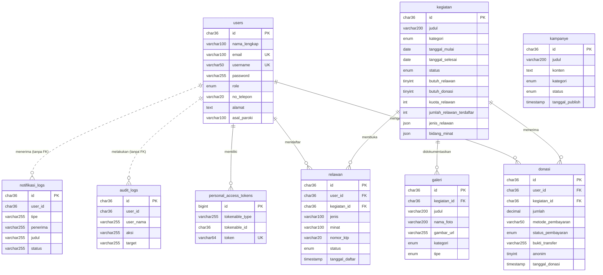

# 2.3 Perancangan Data

## 2.3.1 Dekomposisi Data

Subbab ini menjabarkan struktur fisik sembilan tabel basis data MySQL yang digunakan Website Karinakas. Seluruh tabel entitas bisnis memakai kunci utama bertipe **UUID** yang disimpan sebagai `char(36)` dan dibangkitkan aplikasi, bukan bilangan bulat menaik otomatis sebagaimana bawaan Laravel. Penggunaan UUID mencegah pengenal data ditebak melalui alamat, misalnya untuk mengakses bukti pembayaran milik donatur lain. Pengecualiannya adalah tabel `personal_access_tokens` yang mengikuti bawaan pustaka autentikasi Laravel Sanctum sehingga tetap memakai `bigint unsigned` menaik otomatis.

Kolom `created_at` dan `updated_at` bertipe `timestamp` terdapat pada semua tabel sebagai bawaan Laravel. Keduanya bersifat boleh kosong dengan nilai bawaan NULL, kemudian diisi kerangka kerja pada saat baris dibuat dan diperbarui. Tabel bawaan kerangka kerja yang tidak menyimpan data bisnis, yaitu `cache`, `cache_locks`, `jobs`, `job_batches`, `failed_jobs`, dan `migrations`, tidak dicantumkan pada subbab ini.

---

**Tabel 1 : Struktur Tabel users**

| Nama Field | Tipe Data | Null | Konstrain | Range Nilai | Default | Keterangan |
|---|---|---|---|---|---|---|
| id | char(36) | Tidak | Primary Key | Format UUID | – | ID unik pengguna |
| nama_lengkap | varchar(100) | Tidak | – | – | – | Nama lengkap pemilik akun |
| email | varchar(100) | Tidak | Unique | Format email | – | Alamat surel, dipakai untuk masuk |
| username | varchar(50) | Ya | Unique | – | NULL | Nama pengguna, alternatif untuk masuk |
| password | varchar(255) | Tidak | – | – | – | Kata sandi dalam bentuk *hash* bcrypt |
| role | enum | Tidak | Index | user, admin, super_admin | user | Peran yang menentukan kewenangan akun |
| jenis_kelamin | varchar(20) | Ya | – | Laki-laki, Perempuan | NULL | Jenis kelamin pengguna |
| tanggal_lahir | date | Ya | – | Format YYYY-MM-DD | NULL | Tanggal lahir pengguna |
| usia | int | Ya | – | 0 – 150 | NULL | Usia pengguna dalam tahun |
| no_telepon | varchar(20) | Ya | – | – | NULL | Nomor telepon atau WhatsApp |
| alamat | text | Ya | – | – | NULL | Alamat tempat tinggal |
| kota | varchar(100) | Ya | – | – | NULL | Kota tempat tinggal |
| tentang | text | Ya | – | – | NULL | Keterangan singkat tentang pengguna |
| asal_paroki | varchar(100) | Ya | – | – | NULL | Paroki asal pengguna |
| remember_token | varchar(100) | Ya | – | – | NULL | Token bawaan Laravel, tidak dipakai karena sistem memakai token *bearer* |
| created_at | timestamp | Ya | – | – | NULL | Waktu data dibuat |
| updated_at | timestamp | Ya | – | – | NULL | Waktu data diperbarui |

---

**Tabel 2 : Struktur Tabel kegiatan**

| Nama Field | Tipe Data | Null | Konstrain | Range Nilai | Default | Keterangan |
|---|---|---|---|---|---|---|
| id | char(36) | Tidak | Primary Key | Format UUID | – | ID unik kegiatan |
| judul | varchar(200) | Tidak | – | – | – | Nama kegiatan |
| deskripsi | text | Tidak | – | – | – | Uraian kegiatan |
| lokasi | text | Tidak | – | – | – | Tempat pelaksanaan kegiatan |
| kategori | enum | Tidak | Index | bantuan, pendidikan, kesehatan, sosial, lainnya | sosial | Kategori kegiatan |
| gambar_url | varchar(255) | Ya | – | Lintasan berkas atau URL | NULL | Gambar sampul kegiatan |
| tanggal_mulai | date | Tidak | Index | Format YYYY-MM-DD | – | Tanggal mulai pelaksanaan |
| tanggal_selesai | date | Tidak | – | Sama atau setelah tanggal_mulai | – | Tanggal selesai pelaksanaan |
| status | enum | Tidak | Index | aktif, selesai, dibatalkan | aktif | Status penyelenggaraan kegiatan |
| butuh_relawan | tinyint(1) | Tidak | – | 0, 1 | 0 | Penanda kegiatan membuka pendaftaran relawan |
| butuh_donasi | tinyint(1) | Tidak | – | 0, 1 | 0 | Penanda kegiatan menerima donasi |
| kuota_relawan | int | Tidak | – | ≥ 0 | 0 | Batas jumlah relawan yang dapat diterima |
| jenis_relawan | json | Ya | – | Senarai teks | NULL | Pilihan jenis relawan yang ditetapkan pengelola |
| bidang_minat | json | Ya | – | Senarai teks | NULL | Pilihan bidang minat yang ditetapkan pengelola |
| jumlah_relawan_terdaftar | int | Tidak | – | 0 – kuota_relawan | 0 | Cacah relawan berstatus diterima, dimutakhirkan otomatis oleh peristiwa model |
| created_at | timestamp | Ya | – | – | NULL | Waktu data dibuat |
| updated_at | timestamp | Ya | – | – | NULL | Waktu data diperbarui |

---

**Tabel 3 : Struktur Tabel kampanye**

| Nama Field | Tipe Data | Null | Konstrain | Range Nilai | Default | Keterangan |
|---|---|---|---|---|---|---|
| id | char(36) | Tidak | Primary Key | Format UUID | – | ID unik berita atau kampanye |
| judul | varchar(200) | Tidak | – | – | – | Judul berita |
| konten | text | Tidak | – | – | – | Isi lengkap berita |
| ringkasan | text | Ya | – | – | NULL | Ringkasan singkat untuk daftar berita |
| gambar_url | varchar(255) | Ya | – | Lintasan berkas atau URL | NULL | Gambar sampul berita |
| penulis | varchar(100) | Ya | – | – | NULL | Nama penulis berita |
| penulis_avatar | varchar(255) | Ya | – | Lintasan berkas atau URL | NULL | Foto penulis |
| tags | json | Ya | – | Senarai teks | NULL | Label penanda berita |
| waktu_baca | varchar(20) | Ya | – | – | NULL | Perkiraan lama membaca |
| kategori | enum | Tidak | Index | sosial, pendidikan, kesehatan, bantuan, kegiatan, pengumuman, lainnya | sosial | Kategori berita |
| status | enum | Tidak | Index | draft, published, archived | draft | Status penerbitan berita |
| tanggal_publish | timestamp | Ya | Index | – | NULL | Waktu berita diterbitkan, diisi otomatis saat status menjadi published |
| created_at | timestamp | Ya | – | – | NULL | Waktu data dibuat |
| updated_at | timestamp | Ya | – | – | NULL | Waktu data diperbarui |

---

**Tabel 4 : Struktur Tabel galeri**

| Nama Field | Tipe Data | Null | Konstrain | Range Nilai | Default | Keterangan |
|---|---|---|---|---|---|---|
| id | char(36) | Tidak | Primary Key | Format UUID | – | ID unik foto dokumentasi |
| kegiatan_id | char(36) | Ya | Foreign Key → kegiatan.id, ON DELETE SET NULL | Format UUID | NULL | Kegiatan induk; boleh kosong bagi dokumentasi yang berdiri sendiri |
| judul | varchar(200) | Tidak | – | – | – | Nama album; foto dengan judul sama membentuk satu album |
| nama_foto | varchar(200) | Ya | – | – | NULL | Nama masing-masing foto, diisi otomatis dari nama berkas bila dikosongkan |
| deskripsi | text | Ya | – | – | NULL | Keterangan foto |
| gambar_url | varchar(255) | Tidak | – | Lintasan berkas atau URL | – | Lokasi berkas gambar pada penyimpanan peladen |
| kategori | enum | Tidak | Index | sosial, pendidikan, kesehatan, bantuan, relawan, lainnya | sosial | Kategori dokumentasi |
| tanggal | date | Ya | – | Format YYYY-MM-DD | NULL | Tanggal pengambilan dokumentasi |
| tipe | enum | Tidak | Index | foto, video | foto | Jenis berkas dokumentasi |
| created_at | timestamp | Ya | – | – | NULL | Waktu data dibuat |
| updated_at | timestamp | Ya | – | – | NULL | Waktu data diperbarui |

---

**Tabel 5 : Struktur Tabel donasi**

| Nama Field | Tipe Data | Null | Konstrain | Range Nilai | Default | Keterangan |
|---|---|---|---|---|---|---|
| id | char(36) | Tidak | Primary Key | Format UUID | – | ID unik donasi |
| user_id | char(36) | Tidak | Foreign Key → users.id, ON DELETE CASCADE | Format UUID | – | Donatur pengaju donasi |
| kegiatan_id | char(36) | Ya | Foreign Key → kegiatan.id, ON DELETE SET NULL | Format UUID | NULL | Kegiatan tujuan donasi |
| jumlah | decimal(15,2) | Tidak | – | ≥ 1 | – | Nominal donasi, tanpa batas maksimal |
| metode_pembayaran | varchar(50) | Tidak | – | QRIS, Transfer Bank | – | Metode pembayaran yang dipilih donatur |
| status_pembayaran | enum | Tidak | Index | pending, berhasil, gagal | pending | Status verifikasi pembayaran oleh pengelola |
| keterangan | text | Ya | – | – | NULL | Catatan tambahan dari donatur atau pengelola |
| tujuan_donasi | text | Tidak | – | – | – | Peruntukan donasi yang dinyatakan donatur |
| biaya_transfer | decimal(15,2) | Tidak | – | ≥ 0 | 0.00 | Biaya administrasi transfer yang dicatat pengelola |
| kode_transaksi | varchar(100) | Ya | – | – | NULL | Kode transaksi pembayaran |
| rekening_pengirim | varchar(150) | Ya | – | – | NULL | Rekening asal pembayaran |
| bukti_transfer | varchar(255) | Ya | – | Lintasan berkas | NULL | Berkas gambar bukti pembayaran, maksimal 4 MB |
| anonim | tinyint(1) | Tidak | – | 0, 1 | 0 | Penanda penyembunyian identitas donatur pada tampilan |
| notifikasi_terkirim | tinyint(1) | Tidak | – | 0, 1 | 0 | Penanda bahwa pemberitahuan terima kasih sudah dikirim |
| tanggal_donasi | timestamp | Tidak | Index | – | CURRENT_TIMESTAMP | Waktu pengajuan donasi |
| created_at | timestamp | Ya | – | – | NULL | Waktu data dibuat |
| updated_at | timestamp | Ya | – | – | NULL | Waktu data diperbarui |

---

**Tabel 6 : Struktur Tabel relawan**

| Nama Field | Tipe Data | Null | Konstrain | Range Nilai | Default | Keterangan |
|---|---|---|---|---|---|---|
| id | char(36) | Tidak | Primary Key | Format UUID | – | ID unik pendaftaran relawan |
| user_id | char(36) | Tidak | Foreign Key → users.id, ON DELETE CASCADE, Unique Composite | Format UUID | – | Pengguna yang mendaftar |
| kegiatan_id | char(36) | Ya | Foreign Key → kegiatan.id, ON DELETE CASCADE, Unique Composite | Format UUID | NULL | Kegiatan yang diikuti |
| jenis | varchar(100) | Ya | – | Sesuai opsi jenis_relawan kegiatan | NULL | Jenis relawan yang dipilih pendaftar |
| minat | varchar(100) | Ya | – | Sesuai opsi bidang_minat kegiatan | NULL | Bidang minat yang dipilih pendaftar |
| kemampuan_diri | text | Ya | – | – | NULL | Kemampuan yang dimiliki pendaftar |
| motivasi | text | Ya | – | – | NULL | Alasan pendaftar ingin menjadi relawan |
| nomor_ktp | varchar(20) | Ya | – | – | NULL | Nomor identitas pendaftar |
| kebutuhan_khusus | text | Ya | – | – | NULL | Keterbatasan diri yang perlu diketahui pengelola |
| status | enum | Tidak | Index | pending, diterima, ditolak | pending | Status verifikasi pendaftaran |
| tanggal_daftar | timestamp | Tidak | Index | – | CURRENT_TIMESTAMP | Waktu pendaftaran diajukan |
| created_at | timestamp | Ya | – | – | NULL | Waktu data dibuat |
| updated_at | timestamp | Ya | – | – | NULL | Waktu data diperbarui |

> **Batasan unik gabungan.** Pasangan kolom (`user_id`, `kegiatan_id`) diberi batasan unik melalui indeks `relawan_user_id_kegiatan_id_unique`, sehingga seorang pengguna hanya dapat mendaftar satu kali pada satu kegiatan yang sama. Batasan ini ditegakkan pada tingkat basis data, di samping pemeriksaan duplikasi yang juga dilakukan RelawanController.

---

**Tabel 7 : Struktur Tabel audit_logs**

| Nama Field | Tipe Data | Null | Konstrain | Range Nilai | Default | Keterangan |
|---|---|---|---|---|---|---|
| id | char(36) | Tidak | Primary Key | Format UUID | – | ID unik catatan audit |
| user_id | char(36) | Ya | Index | Format UUID | NULL | Pelaku tindakan; tanpa kunci tamu agar catatan tetap utuh bila akun dihapus |
| user_nama | varchar(255) | Ya | – | – | NULL | Nama pelaku yang disalin saat pencatatan |
| aksi | varchar(255) | Tidak | – | – | – | Jenis tindakan yang dilakukan pengelola |
| target | varchar(255) | Ya | – | – | NULL | Data yang menjadi sasaran tindakan |
| created_at | timestamp | Ya | Index | – | NULL | Waktu tindakan tercatat |
| updated_at | timestamp | Ya | – | – | NULL | Waktu data diperbarui |

---

**Tabel 8 : Struktur Tabel notifikasi_logs**

| Nama Field | Tipe Data | Null | Konstrain | Range Nilai | Default | Keterangan |
|---|---|---|---|---|---|---|
| id | char(36) | Tidak | Primary Key | Format UUID | – | ID unik catatan notifikasi |
| user_id | char(36) | Ya | Index | Format UUID | NULL | Penerima notifikasi; tanpa kunci tamu agar catatan tetap utuh bila akun dihapus |
| tipe | varchar(255) | Tidak | – | email, whatsapp, system | email | Kanal pengiriman notifikasi |
| penerima | varchar(255) | Tidak | – | Alamat surel atau nomor telepon | – | Tujuan pengiriman notifikasi |
| judul | varchar(255) | Tidak | – | – | – | Judul notifikasi |
| isi | text | Ya | – | – | NULL | Isi ringkas notifikasi |
| trigger | varchar(255) | Ya | – | relawan_approved, donasi_verified, password_reset_requested, password_reset_done | NULL | Peristiwa yang memicu notifikasi |
| status | varchar(255) | Tidak | – | terkirim, gagal | terkirim | Status pengiriman notifikasi |
| created_at | timestamp | Ya | Index | – | NULL | Waktu notifikasi dibentuk |
| updated_at | timestamp | Ya | – | – | NULL | Waktu data diperbarui |

---

**Tabel 9 : Struktur Tabel personal_access_tokens**

| Nama Field | Tipe Data | Null | Konstrain | Range Nilai | Default | Keterangan |
|---|---|---|---|---|---|---|
| id | bigint unsigned | Tidak | Primary Key, Auto Increment | – | – | ID token, mengikuti bawaan Laravel Sanctum |
| tokenable_type | varchar(255) | Tidak | Index | App\\Models\\User | – | Kelas pemilik token, bagian dari relasi polimorfik |
| tokenable_id | char(36) | Tidak | Index | Format UUID | – | ID pemilik token, menunjuk users.id |
| name | varchar(255) | Tidak | – | auth_token | – | Nama token |
| token | varchar(64) | Tidak | Unique | – | – | Nilai token dalam bentuk *hash* |
| abilities | text | Ya | – | Senarai JSON | NULL | Kewenangan yang melekat pada token |
| last_used_at | timestamp | Ya | – | – | NULL | Waktu token terakhir dipakai |
| expires_at | timestamp | Ya | – | – | NULL | Waktu token kedaluwarsa |
| created_at | timestamp | Ya | – | – | NULL | Waktu data dibuat |
| updated_at | timestamp | Ya | – | – | NULL | Waktu data diperbarui |

> Tabel ini memakai `uuidMorphs` sehingga kolom `tokenable_id` bertipe `char(36)`, menyesuaikan kunci utama tabel `users` yang berupa UUID. Penyesuaian tersebut diperlukan karena bawaan Sanctum mengasumsikan kunci utama berupa bilangan bulat.

---

## 2.3.2 Physical Data Model

*Physical Data Model* (PDM) Website Karinakas menggambarkan struktur basis data MySQL secara fisik beserta relasi antartabel yang menyusunnya. Model ini menampilkan seluruh tabel beserta kolom, tipe data, kunci utama (*primary key*), dan kunci tamu (*foreign key*) yang menghubungkan antartabel. *Physical Data Model* Website Karinakas selengkapnya dapat dilihat pada Gambar 2.6 berikut.

> **Berkas gambar.** Diagram tersedia dalam bentuk siap sunting pada **[pdm-diagram.drawio](pdm-diagram.drawio)**.
> Buka di [app.diagrams.net](https://app.diagrams.net), lalu ekspor sebagai PNG untuk disisipkan ke naskah Word.

**Gambar 2.6 — *Physical Data Model* Website Karinakas**

Adapun relasi antartabel pada *Physical Data Model* Website Karinakas dapat dijelaskan sebagai berikut.

**Relasi One-to-Many (dengan kunci tamu) :**

- `users` → `donasi` (satu donatur dapat mengajukan banyak donasi)
- `users` → `relawan` (satu pengguna dapat memiliki banyak pendaftaran relawan pada kegiatan berbeda)
- `kegiatan` → `donasi` (satu kegiatan dapat menerima banyak donasi)
- `kegiatan` → `relawan` (satu kegiatan dapat membuka banyak pendaftaran relawan)
- `kegiatan` → `galeri` (satu kegiatan dapat didokumentasikan oleh banyak foto)

**Relasi One-to-Many (tanpa kunci tamu) :**

- `users` → `audit_logs` (satu pengguna dapat menghasilkan banyak catatan jejak audit)
- `users` → `notifikasi_logs` (satu pengguna dapat menerima banyak notifikasi)

Kedua relasi tersebut sengaja tidak diberi kunci tamu. Kolom `user_id` hanya diberi indeks biasa dan nama pelaku disalin ke kolom `user_nama` pada saat pencatatan, sehingga catatan audit dan riwayat notifikasi tetap utuh dan terbaca meskipun akun yang bersangkutan kelak dihapus. Tanpa perlakuan tersebut, penghapusan akun akan menghilangkan jejak tindakan yang justru perlu dipertanggungjawabkan.

**Relasi Polimorfik :**

- `personal_access_tokens` → `users` (melalui pasangan kolom `tokenable_type` dan `tokenable_id`)

**Tabel berdiri sendiri :**

- `kampanye` tidak berelasi dengan tabel mana pun, karena berita dan kampanye lembaga tidak terikat pada kegiatan tertentu.

**Entitas asosiatif.** Tabel `donasi` dan `relawan` berkedudukan sebagai entitas asosiatif yang menghubungkan `users` dengan `kegiatan`. Perbedaannya terletak pada pembatasan keunikan: `relawan` memiliki batasan unik pada pasangan (`user_id`, `kegiatan_id`) sehingga seorang pengguna hanya dapat mendaftar sekali pada satu kegiatan, sedangkan `donasi` tidak memiliki batasan tersebut karena seorang donatur boleh berdonasi berulang kali pada kegiatan yang sama.

**Aturan penghapusan berantai.** Perlakuan terhadap data turunan ketika data induk dihapus dirinci pada Tabel 10.

**Tabel 10 : Aturan ON DELETE pada Kunci Tamu**

| Kunci tamu | Menunjuk | Aturan | Alasan perancangan |
|---|---|---|---|
| `donasi.user_id` | `users.id` | CASCADE | Donasi melekat pada donatur; penghapusan akun turut menghapus riwayat donasinya |
| `donasi.kegiatan_id` | `kegiatan.id` | SET NULL | Catatan donasi dipertahankan sebagai bukti penerimaan dana meskipun kegiatan tujuannya dihapus |
| `galeri.kegiatan_id` | `kegiatan.id` | SET NULL | Foto dokumentasi dipertahankan sebagai arsip lembaga meskipun kegiatan induknya dihapus |
| `relawan.user_id` | `users.id` | CASCADE | Pendaftaran relawan memuat data pribadi sehingga ikut dihapus bersama akunnya |
| `relawan.kegiatan_id` | `kegiatan.id` | CASCADE | Pendaftaran relawan tidak bermakna tanpa kegiatan yang diikuti |

Perbedaan perlakuan antara `relawan.kegiatan_id` yang berupa CASCADE dan `donasi.kegiatan_id` yang berupa SET NULL bersifat disengaja. Pendaftaran relawan kehilangan maknanya apabila kegiatannya tidak ada, sedangkan donasi merupakan catatan penerimaan dana yang harus tetap dapat ditelusuri untuk keperluan pertanggungjawaban lembaga.

**Aturan integritas lain :**

1. **Kunci utama berupa UUID.** Seluruh entitas bisnis memakai UUID sebagai kunci utama, kecuali `personal_access_tokens` yang mengikuti bawaan pustaka autentikasi.
2. **Keunikan identitas akun.** Kolom `email` dan `username` pada `users` bersifat unik, sehingga satu alamat surel hanya dapat dipakai oleh satu akun.
3. **Konsistensi cacah relawan.** Nilai `kegiatan.jumlah_relawan_terdaftar` dijaga oleh peristiwa model pada kelas Relawan agar selalu sama dengan cacah baris `relawan` yang berstatus `diterima` pada kegiatan tersebut.
4. **Keterikatan donasi pada kegiatan.** Meskipun kolom `donasi.kegiatan_id` bersifat boleh kosong pada tingkat basis data, DonasiController mewajibkan pengisiannya pada saat pengajuan dan menolak kegiatan yang tidak aktif atau tidak membuka donasi.
