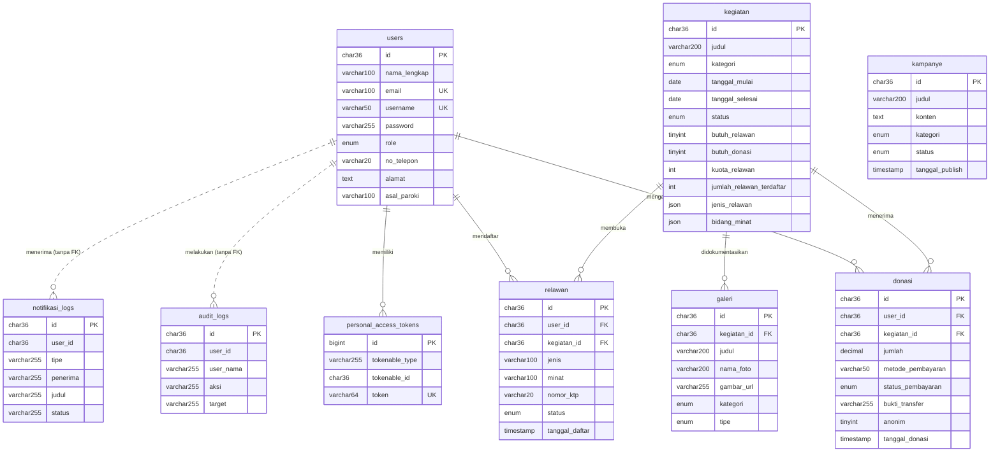

# 2.3.2 Physical Data Model

> **Ketentuan penulisan:** memuat *Physical Data Model* yang menggambarkan struktur fisik basis data beserta relasi antartabelnya. Blok kutipan ini hanya pengingat aturan penulisan — **jangan disalin ke naskah akhir**.

Berkas ini merupakan pecahan dari **[2.3-Perancangan-Data.md](2.3-Perancangan-Data.md)**. Struktur rinci kesembilan tabel beserta 116 medannya berada pada Subbab 2.3.1 di berkas tersebut.

---

*Physical Data Model* (PDM) Website Karinakas menggambarkan struktur basis data MySQL secara fisik beserta relasi antartabel yang menyusunnya. Model ini menampilkan seluruh tabel beserta kolom, tipe data, kunci utama (*primary key*), dan kunci tamu (*foreign key*) yang menghubungkan antartabel. *Physical Data Model* Website Karinakas selengkapnya dapat dilihat pada Gambar 2.6 berikut.

> **Berkas gambar.** Diagram tersedia dalam bentuk siap sunting pada **[pdm-diagram.drawio](pdm-diagram.drawio)**.
> Buka di [app.diagrams.net](https://app.diagrams.net), lalu ekspor sebagai PNG untuk disisipkan ke naskah Word.

**Gambar 2.6 — *Physical Data Model* Website Karinakas**

Adapun relasi antartabel pada *Physical Data Model* Website Karinakas dapat dijelaskan sebagai berikut.

**Relasi One-to-Many (dengan kunci tamu) :**

- `users` → `donasi` (satu donatur dapat mengajukan banyak donasi)
- `users` → `relawan` (satu pengguna dapat memiliki banyak pendaftaran relawan pada kegiatan berbeda)
- `kegiatan` → `donasi` (satu kegiatan dapat menerima banyak donasi)
- `kegiatan` → `relawan` (satu kegiatan dapat membuka banyak pendaftaran relawan)
- `kegiatan` → `galeri` (satu kegiatan dapat didokumentasikan oleh banyak foto)

**Relasi One-to-Many (tanpa kunci tamu) :**

- `users` → `audit_logs` (satu pengguna dapat menghasilkan banyak catatan jejak audit)
- `users` → `notifikasi_logs` (satu pengguna dapat menerima banyak notifikasi)

Kedua relasi tersebut sengaja tidak diberi kunci tamu. Kolom `user_id` hanya diberi indeks biasa dan nama pelaku disalin ke kolom `user_nama` pada saat pencatatan, sehingga catatan audit dan riwayat notifikasi tetap utuh dan terbaca meskipun akun yang bersangkutan kelak dihapus. Tanpa perlakuan tersebut, penghapusan akun akan menghilangkan jejak tindakan yang justru perlu dipertanggungjawabkan.

**Relasi Polimorfik :**

- `personal_access_tokens` → `users` (melalui pasangan kolom `tokenable_type` dan `tokenable_id`)

**Tabel berdiri sendiri :**

- `kampanye` tidak berelasi dengan tabel mana pun, karena berita dan kampanye lembaga tidak terikat pada kegiatan tertentu.

**Entitas asosiatif.** Tabel `donasi` dan `relawan` berkedudukan sebagai entitas asosiatif yang menghubungkan `users` dengan `kegiatan`. Perbedaannya terletak pada pembatasan keunikan: `relawan` memiliki batasan unik pada pasangan (`user_id`, `kegiatan_id`) sehingga seorang pengguna hanya dapat mendaftar sekali pada satu kegiatan, sedangkan `donasi` tidak memiliki batasan tersebut karena seorang donatur boleh berdonasi berulang kali pada kegiatan yang sama.

**Aturan penghapusan berantai.** Perlakuan terhadap data turunan ketika data induk dihapus dirinci pada Tabel 10.

**Tabel 10 : Aturan ON DELETE pada Kunci Tamu**

| Kunci tamu | Menunjuk | Aturan | Alasan perancangan |
|---|---|---|---|
| `donasi.user_id` | `users.id` | CASCADE | Donasi melekat pada donatur; penghapusan akun turut menghapus riwayat donasinya |
| `donasi.kegiatan_id` | `kegiatan.id` | SET NULL | Catatan donasi dipertahankan sebagai bukti penerimaan dana meskipun kegiatan tujuannya dihapus |
| `galeri.kegiatan_id` | `kegiatan.id` | SET NULL | Foto dokumentasi dipertahankan sebagai arsip lembaga meskipun kegiatan induknya dihapus |
| `relawan.user_id` | `users.id` | CASCADE | Pendaftaran relawan memuat data pribadi sehingga ikut dihapus bersama akunnya |
| `relawan.kegiatan_id` | `kegiatan.id` | CASCADE | Pendaftaran relawan tidak bermakna tanpa kegiatan yang diikuti |

Perbedaan perlakuan antara `relawan.kegiatan_id` yang berupa CASCADE dan `donasi.kegiatan_id` yang berupa SET NULL bersifat disengaja. Pendaftaran relawan kehilangan maknanya apabila kegiatannya tidak ada, sedangkan donasi merupakan catatan penerimaan dana yang harus tetap dapat ditelusuri untuk keperluan pertanggungjawaban lembaga.

**Aturan integritas lain :**

1. **Kunci utama berupa UUID.** Seluruh entitas bisnis memakai UUID sebagai kunci utama, kecuali `personal_access_tokens` yang mengikuti bawaan pustaka autentikasi.
2. **Keunikan identitas akun.** Kolom `email` dan `username` pada `users` bersifat unik, sehingga satu alamat surel hanya dapat dipakai oleh satu akun.
3. **Konsistensi cacah relawan.** Nilai `kegiatan.jumlah_relawan_terdaftar` dijaga oleh peristiwa model pada kelas Relawan agar selalu sama dengan cacah baris `relawan` yang berstatus `diterima` pada kegiatan tersebut.
4. **Keterikatan donasi pada kegiatan.** Meskipun kolom `donasi.kegiatan_id` bersifat boleh kosong pada tingkat basis data, DonasiController mewajibkan pengisiannya pada saat pengajuan dan menolak kegiatan yang tidak aktif atau tidak membuka donasi.

---

## Catatan penyusunan

> **Blok ini bukan bagian naskah.** Jangan disalin ke dokumen akhir.

**Sumber pernyataan.** Seluruh isi subbab ini diturunkan langsung dari skema MySQL basis data
`karinakas` yang berjalan, dibaca melalui `information_schema`, bukan dari berkas migrasi maupun
catatan terdahulu.

**Riwayat verifikasi.**

| Tanggal | Yang diperiksa | Hasil |
|---|---|---|
| 30 Agustus 2026 | Kelima kunci tamu beserta aturan `ON DELETE` pada Tabel 10 | Cocok seluruhnya dengan `referential_constraints` |
| 30 Agustus 2026 | Indeks unik `users.email`, `users.username`, `personal_access_tokens.token`, dan batasan unik gabungan `relawan_user_id_kegiatan_id_unique` | Cocok seluruhnya |
| 1 September 2026 | Aturan integritas nomor 3 (konsistensi cacah relawan) diuji ujung ke ujung lewat API | Terbukti: penghitung bergerak 0 → 0 (pending) → 1 (diterima) → 0 (ditolak) |

**Satu ketidakcocokan data yang perlu dibereskan penyusun.** Pengujian 1 September menemukan kegiatan
*"Pemeriksaan Kesehatan Gratis"* memiliki `jumlah_relawan_terdaftar = 15` sedangkan cacah baris `relawan`
berstatus `diterima` untuk kegiatan itu adalah **0**. Ini sisa data awal, bukan cacat pada rancangan —
aturan integritas nomor 3 tetap sahih karena peristiwa model bekerja benar pada seluruh alur normal.
Nilainya perlu dikoreksi menjadi 0 agar data tidak bertentangan dengan naskah.
