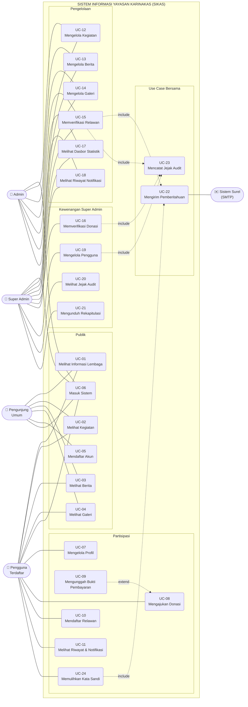

# 3.3 Diagram Use Case

**Dokumen:** SKPL — Sistem Informasi Yayasan Karinakas (SIKAS)
**Bagian:** Bab III Kebutuhan Rinci · Subbab 3.3
**Berkas induk:** [SKPL.md](../../SKPL.md) · **Kebutuhan fungsional terkait:** Subbab 3.2 (FR SIKAS 101–608)

---

## 3.3.1 Aktor Sistem

| Kode | Aktor | Keterangan |
|---|---|---|
| AK-01 | **Pengunjung Umum** | Masyarakat luas yang mengakses sistem tanpa akun. Hanya dapat menelusuri informasi publik. |
| AK-02 | **Pengguna Terdaftar** | Calon donatur dan calon relawan yang memiliki akun. Dapat menelusuri seluruh informasi publik serta mengajukan donasi dan pendaftaran relawan. |
| AK-03 | **Admin** | Staf pengelola lembaga yang mengelola konten serta memverifikasi pendaftaran relawan. Dapat memantau daftar donasi, tetapi tidak berwenang atas data keuangan donasi maupun verifikasi pembayarannya. |
| AK-04 | **Super Admin** | Penanggung jawab lembaga. Memiliki seluruh kewenangan Admin, ditambah verifikasi pembayaran donasi serta kewenangan atas data keuangan, akun pengguna, jejak audit, dan rekapitulasi. |

> Diagram pada Subbab 3.3.2 tidak menggunakan relasi generalisasi antaraktor. Kewenangan setiap aktor digambarkan melalui **asosiasi eksplisit** ke masing-masing use case, sehingga cakupan tiap peran terbaca langsung tanpa perlu menelusuri pewarisan.
| AK-05 | **Sistem Surel (SMTP)** | Aktor sekunder di luar batas sistem yang menerima permintaan pengiriman pemberitahuan. |

---

## 3.3.2 Use Case Diagram

**Gambar 3.1** Use Case Diagram Sistem Informasi Yayasan Karinakas

> **Berkas gambar tersedia dalam dua bentuk:**
> - **[use-case-diagram.png](use-case-diagram.png)** — gambar siap sisip ke naskah Word (2200 × 1360 px)
> - **[use-case-diagram.drawio](use-case-diagram.drawio)** — berkas sumber yang dapat disunting di <https://app.diagrams.net> atau ekstensi Draw.io Integration pada VS Code
>
> Sunting berkas `.drawio` bila perlu mengubah tata letak, lalu ekspor ulang ke PNG melalui menu **File → Export as → PNG**.
> Sintaks Mermaid di bawah disertakan sebagai cadangan dan sebagai rekaman struktur diagram.

> **Cara menyisipkan ke naskah Word:** salin kode di atas ke <https://mermaid.live>, lalu unduh sebagai PNG atau SVG.
> Bila diagram dituntut memakai notasi UML baku (aktor tongkat dan elips), gambar ulang menggunakan draw.io, StarUML, atau Visual Paradigm dengan struktur yang sama persis seperti di atas.

### Keterangan relasi

| Relasi | Antar use case | Penjelasan |
|---|---|---|
| **«extend»** | UC-09 → UC-08 | Unggah bukti pembayaran bersifat opsional dan dapat dilakukan kemudian melalui halaman riwayat donasi, sehingga memperluas UC-08 dan bukan bagian wajibnya. |
| **«include»** | UC-15 → UC-22 | Penerimaan relawan selalu memicu pengiriman pemberitahuan surel. |
| **«include»** | UC-24 → UC-22 | Permintaan pemulihan kata sandi selalu memicu pengiriman tautan melalui surel; tanpa pengiriman tersebut use case ini tidak dapat diselesaikan. |
| **«include»** | UC-15, UC-16, UC-19 → UC-23 | Setiap tindakan pengelola yang mengubah data selalu dicatat pada jejak audit. |

---

## 3.3.3 Spesifikasi Use Case

### UC-01 Melihat Informasi Lembaga

| | |
|---|---|
| **Nama Use Case** | Melihat Informasi Lembaga |
| **Deskripsi singkat** | Pengunjung menelusuri profil lembaga, visi dan misi, nilai, bidang pelayanan, serta informasi kontak resmi. |
| **Aktor** | Pengunjung Umum, Pengguna Terdaftar |
| **Pre kondisi** | Sistem dapat diakses melalui peramban dan layanan data dalam keadaan aktif. |
| **Pos Kondisi** | Informasi lembaga tersaji kepada pengunjung. |
| **Basic Flow** | 1. Pengunjung membuka alamat sistem. 2. Sistem menampilkan layar pengantar pada kunjungan pertama dalam sesi tersebut. 3. Pengunjung menekan tombol lanjut. 4. Sistem menampilkan halaman beranda berisi ringkasan profil, statistik, kegiatan terbaru, dan cuplikan galeri. 5. Pengunjung memilih menu Tentang Kami atau Kontak. 6. Sistem menampilkan uraian profil lengkap atau informasi kontak lembaga. |
| **Alternative Flow** | 2a. Bila layar pengantar sudah pernah ditampilkan pada sesi tersebut, sistem langsung menampilkan beranda. |
| **Error Flow** | 4a. Bila layanan data tidak dapat dihubungi, sistem menampilkan pesan kegagalan memuat data dan tetap menyajikan kerangka halaman. |

### UC-02 Melihat Kegiatan

| | |
|---|---|
| **Nama Use Case** | Melihat Kegiatan |
| **Deskripsi singkat** | Pengunjung menelusuri daftar kegiatan sosial dan membuka detail salah satunya. |
| **Aktor** | Pengunjung Umum, Pengguna Terdaftar |
| **Pre kondisi** | Terdapat data kegiatan pada basis data. |
| **Pos Kondisi** | Detail kegiatan tersaji; pengunjung dapat melanjutkan ke pengajuan donasi atau pendaftaran relawan. |
| **Basic Flow** | 1. Pengunjung memilih menu Kegiatan. 2. Sistem menampilkan daftar kegiatan beserta kategori, lokasi, tanggal, status, dan penanda kebutuhan relawan maupun donasi. 3. Pengunjung memilih satu kegiatan. 4. Sistem menampilkan detail kegiatan beserta jumlah relawan terdaftar terhadap kuota. 5. Sistem menampilkan tautan aksi sesuai kebutuhan kegiatan tersebut. |
| **Alternative Flow** | 2a. Bila belum ada kegiatan, sistem menampilkan keterangan bahwa data kegiatan belum tersedia. 5a. Bila kegiatan tidak membuka relawan maupun donasi, tautan aksi tidak ditampilkan. |
| **Error Flow** | 2a. Bila permintaan data gagal, sistem menampilkan pesan gangguan koneksi. |

### UC-03 Melihat Berita

| | |
|---|---|
| **Nama Use Case** | Melihat Berita |
| **Deskripsi singkat** | Pengunjung membaca berita dan kampanye lembaga beserta berita terkait. |
| **Aktor** | Pengunjung Umum, Pengguna Terdaftar |
| **Pre kondisi** | Terdapat naskah berita berstatus terbit. |
| **Pos Kondisi** | Isi berita tersaji kepada pengunjung. |
| **Basic Flow** | 1. Pengunjung memilih menu Berita. 2. Sistem menampilkan daftar berita berstatus terbit beserta kategori, ringkasan, dan tanggal. 3. Pengunjung memilih satu berita. 4. Sistem menampilkan isi lengkap beserta penulis, tanggal, waktu baca, dan daftar berita terkait. |
| **Alternative Flow** | 4a. Bila tidak terdapat berita lain berkategori sama, bagian berita terkait tidak ditampilkan. |
| **Error Flow** | 3a. Bila berita yang dituju tidak ditemukan, sistem menampilkan keterangan bahwa berita tidak tersedia. |

### UC-04 Melihat Galeri

| | |
|---|---|
| **Nama Use Case** | Melihat Galeri |
| **Deskripsi singkat** | Pengunjung menelusuri album dokumentasi kegiatan dan melihat foto pada tampilan layar penuh. |
| **Aktor** | Pengunjung Umum, Pengguna Terdaftar |
| **Pre kondisi** | Terdapat foto dokumentasi pada basis data dan tautan penyimpanan berkas telah dibuat. |
| **Pos Kondisi** | Foto dokumentasi tersaji kepada pengunjung. |
| **Basic Flow** | 1. Pengunjung memilih menu Galeri. 2. Sistem mengelompokkan foto menjadi album berdasarkan kegiatan dan menampilkan daftar album. 3. Pengunjung memilih satu album. 4. Sistem mengambil seluruh halaman data foto pada album tersebut dan menampilkannya beserta nama tiap foto. 5. Pengunjung memilih satu foto. 6. Sistem menampilkan foto pada ukuran penuh. 7. Pengunjung berpindah antarfoto melalui tombol arah atau papan ketik, lalu menutup tampilan. |
| **Alternative Flow** | 4a. Bila album memuat lebih dari satu halaman data, sistem tetap mengambil seluruh halaman sehingga tidak ada foto yang terlewat. |
| **Error Flow** | 2a. Bila berkas gambar tidak dapat dimuat, sistem tetap menampilkan kerangka album tanpa menghentikan halaman. |

### UC-05 Mendaftar Akun

| | |
|---|---|
| **Nama Use Case** | Mendaftar Akun |
| **Deskripsi singkat** | Calon pengguna membuat akun baru melalui pengisian dua tahap. |
| **Aktor** | Pengunjung Umum |
| **Pre kondisi** | Pengunjung belum memiliki akun dan belum masuk ke sistem. |
| **Pos Kondisi** | Akun tersimpan pada basis data dan pengguna berada dalam keadaan masuk. |
| **Basic Flow** | 1. Pengunjung memilih menu Daftar. 2. Sistem menampilkan formulir tahap pertama. 3. Pengunjung mengisi nama lengkap, surel, nama pengguna, kata sandi, dan konfirmasinya, lalu menekan lanjut. 4. Sistem memvalidasi kelengkapan dan kesesuaian konfirmasi kata sandi. 5. Sistem menampilkan formulir tahap kedua. 6. Pengunjung mengisi jenis kelamin, tanggal lahir, nomor telepon, alamat, kota, dan asal paroki, lalu menekan daftar. 7. Sistem memeriksa keunikan surel dan nama pengguna, menyimpan akun, menerbitkan token, dan mengarahkan pengguna ke halaman utama. |
| **Alternative Flow** | 5a. Pengunjung menekan tombol kembali; sistem menampilkan tahap pertama tanpa menghapus data yang telah diisi. |
| **Error Flow** | 4a. Bila data tidak lengkap atau konfirmasi tidak cocok, sistem menolak dan menampilkan pesan kesalahan. 7a. Bila surel atau nama pengguna telah digunakan, sistem menolak pendaftaran dan menampilkan pesan yang menjelaskan penyebabnya. |

### UC-06 Masuk Sistem

| | |
|---|---|
| **Nama Use Case** | Masuk Sistem |
| **Deskripsi singkat** | Pengguna melakukan autentikasi menggunakan surel atau nama pengguna beserta kata sandi. |
| **Aktor** | Pengunjung Umum, Pengguna Terdaftar, Admin, Super Admin |
| **Pre kondisi** | Akun pengguna telah terdaftar pada sistem. |
| **Pos Kondisi** | Token akses tersimpan pada peramban dan pengguna memperoleh hak sesuai perannya. |
| **Basic Flow** | 1. Pengguna memilih menu Masuk. 2. Sistem menampilkan formulir autentikasi. 3. Pengguna memasukkan surel atau nama pengguna beserta kata sandi. 4. Sistem mengenali bentuk masukan, memvalidasi kredensial, menerbitkan token, dan menyimpannya pada peramban. 5. Sistem mengarahkan pengguna ke halaman yang sebelumnya dituju, atau ke halaman utama bila tidak ada. |
| **Alternative Flow** | 5a. Bila pengguna berperan admin atau super admin, sistem menyediakan akses menuju panel pengelolaan. |
| **Error Flow** | 4a. Bila kredensial tidak sesuai, sistem menolak dan menampilkan pesan kesalahan tanpa menyebutkan bagian kredensial mana yang keliru. 4b. Bila layanan tidak dapat dihubungi, sistem menampilkan pesan gangguan koneksi. |

### UC-07 Mengelola Profil

| | |
|---|---|
| **Nama Use Case** | Mengelola Profil |
| **Deskripsi singkat** | Pengguna memperbarui data pribadinya dan mengganti kata sandi. |
| **Aktor** | Pengguna Terdaftar |
| **Pre kondisi** | Pengguna telah masuk ke sistem. |
| **Pos Kondisi** | Data profil terbarui pada basis data dan digunakan sebagai acuan pada formulir pendaftaran relawan. |
| **Basic Flow** | 1. Pengguna membuka halaman Profil. 2. Sistem menampilkan tab Info Pribadi berisi data pengguna. 3. Pengguna mengubah data yang dikehendaki lalu menyimpan. 4. Sistem memvalidasi masukan, menyimpan perubahan, dan menampilkan konfirmasi. |
| **Alternative Flow** | 3a. Pengguna memilih penggantian kata sandi, memasukkan kata sandi lama, kata sandi baru, dan konfirmasinya; sistem memvalidasi lalu menyimpan. |
| **Error Flow** | 4a. Bila validasi gagal atau kata sandi lama tidak sesuai, sistem menolak perubahan dan menampilkan pesan kesalahan. |

### UC-08 Mengajukan Donasi

| | |
|---|---|
| **Nama Use Case** | Mengajukan Donasi |
| **Deskripsi singkat** | Pengguna mengajukan donasi yang terikat pada kegiatan yang membuka penerimaan donasi, lalu memperoleh instruksi pembayaran. |
| **Aktor** | Pengguna Terdaftar |
| **Pre kondisi** | Pengguna telah masuk dan terdapat kegiatan berstatus aktif yang membuka penerimaan donasi. |
| **Pos Kondisi** | Data donasi tersimpan dengan status menunggu dan instruksi pembayaran tersaji kepada donatur. |
| **Basic Flow** | 1. Pengguna membuka halaman Donasi. 2. Sistem menampilkan daftar kegiatan yang membuka penerimaan donasi. 3. Pengguna memilih kegiatan dan menuliskan tujuan donasi. 4. Pengguna memilih nominal dari pilihan yang tersedia atau mengisi nominal bebas. 5. Pengguna memilih metode pembayaran QRIS atau transfer bank. 6. Pengguna dapat menuliskan pesan dukungan dan menandai donasi sebagai anonim. 7. Pengguna menekan tombol donasikan. 8. Sistem memvalidasi kegiatan, menyimpan data donasi dengan status menunggu, lalu menampilkan instruksi pembayaran sesuai metode terpilih. |
| **Alternative Flow** | 2a. Bila belum ada kegiatan yang membuka donasi, sistem menampilkan keterangan dan menonaktifkan formulir. 8a. Untuk metode QRIS, sistem menampilkan kode QRIS, identitas *merchant*, nominal, tombol salin nominal, tombol unduh gambar, dan langkah pembayaran. 8b. Untuk metode transfer bank, sistem menampilkan nama bank, nomor rekening, nama pemilik rekening, dan tombol salin nomor rekening. |
| **Error Flow** | 7a. Bila kegiatan, tujuan, nominal, atau metode belum lengkap, sistem menolak pengiriman dan menampilkan pesan pelengkapan data. 8c. Bila kegiatan yang dikirim tidak membuka donasi atau tidak berstatus aktif, layanan menolak pengajuan. 8d. Bila berkas gambar QRIS tidak tersedia, sistem menampilkan keterangan dan mengarahkan donatur ke metode transfer bank. |

### UC-09 Mengunggah Bukti Pembayaran

| | |
|---|---|
| **Nama Use Case** | Mengunggah Bukti Pembayaran |
| **Deskripsi singkat** | Donatur mengunggah tangkapan layar bukti pembayaran agar donasinya dapat diverifikasi pengelola. Merupakan perluasan (*extend*) dari UC-08. |
| **Aktor** | Pengguna Terdaftar (dicapai sebagai perluasan UC-08 atau langsung dari halaman Riwayat Donasi) |
| **Pre kondisi** | Terdapat data donasi milik pengguna yang berstatus menunggu, dan pembayaran telah dilakukan di luar sistem. |
| **Pos Kondisi** | Berkas bukti tersimpan pada penyimpanan peladen dan tertaut pada data donasi. |
| **Basic Flow** | 1. Pengguna membuka layar instruksi pembayaran atau halaman riwayat donasi. 2. Pengguna memilih berkas gambar bukti pembayaran. 3. Pengguna menekan tombol kirim bukti. 4. Sistem memvalidasi jenis dan ukuran berkas, menyimpannya, menautkannya pada data donasi, lalu menampilkan konfirmasi bahwa bukti menunggu verifikasi. |
| **Alternative Flow** | 1a. Pengguna menunda pengunggahan dan melakukannya kemudian melalui halaman riwayat donasi. |
| **Error Flow** | 4a. Bila berkas bukan gambar atau berukuran melebihi 4 MB, sistem menolak dan menampilkan pesan kesalahan. 4b. Bila pengunggahan gagal karena gangguan jaringan, sistem menampilkan pesan kegagalan dan pengguna dapat mengulang. |

### UC-10 Mendaftar Relawan

| | |
|---|---|
| **Nama Use Case** | Mendaftar Relawan |
| **Deskripsi singkat** | Pengguna mendaftarkan diri sebagai relawan pada kegiatan yang membuka kebutuhan relawan. |
| **Aktor** | Pengguna Terdaftar |
| **Pre kondisi** | Pengguna telah masuk dan terdapat kegiatan yang membuka pendaftaran relawan dengan kuota belum terpenuhi. |
| **Pos Kondisi** | Data pendaftaran tersimpan dengan status menunggu. |
| **Basic Flow** | 1. Pengguna membuka halaman Daftar Relawan. 2. Sistem menampilkan data pribadi pendaftar yang diambil dari profil akun. 3. Pengguna memilih kegiatan. 4. Sistem menampilkan pilihan jenis relawan dan bidang minat sesuai opsi kegiatan tersebut. 5. Pengguna memilih jenis relawan dan bidang minat, lalu mengisi kemampuan diri, motivasi, kebutuhan khusus, dan nomor identitas. 6. Pengguna mengirim pendaftaran. 7. Sistem memvalidasi kesesuaian pilihan terhadap opsi kegiatan, menyimpan pendaftaran dengan status menunggu, lalu menampilkan konfirmasi. |
| **Alternative Flow** | 3a. Pengguna mengganti kegiatan; sistem memperbarui isi pilihan jenis relawan dan bidang minat mengikuti kegiatan yang baru dipilih. |
| **Error Flow** | 3b. Bila kuota kegiatan telah terpenuhi, sistem menampilkan keterangan kuota penuh dan menutup pendaftaran pada kegiatan tersebut. 7a. Bila isian wajib belum lengkap, sistem menolak dan menampilkan pesan kesalahan. 7b. Bila pilihan yang dikirim tidak termasuk opsi kegiatan, layanan menolak pendaftaran. |

### UC-11 Melihat Riwayat dan Notifikasi

| | |
|---|---|
| **Nama Use Case** | Melihat Riwayat dan Notifikasi |
| **Deskripsi singkat** | Pengguna memantau status donasi, keikutsertaan relawan, dan pemberitahuan yang ditujukan kepadanya. |
| **Aktor** | Pengguna Terdaftar |
| **Pre kondisi** | Pengguna telah masuk ke sistem. |
| **Pos Kondisi** | Riwayat dan pemberitahuan milik pengguna tersaji. |
| **Basic Flow** | 1. Pengguna membuka halaman Profil. 2. Pengguna memilih tab Riwayat Donasi, Kegiatan Relawan, atau Notifikasi. 3. Sistem menampilkan data milik pengguna yang sedang masuk beserta statusnya masing-masing. |
| **Alternative Flow** | 3a. Bila belum ada data pada tab terpilih, sistem menampilkan keterangan data belum tersedia. |
| **Error Flow** | 3b. Bila layanan tidak dapat dihubungi, sistem menampilkan pesan gangguan koneksi. |

### UC-12 Mengelola Kegiatan

| | |
|---|---|
| **Nama Use Case** | Mengelola Kegiatan |
| **Deskripsi singkat** | Pengelola menambah, mengubah, menghapus kegiatan, serta menetapkan kebutuhan relawan, kebutuhan donasi, kuota, dan opsi relawan. |
| **Aktor** | Admin, Super Admin |
| **Pre kondisi** | Pengelola telah masuk dengan peran admin atau super admin. |
| **Pos Kondisi** | Data kegiatan terbarui dan tercermin pada halaman publik serta pada pilihan formulir donasi dan relawan. |
| **Basic Flow** | 1. Pengelola membuka menu Kegiatan pada panel pengelolaan. 2. Sistem menampilkan daftar kegiatan. 3. Pengelola menekan tombol tambah atau ubah. 4. Pengelola mengisi judul, deskripsi, kategori, lokasi, gambar, dan jadwal. 5. Pengelola menandai kebutuhan relawan dan/atau donasi serta menetapkan kuota relawan. 6. Pengelola menetapkan opsi jenis relawan dan bidang minat melalui penyunting label. 7. Pengelola menyimpan; sistem memvalidasi dan menyimpan data. |
| **Alternative Flow** | 3a. Pengelola mengubah status kegiatan menjadi aktif, selesai, atau dibatalkan langsung dari daftar. 3b. Pengelola menghapus kegiatan; sistem meminta konfirmasi sebelum melaksanakan penghapusan. |
| **Error Flow** | 7a. Bila isian wajib belum lengkap, sistem menolak penyimpanan dan menampilkan pesan kesalahan. |

### UC-13 Mengelola Berita

| | |
|---|---|
| **Nama Use Case** | Mengelola Berita |
| **Deskripsi singkat** | Pengelola menyusun, mengubah, menghapus naskah berita, serta mengatur status terbitnya. |
| **Aktor** | Admin, Super Admin |
| **Pre kondisi** | Pengelola telah masuk dengan peran admin atau super admin. |
| **Pos Kondisi** | Naskah tersimpan; naskah berstatus terbit tampil pada halaman publik. |
| **Basic Flow** | 1. Pengelola membuka menu Berita pada panel pengelolaan. 2. Sistem menampilkan daftar naskah beserta statusnya. 3. Pengelola menekan tombol tambah atau ubah. 4. Pengelola mengisi judul, isi, ringkasan, gambar, penulis, kategori, dan label. 5. Pengelola menetapkan status rancangan, terbit, atau arsip. 6. Pengelola menyimpan; sistem memvalidasi dan menyimpan naskah. |
| **Alternative Flow** | 3a. Pengelola menghapus naskah; sistem meminta konfirmasi terlebih dahulu. |
| **Error Flow** | 6a. Bila isian wajib belum lengkap, sistem menolak penyimpanan dan menampilkan pesan kesalahan. |

### UC-14 Mengelola Galeri

| | |
|---|---|
| **Nama Use Case** | Mengelola Galeri |
| **Deskripsi singkat** | Pengelola mengunggah foto dokumentasi, baik satuan maupun massal, serta mengubah dan menghapus data foto. |
| **Aktor** | Admin, Super Admin |
| **Pre kondisi** | Pengelola telah masuk dan tautan penyimpanan berkas telah dibuat pada peladen. |
| **Pos Kondisi** | Foto tersimpan dan tampil pada album yang sesuai di halaman publik. |
| **Basic Flow** | 1. Pengelola membuka menu Galeri pada panel pengelolaan. 2. Pengelola menekan tombol unggah. 3. Pengelola menentukan album, kategori, dan tanggal. 4. Pengelola memilih satu atau banyak berkas foto sekaligus. 5. Pengelola memberi nama pada masing-masing foto. 6. Pengelola menekan tombol simpan. 7. Sistem memecah pengiriman menjadi kelompok berisi paling banyak 20 berkas, menampilkan indikator kemajuan, dan menyimpan seluruh foto. |
| **Alternative Flow** | 2a. Pengelola mengubah nama album, nama foto, atau keterangan foto yang telah ada. 2b. Pengelola menghapus foto; sistem meminta konfirmasi terlebih dahulu. |
| **Error Flow** | 7a. Bila terdapat berkas yang bukan gambar atau berukuran melebihi 5 MB, sistem menolak berkas tersebut dan menampilkan pesan kesalahan. 7b. Bila salah satu kelompok pengiriman gagal, sistem menampilkan kegagalan tersebut tanpa membatalkan kelompok yang telah berhasil tersimpan. |

### UC-15 Memverifikasi Pendaftaran Relawan

| | |
|---|---|
| **Nama Use Case** | Memverifikasi Pendaftaran Relawan |
| **Deskripsi singkat** | Pengelola menelaah data pendaftar relawan dan menetapkan status penerimaannya. Menyertakan (*include*) UC-22 dan UC-23. |
| **Aktor** | Admin, Super Admin |
| **Pre kondisi** | Terdapat pendaftaran relawan berstatus menunggu. |
| **Pos Kondisi** | Status pendaftaran terbarui; bila diterima, jumlah relawan terdaftar bertambah, pemberitahuan terkirim, dan tindakan tercatat pada jejak audit. |
| **Basic Flow** | 1. Pengelola membuka menu Relawan pada panel pengelolaan. 2. Sistem menampilkan daftar pendaftar beserta penyaringan jenis, status, kegiatan, dan bulan pendaftaran. 3. Pengelola membuka detail pendaftar untuk menelaah data lengkapnya. 4. Pengelola menetapkan status menjadi diterima atau ditolak. 5. Sistem menyimpan status baru. 6. Bila status diterima, sistem menambah jumlah relawan terdaftar pada kegiatan terkait. 7. Sistem menjalankan UC-22 untuk mengirim pemberitahuan. 8. Sistem menjalankan UC-23 untuk mencatat jejak audit. |
| **Alternative Flow** | 4a. Pengelola menetapkan status langsung dari daftar tanpa membuka detail. 4b. Pengelola menghapus pendaftaran; sistem meminta konfirmasi terlebih dahulu. |
| **Error Flow** | 5a. Bila layanan gagal menyimpan, status tidak berubah dan sistem menampilkan pesan kegagalan. 7a. Bila pengiriman pemberitahuan gagal, perubahan status tetap tersimpan dan kegagalan tercatat pada riwayat notifikasi. |

### UC-16 Memverifikasi Pembayaran Donasi

| | |
|---|---|
| **Nama Use Case** | Memverifikasi Pembayaran Donasi |
| **Deskripsi singkat** | Super admin menelaah bukti pembayaran yang diunggah donatur dan menetapkan status pembayarannya. Menyertakan (*include*) UC-23. |
| **Aktor** | Super Admin |
| **Pre kondisi** | Terdapat data donasi berstatus menunggu. |
| **Pos Kondisi** | Status pembayaran terbarui dan tindakan tercatat pada jejak audit. |
| **Basic Flow** | 1. Super admin membuka menu Donasi pada panel pengelolaan. 2. Sistem menampilkan daftar donasi beserta ringkasan jumlah transaksi, jumlah menunggu verifikasi, dan total penerimaan. 3. Super admin mencari atau menyaring data donasi. 4. Super admin membuka detail donasi untuk melihat bukti pembayaran. 5. Super admin membandingkan bukti dengan nominal yang tercatat dan mutasi rekening lembaga. 6. Super admin menetapkan status menjadi berhasil atau gagal. 7. Sistem menyimpan status baru dan menjalankan UC-23. |
| **Alternative Flow** | 1a. Bila pengguna berperan admin biasa, menu Donasi hanya menampilkan donatur, tujuan, metode, tanggal, dan status tanpa data keuangan, serta tidak menyediakan tindakan verifikasi, pengubahan, maupun penghapusan. 4a. Bila donatur belum mengunggah bukti, sistem menampilkan keterangan dan super admin menunda verifikasi. 6a. Super admin mengubah data donasi seperti nominal, biaya, atau kode transaksi sebelum menetapkan status. 6b. Super admin menghapus data donasi; sistem meminta konfirmasi terlebih dahulu. |
| **Error Flow** | 6c. Bila permintaan verifikasi, pengubahan, atau penghapusan dikirim oleh admin biasa, misalnya dengan memanggil layanan secara langsung, layanan menolak dengan kode 403 dan data tidak berubah. 7a. Bila layanan gagal menyimpan, status tidak berubah dan sistem menampilkan pesan kegagalan. |

### UC-17 Melihat Dasbor Statistik

| | |
|---|---|
| **Nama Use Case** | Melihat Dasbor Statistik |
| **Deskripsi singkat** | Pengelola memperoleh gambaran menyeluruh kondisi lembaga melalui ringkasan statistik. |
| **Aktor** | Admin, Super Admin |
| **Pre kondisi** | Pengelola telah masuk dengan peran admin atau super admin. |
| **Pos Kondisi** | Statistik tersaji sesuai kewenangan peran pengelola. |
| **Basic Flow** | 1. Pengelola membuka panel pengelolaan. 2. Sistem menghitung dan menampilkan jumlah kegiatan, relawan, donasi, berita, foto galeri, dan pengguna. 3. Sistem menampilkan rincian relawan menurut jenis serta tabel donasi dan relawan terkini. |
| **Alternative Flow** | 2a. Bila pengelola berperan admin biasa, sistem menyembunyikan nominal donasi dan menampilkan penanda terkunci. 2b. Bila pengelola berperan super admin, nominal ditampilkan sepenuhnya. |
| **Error Flow** | 2c. Bila layanan tidak dapat dihubungi, sistem menampilkan pesan gangguan koneksi pada bagian statistik. |

### UC-18 Melihat Riwayat Notifikasi

| | |
|---|---|
| **Nama Use Case** | Melihat Riwayat Notifikasi |
| **Deskripsi singkat** | Pengelola menelusuri pemberitahuan yang telah dibangkitkan sistem beserta statusnya. |
| **Aktor** | Admin, Super Admin |
| **Pre kondisi** | Pengelola telah masuk dan terdapat catatan notifikasi pada basis data. |
| **Pos Kondisi** | Riwayat notifikasi tersaji kepada pengelola. |
| **Basic Flow** | 1. Pengelola membuka menu Notifikasi pada panel pengelolaan. 2. Sistem menampilkan daftar pemberitahuan beserta jenis, penerima, judul, pemicu, status, dan waktu pembangkitan. |
| **Alternative Flow** | 2a. Bila belum ada catatan, sistem menampilkan keterangan data belum tersedia. |
| **Error Flow** | 2b. Bila layanan tidak dapat dihubungi, sistem menampilkan pesan gangguan koneksi. |

### UC-19 Mengelola Pengguna

| | |
|---|---|
| **Nama Use Case** | Mengelola Pengguna |
| **Deskripsi singkat** | Super admin mengelola akun dan peran pengguna sistem. Menyertakan (*include*) UC-23. |
| **Aktor** | Super Admin |
| **Pre kondisi** | Pengelola telah masuk dengan peran super admin. |
| **Pos Kondisi** | Data akun terbarui dan tindakan tercatat pada jejak audit. |
| **Basic Flow** | 1. Super admin membuka menu Manajemen Pengguna. 2. Sistem menampilkan seluruh akun beserta perannya. 3. Super admin menambah akun baru, mengubah peran akun, menyetel ulang kata sandi, atau menghapus akun. 4. Sistem memvalidasi permintaan, menyimpan perubahan, dan menjalankan UC-23. |
| **Alternative Flow** | 3a. Super admin menyetel ulang kata sandi akun tertentu, lalu menyampaikan kata sandi baru kepada pemilik akun di luar sistem. |
| **Error Flow** | 4a. Bila super admin berupaya mengubah peran atau menghapus akunnya sendiri, sistem menolak permintaan tersebut guna mencegah hilangnya akses tertinggi. 4b. Bila surel atau nama pengguna telah digunakan akun lain, sistem menolak penyimpanan. |

### UC-20 Melihat Jejak Audit

| | |
|---|---|
| **Nama Use Case** | Melihat Jejak Audit |
| **Deskripsi singkat** | Super admin menelusuri riwayat tindakan pengelola yang mengubah data. |
| **Aktor** | Super Admin |
| **Pre kondisi** | Pengelola telah masuk dengan peran super admin dan terdapat catatan audit. |
| **Pos Kondisi** | Jejak audit tersaji kepada super admin. |
| **Basic Flow** | 1. Super admin membuka menu Audit Log. 2. Sistem menampilkan catatan tindakan berurutan dari kejadian terbaru, beserta pelaku, jenis tindakan, objek, dan waktu kejadian. |
| **Alternative Flow** | 2a. Bila belum ada catatan, sistem menampilkan keterangan data belum tersedia. |
| **Error Flow** | 2b. Bila permintaan dikirim oleh pengguna berperan admin biasa, layanan menolak permintaan tersebut. |

### UC-21 Mengunduh Rekapitulasi

| | |
|---|---|
| **Nama Use Case** | Mengunduh Rekapitulasi |
| **Deskripsi singkat** | Super admin menghasilkan berkas rekapitulasi donasi, rekapitulasi relawan, atau laporan keseluruhan lembaga. |
| **Aktor** | Super Admin |
| **Pre kondisi** | Pengelola telah masuk dengan peran super admin dan terdapat data yang memenuhi kriteria penyaringan. |
| **Pos Kondisi** | Berkas lembar kerja terunduh pada perangkat super admin. |
| **Basic Flow** | 1. Super admin membuka menu Donasi, Relawan, atau Dasbor. 2. Super admin menerapkan pencarian dan penyaringan sesuai kebutuhan pelaporan. 3. Super admin menekan tombol export rekap. 4. Sistem menyusun berkas lembar kerja berisi data yang lolos penyaringan, dilengkapi keterangan penyaring, blok ringkasan, dan penataan agar langsung terbaca. 5. Peramban mengunduh berkas tersebut. |
| **Alternative Flow** | 2a. Bila penyaringan tidak diterapkan, berkas memuat seluruh data yang tersedia. 4a. Pada rekapitulasi relawan, sistem menyertakan peringatan bahwa berkas memuat data pribadi. |
| **Error Flow** | 3a. Bila tidak terdapat data yang memenuhi kriteria, sistem menonaktifkan tombol export sehingga berkas kosong tidak dapat dihasilkan. 3b. Bila permintaan dikirim oleh pengguna berperan admin biasa, fungsi tidak tersedia. |

### UC-22 Mengirim Pemberitahuan

| | |
|---|---|
| **Nama Use Case** | Mengirim Pemberitahuan |
| **Deskripsi singkat** | Sistem membangkitkan dan mengirimkan pemberitahuan surel kepada pengguna, serta mencatatnya pada riwayat notifikasi. Dijalankan sebagai bagian (*include*) dari UC-15 dan UC-24. |
| **Aktor** | Sistem Surel (SMTP) sebagai aktor sekunder |
| **Pre kondisi** | Terjadi peristiwa yang memicu pemberitahuan, yaitu penetapan status pendaftaran relawan menjadi diterima, atau permintaan tautan pemulihan kata sandi. |
| **Pos Kondisi** | Pemberitahuan terkirim ke alamat surel penerima dan tercatat pada riwayat notifikasi. |
| **Basic Flow** | 1. Sistem menyusun isi pemberitahuan berdasarkan peristiwa pemicunya, yaitu data pendaftar beserta kegiatan terkait, atau tautan pemulihan kata sandi beserta masa berlakunya. 2. Sistem mengirimkan pemberitahuan ke peladen surel. 3. Sistem mencatat pemberitahuan pada riwayat notifikasi beserta jenis, penerima, judul, isi, pemicu, dan statusnya. |
| **Alternative Flow** | 2a. Pada lingkungan pengembangan, pemberitahuan dituliskan ke berkas log alih-alih dikirimkan ke peladen surel. |
| **Error Flow** | 2b. Bila peladen surel tidak dapat dihubungi, kegagalan dicatat pada riwayat notifikasi dan proses induk tetap dinyatakan berhasil. |

### UC-23 Mencatat Jejak Audit

| | |
|---|---|
| **Nama Use Case** | Mencatat Jejak Audit |
| **Deskripsi singkat** | Sistem mencatat secara otomatis tindakan pengelola yang mengubah data. Dijalankan sebagai bagian (*include*) dari UC-15, UC-16, dan UC-19. |
| **Aktor** | — (dijalankan sistem tanpa interaksi langsung aktor) |
| **Pre kondisi** | Pengelola melaksanakan tindakan yang mengubah data pada sistem. |
| **Pos Kondisi** | Catatan tindakan tersimpan dan dapat ditelusuri melalui UC-20. |
| **Basic Flow** | 1. Sistem mengenali tindakan pengelola yang mengubah data. 2. Sistem menghimpun identitas pelaku, jenis tindakan, objek yang dikenai tindakan, dan waktu kejadian. 3. Sistem menyimpan catatan tersebut pada basis data. |
| **Alternative Flow** | — |
| **Error Flow** | 3a. Bila pencatatan gagal, tindakan induk tetap dilaksanakan agar proses pengelolaan tidak terhambat. |

### UC-24 Memulihkan Kata Sandi

| | |
|---|---|
| **Nama Use Case** | Memulihkan Kata Sandi |
| **Deskripsi singkat** | Pengguna yang lupa kata sandinya menetapkan kata sandi baru melalui tautan sekali pakai yang dikirimkan ke alamat surel akunnya. Menyertakan (*include*) UC-22. |
| **Aktor** | Pengguna Terdaftar, dengan Sistem Surel (SMTP) sebagai aktor sekunder |
| **Pre kondisi** | Pengguna memiliki akun terdaftar beserta alamat surel aktif, dan sedang tidak dalam keadaan masuk. |
| **Pos Kondisi** | Kata sandi akun tergantikan, tautan hangus, dan seluruh token sesi lama milik pengguna dicabut. |
| **Basic Flow** | 1. Pengguna memilih tautan Lupa Kata Sandi pada halaman masuk. 2. Pengguna memasukkan alamat surel akunnya lalu mengirim permintaan. 3. Sistem membangkitkan token acak, menyimpan sidiknya selama 60 menit, dan membatalkan tautan yang mungkin masih aktif dari permintaan sebelumnya. 4. Sistem menjalankan UC-22 untuk mengirimkan tautan ke alamat surel tersebut. 5. Sistem menampilkan keterangan bahwa tautan telah dikirim, tanpa menyatakan apakah surel tersebut terdaftar. 6. Pengguna membuka tautan pada surelnya. 7. Sistem memeriksa keabsahan dan masa berlaku tautan sebelum formulir ditampilkan. 8. Pengguna memasukkan kata sandi baru beserta konfirmasinya, lalu menyimpan. 9. Sistem menyimpan kata sandi baru dalam bentuk *hash*, menghanguskan tautan, mencabut seluruh token sesi pengguna, lalu mengarahkannya ke halaman masuk. |
| **Alternative Flow** | 5a. Bila surel yang dimasukkan tidak terdaftar, sistem tetap menampilkan keterangan yang sama sehingga keberadaan suatu akun tidak dapat disimpulkan. 6a. Pengguna meminta tautan baru sebelum tautan lama dipakai; tautan lama menjadi tidak berlaku. |
| **Error Flow** | 7a. Bila tautan sudah kedaluwarsa, sudah terpakai, atau tidak cocok dengan surel akun, sistem menolak dan mengarahkan pengguna untuk meminta tautan baru. 8a. Bila kata sandi baru kurang dari delapan karakter atau konfirmasinya tidak cocok, sistem menolak penyimpanan. 2a. Bila permintaan tautan melampaui lima kali per menit dari satu alamat IP, sistem menolak dengan tanggapan `429`. |

---

## 3.3.4 Penelusuran Use Case terhadap Kebutuhan Fungsional

| Use Case | Kebutuhan fungsional terkait (Subbab 3.2) |
|---|---|
| UC-01 Melihat Informasi Lembaga | FR SIKAS 101, 102, 103 |
| UC-02 Melihat Kegiatan | FR SIKAS 104, 105, 106 |
| UC-03 Melihat Berita | FR SIKAS 107, 108 |
| UC-04 Melihat Galeri | FR SIKAS 109, 110, 111 |
| UC-05 Mendaftar Akun | FR SIKAS 201, 202 |
| UC-06 Masuk Sistem | FR SIKAS 203, 204, 205, 206, 207 |
| UC-07 Mengelola Profil | FR SIKAS 208, 209 |
| UC-08 Mengajukan Donasi | FR SIKAS 301, 302, 303, 304, 305, 306, 308 |
| UC-09 Mengunggah Bukti Pembayaran | FR SIKAS 307 |
| UC-10 Mendaftar Relawan | FR SIKAS 309, 310, 311, 312 |
| UC-11 Melihat Riwayat dan Notifikasi | FR SIKAS 210, 211, 212 |
| UC-12 Mengelola Kegiatan | FR SIKAS 401, 402, 403, 404, 411 |
| UC-13 Mengelola Berita | FR SIKAS 405, 406, 411 |
| UC-14 Mengelola Galeri | FR SIKAS 407, 408, 409, 410, 411 |
| UC-15 Memverifikasi Pendaftaran Relawan | FR SIKAS 501, 502, 503, 504 |
| UC-16 Memverifikasi Pembayaran Donasi | FR SIKAS 507, 508, 509, 510, 511, 512 |
| UC-17 Melihat Dasbor Statistik | FR SIKAS 601, 602, 603, 512 |
| UC-18 Melihat Riwayat Notifikasi | FR SIKAS 506 |
| UC-19 Mengelola Pengguna | FR SIKAS 513, 514, 515 |
| UC-20 Melihat Jejak Audit | FR SIKAS 517 |
| UC-21 Mengunduh Rekapitulasi | FR SIKAS 604, 605, 606, 607, 608, 513 |
| UC-22 Mengirim Pemberitahuan | FR SIKAS 505, 506 |
| UC-23 Mencatat Jejak Audit | FR SIKAS 516 |
| UC-24 Memulihkan Kata Sandi | FR SIKAS 213 |

Seluruh 71 kebutuhan fungsional pada Subbab 3.2 tercakup dalam 24 use case di atas, dan sebaliknya tidak terdapat use case yang tidak memiliki kebutuhan fungsional pendukung.

---

## Catatan penyusunan

**Pemodelan autentikasi.** Use case UC-06 tidak dimodelkan sebagai «include» pada setiap use case yang menuntut sesi aktif, melainkan dinyatakan sebagai **prakondisi**. Pemodelan «include» hanya tepat apabila suatu use case selalu dijalankan sebagai bagian dari use case lain, sedangkan proses masuk dilakukan sekali dan berlaku untuk banyak aktivitas berikutnya.

**Penggunaan «extend» pada UC-09.** Unggah bukti pembayaran dimodelkan sebagai perluasan, bukan bagian wajib UC-08, karena donatur memang dapat menyelesaikan pengajuan donasi tanpa langsung mengunggah bukti dan melakukannya kemudian melalui halaman riwayat donasi.

**Use case bersama UC-22 dan UC-23.** Keduanya dipisahkan agar perilaku yang berulang pada beberapa use case tidak ditulis berkali-kali. Perhatikan bahwa keduanya memiliki *error flow* yang menyatakan kegagalannya **tidak membatalkan proses induk**. Ketentuan ini penting agar data verifikasi tetap konsisten ketika peladen surel bermasalah, sejalan dengan kebergantungan D-02 pada Subbab 2.5.

**Aktor Sistem Surel.** Dimodelkan sebagai aktor sekunder karena berada di luar batas sistem dan hanya menerima permintaan. Kanal pembayaran QRIS dan perbankan **tidak** dimodelkan sebagai aktor, sebab tidak melakukan pertukaran data apa pun dengan sistem — keterkaitannya hanya berupa berkas bukti yang diunggah donatur secara manual, sebagaimana kekangan K-11.
